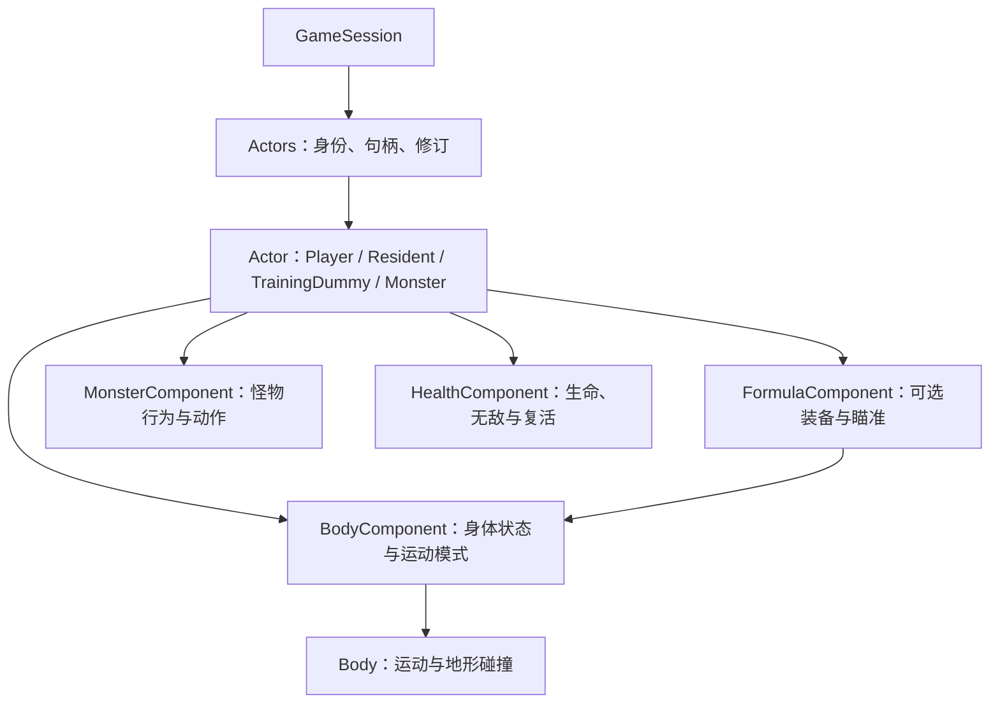

# Actors 身份、生命周期与地形边界

现状核对：2026-11-10。策划入口见[角色、怪物与战斗系统](SystemsActors.md)；本文保留当前实现合同及日期化历史验证。

Session 拥有 `Actors` 集合，统一维护角色身份、句柄和提交修订。主角、居民、木头人和怪物全部使用 `Actor` 运行时对象并独占 `Component`；`ActorKind` 区分角色类型，能力通过组件组合。Actor 表示具有独立身份、可承载主动行为的游戏对象，不要求已经具备 AI 或正在运动；后续 NPC、敌人、动物等行为对象沿用这一入口。`World` 只拥有材料、环境与流式存储，不知道角色或组件，也不接收玩家输入。

生产玩家的默认构式已迁至手持木棍，初始化、重置和新档恢复不再装配FormulaComponent。该可选组件与瞄准几何仍保留为显式Actor能力及测试接点；玩家操作和旧档迁移以[手持物品合同](HandheldItems.md)为准。

## 状态与身份

`Actor` 独占组件容器，以 `AddComponent<T>(args...)` 构造组件、`GetComponent<T>()` 查询具体类型；同一类型不能重复添加，缺失查询返回空。组件继承 `Component`，构造时获得所属 Actor，`GetOwner()` 仅提供只读访问。Actor 与 Component 不可复制或移动；组件通过 `unique_ptr` 管理，集合扩容不会改变任何 Actor 及组件的地址。删除对象、清空集合或恢复检查点会销毁旧 Actor 及全部组件，装备更新则复用已有构式组件。

`BodyComponent` 是所有 Actor 的必需组件，拥有唯一的权威 `Body`。Player/Resident 装配 `Dynamic` 模式，位置、速度、碰撞、移动和水体响应仍由原 `Body` 算法处理；TrainingDummy 装配 `Anchored` 模式，保留身体和命中框但不推进运动。模式由角色类型在创建/恢复时确定，无需改变旧存档格式。`FormulaComponent` 是上一轮构式组件的直接子类化，继承 `Component`，保存已装备的 `ProgramRef`；`Aim` 读取同一 Actor 的 `BodyComponent` 计算身体外侧起点和方向。装备更新先验证程序身份再替换引用，不自动创建运行实例。GameSession 继续负责动作许可、发射路径检测、FormulaBridge 执行与提交。

`ActorRecord` 现在是独立的可复制值，包含身份、类型、完整 Body、可选 `FormulaEquipment`、怪物行为状态与生命状态；它不拥有 Component，也不含 Actor 指针。`ActorsState` 用于捕获/恢复，`ActorSnapshot` 用于已提交观测与呈现。恢复任意角色时按值重新构造身体和可选构式组件；集合内只存储 Actor，不再将居民或木头人的值记录作为运行时对象。通用组件不自动持久化；以后增加有状态组件时需显式扩展值合同及恢复逻辑。当前没有动态卸载组件、通用 Tick 调度器、反射或 ECS。

Player 接收宿主输入；Resident 同样是 Actor，通过身体组件使用原有重力、地形碰撞和水体响应，集合不会将玩家输入传给它。Resident 已按群落适生率在地区首次激活时生成，并参与离区休眠与重返恢复；当前有头、身体和双腿的简易几何呈现，尚无专用动画、AI、对话或生活交互。地区生命周期见[世界生态群落](WorldBiomes.md)。任意 Actor 都可通过同一个 `EquipFormula` 入口装载构式组件；自动装载和游戏内施放入口仍只对主角开放，新增 AI 或 NPC 激活规则需要显式接入会话动作合同。

`TrainingDummy` 是固定的构式测试目标。新世界初始化在玩家出生点右侧12格生成一个，包含Natural、Flat和育圃；位置位于生成器的干燥平坦出生区域。它跳过Body推进，不受重力、水体、输入或固体解嵌影响，也不执行攻击。木头人不装配生命组件，弹体命中只产生构式Hit事件，不删除或改写目标。持久会话沿用Actors检查点保存类型、身份和位置；载入旧档不补生，重置新世界才重新创建。

`ActorId` 是世界内的值身份，从 1 单调分配。删除、复用 slot 或清空当前集合不会倒退 ID 分配器；0 表示无效。跨域引用使用 ID，并携带所属世界/会话上下文。`ActorHandle` 是本进程的 `{Slot, Generation, Owner}`：删除提升代次，其他集合/重建集合的 Owner 不同，旧句柄不会命中新对象。ID 与 slot 没有数值对应关系。

`Spawn` 创建新身份；`Remove` 删除对象；`Resolve(id)` 重新获得当前内存句柄。`Find` 对失效引用返回空；`Require` 用于内部保证有效的句柄，失效直接抛出逻辑错误。`Restore(record)` 恢复同一身份及完整运动状态，分配新的内存句柄，并提升后续新 ID 的起点。恢复重复的活 ID、重复玩家、未知类型或非法位置属于程序错误。容量固定最多 256 个对象，容量不足返回空且不修改集合。

`Find` 返回 `optional<ActorRecord>`，`Require` 返回 `ActorRecord` 值；调用方保留值不会受后续移动、装备或删除影响。`FindActor(handle/id)` 提供任意类型 Actor 的同步只读借用，遵循同一套 Owner/Generation 校验；`PlayerActor` 是主角快捷入口，`Player` 提供主角 Body。借用不可跨删除、Clear 或 RestoreState 保存。通过集合获取的 Actor 为 const，组件写入仍经过 Actors 的修改入口，保证提交修订不会被绕过。`ActorSnapshot` 包含身份、类型、分段位置、着地状态、身体尺寸、可选怪物动作与生命/生命上限；不暴露 slot、代次或速度内部状态。

## 推进与占用

`SimulationCoordinator` 是唯一输入与时钟所有者，仍按 Environment → Actors → FormulaBridge → commit 推进。`Actors::Step` 接收只读 `WorldMapView` 和本次成功固定步的输入，非怪物角色进入 `Actor::Step → BodyComponent::Step`，动态身体再调用 `Body::Tick`，固定身体直接返回未推进；怪物由 `MonsterComponent::Step` 驱动行为和身体，仅成功推进时递减生命计时。只有主角接收玩家意图。动态身体固定步为 1/60 秒，Player/Resident 都不能写材料格。FormulaComponent 不参与自动推进。生产玩家由F4修改手持木棍，左键经统一UseHeldItem显式激活。角色不相互碰撞；建造占用检查独立于角色物理。

环境等待预算时，Session 不调用 Actors；重试使用步首冻结输入。清理或更新输入仅影响下一步。角色身体未完整处于当前模拟窗口内，或身体覆盖格尚未驻留时不推进，避免把窗口/缺块边界当实体重叠而向上解嵌；推进中的缺失目标地形仍视为障碍。Actors 本身不做离线补算；Gameplay/Ecology 的 RegionalPopulation 负责地区居民/怪物的离区休眠和原身份恢复，设备与构式的活动冻结另见[区域活动](RegionActivity.md)。

Session 以玩家位置调用 `World::SetSimulationFocus`，World 只按明确的活动中心管理流式窗口。成功角色步后更新 focus；更新位置本身不会移动模拟域。安全边界的 `UpdateStreaming` / 可见区请求执行原有居中策略，pending 环境步仍禁止域重映射或接纳加载。

`GameSession` 的 PlaceMaterial 先检查所有 Actors 的矩形占用，再写材料。World 的材料写入口只判断材料/驻留约束；它不会反向依赖 Actors。程序化材料变化进入角色身体时，Body 的向上解嵌行为保持。

## 观测、呈现与保存边界

Session 的 `GetPlayer` 是同步只读借用；渲染使用 `CommittedWorldView` 中复制的 `ActorSnapshot`。Actors 修订与材料/风修订一起参与离散提交刷新，pending 期间只保留最后完整快照。相机接收明确的 bounds 和角色读引用，不再从 World 查找玩家；呈现只消费角色 DTO。

`Actors::Snapshot`复制有界角色集合；`CommittedWorldView::GetActors`在同一提交中发布它并计入内存预算。Render的`ActorFrame`将木头人转换成五个木色矩形，复用场景物件Pass，在弹体与玩家之前绘制，F1不显示。Resident在同一ActorFrame入口生成头、身体和双腿四个矩形，F1同样隐藏；玩家保留原CharacterPass。

FormulaBridge在每个准备边界捕获角色值快照，弹体出生与移动均比较圆形扫掠对地形、木头人和活怪物身体的最早接触；支持高速穿越、圆角和起点重叠，地形或未就绪边界在同一时刻优先。角色命中支持TrainingDummy和活Monster；宿主在接触结算后对怪物应用弹体伤害，Player/Resident不引入构式友伤；World不依赖Actors。`on_hit`使用弹体的实际接触位置，后续开采等动作仍通过原有游戏能力执行。

PlayerObservation 新增世界内 `ActorId`，LLMView JSON 的 `actorId` 使用十进制字符串，避免超过 2^53 时丢精度。观测仍按玩家矩形是否与 scope 相交决定返回；当前没有将整个 Actors 集合暴露为新查询 topic。

M4.6通过 `ActorsState` 保存所有角色的持久ID、next-ID、分段位置、垂直速度和着地状态。恢复重建Owner与slot，不恢复内存句柄；会话epoch和调用者身份更新。磁盘损坏在载入边界报告，具体见[一致检查点](Checkpoints.md)。本次组件重组保持磁盘格式不变：主角构式仍从 FormulaBridge 已保存的当前程序重建；运行态 ActorsState 单独保留构式装备值。

## 怪物增量（2026-11-10）

`Monsters.json` 同时定义 Gameplay 行为与 Render 动作映射，组合根分别注入两个模块。怪物添加 `MonsterComponent` 与 `HealthComponent`，Body 尺寸按定义配置；主角在启用怪物目录时获得生命、无敌与复活状态。Actors 在成功固定步调度怪物 AI，构式命中只在结算边界修改生命。快照携带身体尺寸、动作 tick、朝向和生命值，Render 不读取活动组件。

怪物接入时采用 `PixelGameplay 4`；v5新增地区候选、死亡墓碑和休眠角色；当前写入v6、兼容读取v1～v5，新增木棍实例与掉落保存。此前组件重组保持格式不变的记录仅描述当时改动。身份、构式与旧角色行为保留，恢复重新创建运行态组件。全部行为、资源及验证合同见 [怪物与动画接入](../../Docs/Monsters.md)。

## 验证入口

2026-11-09 统一全部角色为Actor的追加验证：重新完整构建 `build-cpu` 后运行 `ctest --test-dir build-cpu --output-on-failure -j 4`，**124/124** 通过（73.55秒）。`Pixel.Actors` 对 Player/Resident/TrainingDummy 逐类验证运行时查询、组件Owner、构式瞄准、扩容地址稳定、错误恢复原子性、跨集合句柄拒绝、类型/运动模式恢复和删除复用；居民物理/输入隔离及木头人空气、水、火、固体重叠下固定的既有测试继续通过。

ASan/UBSan重新构建 `PixelActorTests PixelTrainingDummyTests PixelCheckpointTests PixelCompositionBindingTests`，`ctest --test-dir build-storage-sanitize -R '^Pixel\.(Actors|TrainingDummy|Checkpoint|CompositionBinding)$' --output-on-failure` **4/4** 通过，无诊断。Pixel与PixelRuntimeSmoke编译通过；原生 `--dummy-only` 与 `--character-only` 均退出0，验证木头人五部件/F1、角色贴图动画和移动/朝向/跳跃/落地/暂停。Vulkan validation layer不可用；本次追加验证未运行完整GPU套件或AET，引擎未改动。

2026-11-09 主角组件重组验证：`cmake --build build-cpu -j 6` 与 `ctest --test-dir build-cpu --output-on-failure -j 4` 完成，全量 **124/124** 通过。`Pixel.Actors` 新增所有权/析构、重复组件拒绝、const查询、集合扩容地址稳定、装备更新复用实例、值查询隔离、错误恢复原子性和恢复后Owner重建检查；既有运动、区域冻结、身份、存档与构式用例继续通过。

`build-storage-sanitize` 使用 `-fsanitize=address,undefined -fno-omit-frame-pointer`，重建 `PixelActorTests PixelInputTests PixelCheckpointTests PixelFormulaPresetTests` 后，对应四项 CTest **4/4** 通过，无诊断。`cmake --build build --target Pixel PixelRuntimeSmoke -j 6` 成功；在 Pixel 目录执行 `../build/tests/PixelRuntimeSmoke --formula-only` 和 `--character-only` 均退出0，覆盖构式GPU读回、F2/F4预设装载与施放、Actor绑定跟随/清理、动画贴图及角色移动/跳跃/落地/暂停。首次沙箱执行无法连接macOS窗口服务，停止后使用允许窗口访问的执行环境完成上述验证；本机Vulkan validation layer不可用。本轮未运行完整GPU套件或AET窗口测试，引擎代码未修改。`git diff --check` 与AWT `check`通过。

`Pixel.TrainingDummy`覆盖默认生成与重置、Natural/Flat/育圃出生、提交快照隔离和外观、输入/水/火/固体下静止、扫掠/圆角/遮挡，以及连续百万伤害弹体和出生重叠触发真实`on_hit`开采。`Pixel.Checkpoint`覆盖包含木头人的完整磁盘保存恢复；`PixelRuntimeSmoke --dummy-only`读回木头人五个部件并验证帧切换与F1显隐。

2026-10-27木头人接入验证：默认CPU全量99/99、64格Release专项（TrainingDummy、GenerationSession、Actors、Checkpoint）4/4通过；Pixel、AET和PixelRuntimeSmoke编译成功。Apple M5真实窗口木头人专项和完整PixelRuntimeSmoke均通过，包含构式/预设/育圃UI及两轮resize/minimize生命周期。已检查导出画面；Vulkan validation layer不可用，本轮未运行AET窗口测试。引擎无改动。

新增 `Pixel.Actors` 覆盖删除复用、跨集合句柄、Clear、运行态恢复/运动延续、大 ID 和容量拒绝；同时验证 Resident 落地/水体/输入隔离、窗口外/部分身体缺失冻结与恢复、材料不被角色改写、±2^55 格以上的亚格运动/占用/相机/呈现，以及 Session 占用与观测身份。

`Pixel.Body`、`Pixel.Liquids`、`Pixel.Input`、`Pixel.Session`、`Pixel.Persistence`、`Pixel.Camera`、`Pixel.Simulation`、`Pixel.Observation`、`Pixel.LLMView` 与呈现回归覆盖行为迁移。纯 World 测试使用无角色的 `SimulatedWorld`；需要角色组合的独立测试使用 `SimulatedActorWorld`。测试夹具不进入游戏公开 API。

2026-10-25，身体类型及文件由 `Character` 改为 `Body`，`CharacterState` 改为 `BodyState`；测试目标由 `PixelCharacterTests` / `Pixel.Character` 改为 `PixelBodyTests` / `Pixel.Body`。运动规则与存档格式保持不变，渲染层 `CharacterDraw` 继续表示角色外观。下列历史验证记录保留当时的名称。

2026-10-22，本机 Apple M5 / macOS，独立验证 Subagent 完成最终 Debug 全量构建及 CTest **71/71**（78.64 秒）；Release 最终相关 CTest **12/12**（12.44 秒），ASan/UBSan 最终相关 CTest **11/11**（29.22 秒），无诊断。Sanitizer 的 `Pixel.Cpu` 在本轮稍早通过（195.35 秒），最后的边缘冻结/身份测试改动未涉及该目标。运行时 `cmake --build build --target Pixel PixelRuntimeSmoke -j 6` 成功；`(cd Pixel && ../build/tests/PixelRuntimeSmoke)` 完整运行退出 0，包含角色/材质 GPU 读回、点击/移动、HiDPI 与模式切换、F1、构式及 ImGui、两轮 resize/minimize 生命周期。Vulkan validation layer 在本机不可用；没有把该运行称为 validation-layer 检查。没有引擎代码变动，本任务未重跑 AET。

独立 Review 发现并修复一项 P2：身体跨活动窗口底边时，被 Character 的固体解嵌向上推移。现在先检查完整身体的视图覆盖与地形驻留。审查者以独立临时程序验证底边冻结、缺块补齐恢复和冻结前后速度连续性，并复核无未决意见；对应窗口/缺块回归已加入 `Pixel.Actors`。

独立验证使用三个 CPU 构建目录：`/private/tmp/pixel-bridge-verify`（Debug）、`/private/tmp/pixel-bridge-release`（Release）、`/private/tmp/pixel-bridge-sanitize`（`-fsanitize=address,undefined -fno-omit-frame-pointer`）。Debug 完整构建后执行全量 CTest；Release 目标和 CTest 选择 Actors、Character、Liquids、Input、Session、Persistence、Camera、Simulation、Observation、LLMView、LLMJson、Cpu；最终 Sanitizer 选择相同集合但不重复未受最后修改影响的 Cpu。`git diff --check` 和 AWT `check` 均通过。
