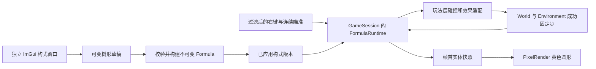

# 构式基础版：游戏接入、结构编辑与实施计划

> 历史记录：2026-10-25已删除旧cast语言、树形Simulator/编辑器/验证器和对照实验代码。本文中的旧代码路径、构建命令与验证数字仅描述当时状态。当前只保留[process运行时](FormulaProcessRuntime.md)与[FormulaBridge](FormulaBridge.md)。

日期：2026-10-20。状态：已通过干净上下文 gpt-6-astra（xhigh）独立审查及修订复核，可作为实施基线；本文不表示功能已实现。评审证据位于 AWT 任务“构式基础版设计与独立评审”的 Doc 索引。

后续用户调整（2026-10-20）：Formula Editor现由F4独立显隐，F2只控制Pixel Debug；下文F2统一显隐是原评审基线，当前操作见[实现说明](FormulaGameplayV1Implementation.md)。

## 1. 用户目标与本轮交付

用户要求依据先前设计实现基础版构式系统：右键激活，以黄色小球为基础输入；用当前 DebugUI 单独构建可修改构式结构的界面；先完成设计和计划，再用干净上下文、极高推理等级的 Astra review。

用户补充：**小球只是构式的输入，不一定真的显示出来；发射位置在人前方一点，指向鼠标。** 因此输入是不可变的基础 `Formula::Bolt()` 描述，不是先生成一个可见实体再修改它。右键执行的是整个已应用构式：`empty()` 没有弹体，`delay(30, bolt())` 在第 30 tick 才生成球，`on_hit(bolt(), dig(3))` 只有载体飞行时显示球。基础输入节点复用现有 Bolt，不新增带隐藏物理行为的“种子实体”。

本轮交付设计、分步实施计划和独立评审记录。后续实施以评审修订稿为基线；本轮不修改游戏代码、不将计划中的测试记成通过。

## 2. 依据和当前代码基线

- 当前父仓库 HEAD：`a748ef8d25b7270117ebd99cef12b14321df3c0a`；本地 Axiom gitlink/HEAD：`150ea98077aa9f0fb857229220917ebb98baa775`。main 工作区已有世界生成、美术和玩法修改，当前文件内容是设计基线，不能用 HEAD 中旧文件替代。
- 当前设计依据：[构式系统](../../Docs/GameDesign/FormulaSystem.md)、[构式语言架构](FormulaLanguageArchitecture.md)、[Formula README](../../Pixel/Source/Runtime/System/Formula/README.md)。早期 DOCX 仅是历史方案。
- `Pixel/Source/Runtime/System/Formula` 已有不可变描述、封闭组合、CPU Simulator、60 Hz tick、CLI 和测试；`Node.h` 是私有结构。没有游戏运行时、自动碰撞或结构编辑器。
- `GameInput::OnMouseButtonEvent` 当前左键放 Dirt、右键开采；用事件携带的 `MousePointerState` 取尺寸，不重新读取光标。引擎 `InputManager::Dispatch` 已按本帧 ImGui capture 过滤。
- `GameSession::Tick` 调 `World::Tick`；Environment 自有固定步累加器和预算重试状态，角色目前按传入帧 duration 更新，Session 时间也按 duration 增加。不能简单给构式再加一个逐帧累加器。
- `WorldPosition` 用块坐标 + 局部 double 保持远坐标精度；原型 `Vec2` 是普通 double，不能直接装入绝对世界坐标。
- `GamePresentation::CreateFramePublisher` 在帧首发布，`PixelRender::RecordFrame` 只消费快照。发布内存不足有提前返回分支，也必须刷新/清空构式数据。
- `PixelDebugUI` 已有 ImGui overlay 和 F2 显隐。现有 RHI 支持普通纹理、push constants、viewport/scissor 和索引绘制；基础球无需引入引擎粒子或扩展 RHI。

## 3. 基础版范围与交互

### 3.1 默认行为

默认已应用构式为 `cast bolt();`：伤害元数据 10，速度 60 格/秒，寿命 120 tick；黄色圆形是该弹体的基础表现，半径固定为 0.35 格。颜色与表现半径属于表现/基础弹体配置，不新增材料类型。首版无重力、风偏转、敌人生命值或伤害结算；伤害修改仍可通过运行诊断验证。

普通右键 PRESS 在标准模式和自由相机模式都激活一次构式；按住、RELEASE 不连发。左键保留放 Dirt；**Shift + 右键保留开采**，不同时激活构式。更新帮助、README 和现有鼠标测试。ImGui 捕获范围内的点击、无效窗口尺寸、鼠标在窗口外、世界未 Ready、无玩家时不激活；F1 只隐藏实体表现，不改变执行规则。材料步处于 `IsWaitingForBudget()` 时拒绝新激活、放 Dirt 和 Shift 开采，不排队稍后重放；面板显示等待原因，用户可先释放存储或重试。

### 3.2 瞄准与发射原点

1. 新增 `GameCamera::PickWorldPosition(pointer)`，以事件的 WindowSize/FramebufferSize、当前相机中心和缩放，获得连续 `WorldPosition`。复用 PickCell 的有效区域与尺寸判断，但不先取整格中心。
2. 取玩家连续中心 `C`，用同一局部参考格计算鼠标位置与 `C` 的差，再归一化为方向 `d`。正 Y 向下，角度由 `atan2(d.y,d.x)` 转为度；鼠标恰在中心时采用会话最近有效瞄准方向，初始向右。
3. 原点在角色外缘前方：沿 `d` 求与角色矩形（各边外扩 0.35 格）的出口距离，再加 0.25 格，得到 `O = C + d * distance`。轴向为零的分量不作除法。该距离通常为 1.6～2.6 格量级，随方向而变。
4. 从 `C` 到 `O` 检查地形/驻留边界，忽略玩家自身。若枪口路径或最终球体与固体重叠，拒绝这次激活并显示简短原因，不把球传送到墙另一侧。瞄准点可以在远处；激活不加载远处块。
5. 请求在输入处理时捕获已应用描述版本、原点与方向；延迟和重复使用该固定原点与方向，不追踪随后移动的角色或鼠标。

### 3.3 暂停、编辑和重置

- 默认仍暂停。右键可以在当前 tick 激活根描述，让默认球在下一次帧首发布后可见；暂停期间不移动、不减寿命、不推进 delay/repeat/on_hit。这样可先布置再单步。
- 根描述内同 tick 的瞬时 dig/wind 也立即执行，属于显式用户编辑；暂停不会偷偷推进材料与风求解。窗口明确显示“暂停；右键激活，单步推进”。若环境已有预推进风而材料步等待预算，则拒绝整次新激活，保证其重试前没有新的编辑副作用。
- “应用”原子替换已应用不可变描述，只有下一次激活使用新版本；现存球及其未来载荷继续持有旧版本。编辑草稿不修改运行实例。
- “清除运行实例”删除所有活球、延迟/重复/命中任务和运行日志，不执行命中载荷，不改变世界或已应用构式；暂停状态保持。
- R 创建新世界、重新载入或恢复世界时清空运行实例并递增会话 WorldEpoch；保留编辑草稿和已应用构式。旧世界保存失败且世界未替换时保留实例；如果候选世界已替换或恢复重建旧世界，即使 TryReset 返回 false，也要清除旧实例。清理挂在真正世界替换路径，不能只依赖按键成功返回。
- 本版构式草稿、配方、运行实例不写入世界存档；退出后回默认构式。挖掘与风作用后实际改变的材料沿用世界存档；保存风配置/时钟，但不保存动态风扰动场或脉冲本身。面板写明此限制。

## 4. 结构与模块边界



数据与生命周期归属：

| 模块 | 持有的状态与责任 |
|---|---|
| `PixelFormula` | 既有不可变 Formula/Parser/Simulator；新增不暴露私有 Node 的只读节点访问、增量取事件、运行状态查询/取消 |
| `PixelGameplay` | 新 `FormulaRuntime`、世界命中与效果适配；Session 持有已应用构式、根实例、WorldEpoch、固定步接线；不包含 ImGui/RHI |
| `PixelFormulaEditing`（新 CPU 库） | 树形草稿、结构操作、参数校验与编译、运行上界分析；只依赖 PixelFormula，可无窗口测试 |
| `PixelDebugUI` | `FormulaDebugUI` 的可见性、选中 NodeId、草稿与错误呈现；通过 Session 应用描述；不直接改 Simulator |
| `PixelInput` / `PixelCamera` | 单次按键与 Shift 分流、连续瞄准；不执行 AST、不处理碰撞 |
| `PixelPresentation` / `PixelRuntime` | 将运行快照转换为屏幕圆形数据；PixelRender 的独立合成 pass；不回写 gameplay |
| `PixelWorld` | 原有地图、材料、角色和风；只增加通用“固定步成功”通知及必要的精确坐标风脉冲入口，不依赖 Formula/ImGui/RHI |

`PixelGameplay → PixelWorld + PixelFormula`；`PixelFormulaEditing → PixelFormula`；DebugUI 链接 editing 与既有 gameplay/presentation。根工程已经先 add_subdirectory(Formula) 再 Source，可直接链接；维持 `cmake -S Pixel/Source/Runtime/System/Formula` 的独立构建。没有引擎改动计划，AET 和 AxiomVersion 不变；相邻 `../Axiom` 不写入、不构建。

## 5. 编辑器：独立树形窗口

窗口显示名先沿用当前 ImGui 默认字体的英文 `Formula Editor`，帮助文档使用中文“构式编辑器”。不引入节点编辑器外部库、任意 DAG 连线或中文字体工程。

- Pixel Debug 内增加 `Formula editor` 显示开关；首次启动打开，F2 同时控制整个 debug UI 的可见性。关闭子窗口保留草稿，可从 Pixel Debug 重新打开。主窗口折叠不影响已打开的子窗口绘制。
- 顶部：已应用版本、草稿是否修改、Apply、Revert to applied、Reset draft to bolt、Clear running。重置草稿也需要 Apply 才影响激活。
- 左侧：可折叠结构树，稳定 NodeId 与节点类型摘要；OnHit 显式标记 Carrier 和 Payload；seq 显示有序子项。
- 右侧：选中节点参数、单位、参数/结构错误；新节点类型选择；Add child、Wrap selected、Replace、Unwrap、Delete、Move up/down。seq 支持增删重排；单输入节点不可缺 child；删固定槽内容替换为 Empty；删根变为 Empty；替换/删除选择后把选中定位到仍存在的父节点，不能保存 vector 元素指针。
- 底部：只读规范 DSL 预览、当前根实例/球/待执行数量、最近 256 条事件与诊断、暂停提示。首版不支持文本导入/手写编辑、命名共享图或配方文件；避免树形编辑与文本两份权威源互相覆盖。

支持现有节点全集：Empty、Bolt、Wind、Dig、Sequence、AddDamage、MultiplyDamage、MultiplySpeed、Delay、Repeat、Fan、OnHit。默认只有一个 Bolt。基础输入在树中叫 `Bolt (base input)`；可包裹、复制、替换或放入任意载体/载荷，封闭性保持。Wind 节点可编辑和执行到事件层，但基础版实际风脉冲只适配受控规模的 Coarse 后端（见 8.3）；面板同时显示当前兼容性与显式跳过诊断。

草稿使用 `unique_ptr` 树和稳定递增 NodeId（复制分配新 ID）；递归节点的 tag/参数/子槽必须配套。每次 Apply 先检查结构、参数及工作量，再通过现有 Formula 工厂构造完整不可变值；全部成功才替换 active。Revert 通过 Formula 只读访问生成新草稿；不让 UI include `Source/Node.h`，不往不可变 Node 注入 editor 状态。

默认保留原型参数语义：count=0 为空，delay/interval=0 合法；不兼容修改器保留效果并给诊断；payload 不继承载体的属性修改。错误必须定位 NodeId 和字段，不因为失败悄悄使用 Empty，也不丢弃上一版本。

建议预设：单球；三向散射；延迟三连发；命中挖掘；命中风脉冲。预设只更新草稿，并显示需要 Apply。

## 6. 执行、局部坐标与有限工作量

### 6.1 每次根激活独立运行

`FormulaRuntime` 为每个根激活持有一个 Simulator、固定 `WorldPosition Anchor`、SessionCastId、WorldEpoch、配方版本和上界预留。Simulator 的 origin 始终从 `{0,0}` 开始；命中位置/子弹体均为相对 Anchor 的局部 double。向世界查询时将局部位移加到 Anchor 并 Normalize；禁止先转换为绝对 double。不同实例中的 ProjectileId 可重复，对外身份是 `(WorldEpoch, SessionCastId, ProjectileId)`。

每实例以自己的激活 tick=0 开始，每成功世界固定步加 1；暂停显式激活只做 `Cast + AdvanceTo(Now)`。延迟、重复、payload 都继承这个实例的 Anchor；不会随着相机/人物平移坐标系。显示位置由精确 WorldPosition 与相机局部差构建，送 GPU 前才转 float。

这使异常和清理以根实例为边界。正常完成要同时没有活球和待执行任务；不能看到 `Projectiles().empty()` 就回收包含 delay 的实例。增加 `Simulator::IsIdle()` / pending count，取消不再触发事件。异常捕获在 FormulaRuntime，丢弃出错根实例及未提交的本批效果，记录诊断，不让异常穿过世界固定步提交回调。以前已提交的挖掘/风不回滚，不宣称事务执行。

### 6.2 增量事件

新增 `DrainTrace()` 取得并清空本批事件；保留未调用 Drain 时 CLI 的 Trace 契约。运行时在即时激活、AdvanceTo 和 Hit 批次后立即 drain，将带 Epoch/SessionCastId 的记录写入容量 256 的环形诊断区。世界效果只从新 drain 的批次消费一次，渲染只读取活球快照；不能每帧重放整份 Trace。

新增无触发 `DiscardProjectile(id)` 用于出模拟域/缺失块退场；不能用 `Hit` 冒充卸载，否则会触发 payload。保留旧 expiration 任务直到到期是允许的，但 `IsIdle` 必须计入实际队列，预留直到真正空闲释放。

### 6.3 首版上限

这是可交互调试版的响应性约束，不引入收费、资源经济或生产沙箱。下面数值为保守起点，实施时用测试/运行数据核对，不能当作已测性能指标。

- 草稿最多 64 节点、深度 16；单个 count≤16、delay/interval≤600 tick、单个寿命 1～600 tick；半径≤16 格；求值后速度≤600 格/秒，风脉冲绝对值≤600 格/秒。
- 每根最坏基本效果发出总数（Bolt/Wind/Dig，含所有载荷后代）≤64；递归求值节点访问上界≤4096；全部后代结束时间上界≤3600 tick；伤害等数值必须有限。
- 会话最多 16 个活根实例，并以最坏总效果数预留，全部根合计≤256。预留包括未来 repeat、fan、on_hit 后代，直到根空闲才释放；当场没有球不代表没有占额。一次输入分派帧最多接受 8 次激活，超出给出拒绝计数；无自动连发。
- 额外统计每根全部后代的最坏 Wind 发出次数，活根预留加“本帧已退休根的风预留”合计≤64；根即使即时完成，也要到下一帧 BeginFrame 才退还这部分风额度。不支持当前风后端、零半径等仍按潜在 Wind 预留，不能切策略绕过。额度不足在根展开前拒绝整次新激活，不能运行后只截断超额命令。BeginFrame 只退还已退休额度，不能清空仍在飞行或延迟的根预留。
- FrameBegin 的额度切换只由 PixelGame 每帧调用一次，顺序早于 UI/输入/成功步执行；CPU fixture 显式调用同一入口。清除实例、取消、运行异常、R/恢复世界时将该根的风额度转入“本帧已退休”账本，不能随 WorldEpoch 清空它；这样同帧清除再激活也不能重获已占用额度。
- 同一批次 Dig 最大圈选面积受半径限制，球扫掠候选数由速度/半径上界直接推导。**Wind 不适用这条局部面积估算**：实际实现扫描整个后端网格；首版另以 Coarse 网格≤1024 cells、每帧 Wind≤64 的组合将新增脉冲扫描限定到≤65,536 次网格迭代（各迭代处理两个面分量），且不逐条 Project。这个操作数上界不等于总帧时间保证，既有风求解耗时另计。无跨帧“执行一半的 AST”状态，也不静默截断结果。

上界分析在构建 Formula 前运行于草稿，对已经生成的 Formula 也使用只读访问复核。按解释器语义递归估计，不实例化展开结果：seq 求和，repeat/fan 乘 count，delay 加时间；遇 OnHit 将 payload 描述放入当前载体触发列表，每个 Bolt 按最坏命中计算列表中每个 payload（新作用域），多个嵌套 OnHit 都计入。Modifiers 内到外计算有效数值；到期/激活/触发排队工作一并估计。所有整数运算采用上限饱和检查，先判断再乘加；count=0 路径不产生运行工作但仍检查结构合法。上界拒绝给出具体节点原因，发生在任何 Simulator 展开前。

若第一轮实现无法证明这个预检覆盖了原型所有展开路径，应先缩小可编辑节点/参数范围并明确报告，不能把未经约束的 repeat/fan 暴露到每帧 UI 线程。首版不添加泛化字节码、计划缓存或预算继承框架。

## 7. 固定步与成功提交顺序

### 7.1 使用现有累加器，不叠加新累加器

保留 Environment 的 `TimeRemainder`、`SimulationSeconds`、`WindAdvancedForStep`、预算重试及存档字段。给 `Environment::Tick` 增加可选、同步、非存储的“成功完成一个固定步”通知，在材料与反馈已完成且时钟/WaitingForBudget 已提交后调用。

`World::Tick(duration, onStepCommitted)` 在通知中先以准确 1/60 秒更新角色，再通知调用方；旧 `World::Tick(duration)` 使用默认空通知，仍更新角色。角色不再在外层用完整 duration 再更新一次。World/Environment 不存储指向 Session 的长期回调，也不包含 Formula 类型。

`GameSession` 在每次成功通知内更新 `SimulationTime += 1/60` 并推进 FormulaRuntime 一步。单帧可有 0、1 或多次通知；若第三步预算失败，前两步仍各推进一次，失败步不推进角色/构式。失败步已经预推进的风继续复用，重试不能重复 Advance wind、重复回调或重复 effects。

JumpRequested 在 Session/World 侧锁存到第一个成功固定步消费，不能在 120/240 Hz 的零步帧或预算等待中丢失；多步帧只首步收到 jump，水平移动按本帧当前值使用。ClearInputState/模式切换/世界替换清除锁存跳跃。

预算等待期间，Session 入口与 DebugUI 同时禁用当前风策略/风边界的重配置；它们会重建后端，破坏已预推进但待材料重试的风状态。允许存储重试、保存、暂停/单步、完整世界重置/恢复，以及纯构式草稿编辑/Apply/清实例。不得只靠按钮灰显阻止程序调用；返回显式等待结果，不改变现有参数。解除预算等待后恢复可编辑。

单步在暂停时必须完成**恰好一个**固定步，不能调用普通 Tick(1/60) 排干既有 remainder。新增限制最多成功一步的入口/参数；正常帧把 `TimeRemainder + 本帧有效duration` 上限钳到 0.25 秒，再执行固定步。若已有完整积压步（无论是否 WaitingForBudget），单步消费/重试一个，不额外加时；只有 remainder 不足一步时才添加 1/60 秒，执行后保留原有分数余量。单步请求在预算等待和非法 duration 时保留，完成一次后清除。普通暂停不积累真实时间；恢复不追赶暂停墙钟。单步后的完整积压步可以留在 remainder 中，不能假定 WaitingForBudget=false 就意味着 remainder<1/60。

新写入世界元数据升级为 **v4**，字段顺序沿用 v3；版本号标明扩大后的时钟状态集合。v4 要求 seconds 有限且非负，`0≤remainder≤0.25`；deferred=true 还要求 remainder≥1/60。deferred 仅表示“风已预推进，材料待重试”，不能由完整积压步数推导。RestoreClock 恢复风时间为 `seconds + (deferred ? 1/60 : 0)`，使成功单步后仍有 backlog 但 deferred=false 的状态能正确保存/载入。

继续读取旧 v2/v3，进入 RestoreClock 前按各自旧限制校验（非 deferred 时 remainder<1/60）；v2 保持 Flat 生成语义，v3/v4 都读取生成描述，不能漏改当前 `version==3` 分支。新旧版本都只恢复世界，不恢复构式实例。Session 的 simulationTime 旧值可作显示时钟起点，此后只按成功步递增，不由存档秒数四舍五入推导构式 tick。旧二进制会明确拒绝 v4，不声称向旧程序反向兼容。调整角色时间基准是明确行为变更，需跑移动、跳跃、游泳、暂停、存档重试回归。

### 7.2 每次成功世界步 k→k+1

1. Environment 完成风预推进 → 材料同步提案/提交 → 风反馈；失败则不进入后续步骤。
2. World 以固定 dt 更新角色（消费一次 jump）。
3. FormulaRuntime 保存旧活球位置，逐根按 SessionCastId 递增执行 `AdvanceTo(k_local+1)`：原型到期优先，再处理计划激活；收集新的世界效果指令，暂不改地图。
4. 针对仍存活球建立碰撞候选：旧球扫掠前后位置，新生成球只检查当前位置；所有根都基于此时同一份已提交地图查询，期间不执行 Dig。
5. 按 `(命中分数t, SessionCastId, ProjectileId, CellY, CellX)` 排序并注入 Hit；没有球-球碰撞。Hit 的 payload 在当前本地 tick+1 执行，绝不在本步递归触发。每个球最多一次 Hit。
6. 汇总 Advance/Hit 新事件并提交 Dig/Wind，按 `(SessionCastId, 根内事件序号)` 稳定顺序；下一材料步才受到它们影响。本步所有命中不会因先处理某颗球的挖掘而改变。
7. 清理空闲根并更新 CPU 快照与统计；帧首的下一次发布读取结果。

边界沿用原型：寿命区间 `[born, expires)`，在 expires tick 先移除，因此不对该 tick 的末段补注入 Hit；寿命为 1 的球只在生成时能做重叠命中。这个离散取舍明确写入测试，不宣称连续事件时间物理。即时根激活时同样先求值、再点碰撞、最后统一提交该批效果；暂停中 Hit 排入的载荷等待下一成功固定步。

## 8. 世界碰撞与效果适配

### 8.1 球体与地形

首版球半径 0.35 格，碰撞体与显示半径一致。用线段扫掠圆与轴对齐单位格求最早接触：枚举有限扫掠包围盒内固体候选，计算面接触及角点圆接触；仅用扩大 AABB 的 slab 会在格角产生误判，不能当作精确圆碰撞。

在局部参考格执行 double 几何，格坐标仍用 int64；碰到相同 t 的格以 `(y,x)` 选定。起点重叠/零速度也能命中；切线接触是否算命中统一取闭集接触，使用固定 epsilon 仅解决比较，不把位置推回格中心。Hit 传球心在接触时的位置，方向取原载体方向。

固体判断复用当前 `BlocksCharacter(type)` 作为首版弹体阻挡规则；Dirt、土、岩石、矿石阻挡，空气和水通过，不与玩家自身碰撞。仅查询成功步的玩家模拟窗口；自由相机驻留的远块不扩大构式模拟域。

到达窗口外或缺失块时按最早边界位置无触发退场并记 `OutOfSimulation` / `NotReady`，不能穿过未知区域，也不能将未知块当成可挖地形命中。若固体与边界同 t，优先已知实体命中，稳定排序。不为弹体强制驻留、扩窗或发起远块生成。

### 8.2 DigArea

半径表示圆形范围内格中心距离≤radius；radius=0 只处理包含中心的格。用当前 `TryRemoveMaterial` 而不是早期 RemoveDirt，支持所有 Mineable 固体，不删除 Water。仅处理模拟窗口内已驻留格，按 `(y,x)` 调用并汇总 Applied/Blocked/NotReady；不从缺失格构造默认材料，不吞掉整个批次异常，不承诺跨格事务。

### 8.3 WindImpulse

范围/强度遵循原型单位；不改变选中策略或基础力。新增 `World::AddWindImpulse(WorldPosition, ...)` → `WindSimulation` 的局部坐标适配，先做 int64 原点差再转 float；不能使用当前双 double 绝对坐标入口处理远处命中。

游戏适配策略按如下顺序处理，预期边界只返回结果/诊断，不抛异常取消同根延迟球：

1. radius=0 返回 `WindZeroRadius`、零位移；`0<radius<1/256` 格返回 `WindBelowResolution`、零位移。这是首版风适配的明确空间分辨率，不修改 DSL 对非负 double 的合法性；UI 参数帮助中注明。支持区间 `[1/256,16]` 转 float 后一定仍为有限正数。零脉冲速度同样不调用后端。
2. Empty/disabled/零高度返回 `WindUnavailable`。其他非 Coarse 后端返回 `WindBackendUnsupported`；Coarse 只有 `Columns * Rows≤1024` 且后端已启用才接受，超限返回 `WindGridUnsupported`。范围判定使用整数乘法溢出检查。首版不优化 Procedural/Reference/Adaptive/LBM/Hybrid 的全域脉冲或投影。
3. 在精确局部 double 中检查中心位于 `[0,width)×[0,height)`；真正域外返回 `WindUnavailable`。只有已证实域内的坐标才转 float，转换结果夹到 `[0,std::nextafter(float(extent), 0.0f)]`，避免内侧点舍入成上边界。两个参数必须都是float；第二参数写整数0会选择double运算，随后转float可能重新落到extent。不能把本来域外点夹进来。速度按有效上限转换，radius 和位置的最终后端条件再次校验。
4. 域内合法命令一次提交给 Coarse，半径超域部分沿用其边界规则。每条只扫描受限的 Coarse 网格，当前 `WindField::AddImpulse` 不立即投影，投影仍在既有 Step 中。

Apply 只检查配方的语义和静态总量，不因暂时处于 Empty 或其他后端而修改配方。真正发出命令时重新检查后端/网格/风域；延迟期间切换策略、改变网格或移动域后，依新状态返回明确结果，其他正常 Bolt/Dig 和延迟任务继续。使用预设时显示“风脉冲需要 Coarse，网格至多 1024 cells”；默认 Empty 下无可见风场，不能宣称风预设自动启用风。默认球不采样风、不受其推动。

运行时的每根最坏 Wind 预留在根开始前取得且持续到退休后的下一帧；这是跨根、延迟和同帧即时重复共同的上界。策略或域变化不能使单条脉冲扫描超过 1024 cells，也不能改变已预留的数量。按原事件顺序提交，不合并/重排会改变逐条 clamp 结果的命令。实施须记录 Release 下最大合法 64 脉冲批次及同帧重复尝试的实际时间和后端调用数；不宣称所有机器都达到 60 FPS。

### 8.4 故障边界

完成材料固定步后，构式预检/计算或命令适配异常不得回滚已经完成的材料/角色；隔离根实例并保留简短错误。可预期的 OutOfSimulation/NotReady/WindUnavailable 使用结果枚举，不抛异常。真正 I/O/分配异常沿用世界现有错误状态，暂停并暴露原因；不能清掉保存错误或把失败记成成功。

## 9. 黄色球的表现与帧生命周期

新增 render-owned `FormulaDraw` 数组，元素为屏幕连续球心、屏幕半径、线性 RGB 黄色和组合实体 ID；从 GameSession 活球生成，独立于地图 CellType/纹理层。先做视口裁剪，再将局部 double 转 float；不对静止球加视觉漂移。无弹体的构式没有圆形数据。

合成顺序：世界/背景 → 风效 → 构式球 → 人物 → 后处理 → ImGui。F1 不发布球；退出 F1 恢复现存实例的表现。构式窗口仍可查看实例与事件。

基础版用现有 RHI 实现一个额外颜色目标/pass：先把世界或风效颜色全屏复制到球目标，再对每颗可见球设小 viewport/scissor，使用现有 fullscreen quad、push constants 和圆形 shader 绘制纯黄圆内部，圆外 `discard`。圆内不采样原背景，多个同色不透明球重叠不擦除先前圆。首版用清晰的硬边圆，不加透明光晕，避免依赖当前 RHI 尚未暴露的混合设置。单 pass、1 次底图复制 + N 次小范围 draw，不为每球复制全屏，不在每像素遍历全部弹体。

`Pixel2DFormula.Frag.slang` 和 pass 属于 Pixel；无需新材质 PNG。Circle pass 无球/F1 时跳过，原有 world/wind→character/post 路径不变；有球时 character/post 输入从新增球目标取。更新 descriptor pool 的准确容量、绑定组合、frame-slot 私有颜色目标、resize/重建/clear 顺序和 mock 验证。

`WorldGridFrame` 持有独立 vector，`Read()` 返回只读 span；FrameBegin 发布后即使 Session 在本帧改配方/清实例，RecordFrame 仍只使用本次已发布快照。每次 publisher 的入口先清空球列表，再在正常和预算回退路径按当前视图构建；Ready=false/F1/无球必须为空，不能复用旧世界残影。重置造成的当前帧旧快照最多显示到帧末，与既有世界发布延迟一致。

帧内不读取 Simulator，不存指向 ProjectileView/Trace 的引用。内存统计单列 gameplay 构式实例/事件与 presentation 圆数组；有球时增加每 frame slot 一个 RGBA8 framebuffer 目标，GPU 成本按 width×height×4×slots 报告，不混入既有世界 CPU 512 MiB 预算。截图验证默认黄色、相机移动/缩放/resize、低帧率多步与 F1 切换。

## 10. 实施分解与完成门槛

| 阶段 | 主要改动 | 完成证据 |
|---|---|---|
| P0 设计评审（本轮） | 本文、AWT 任务与评审处理表；干净 Astra xhigh 审查 | 原始意见、逐项处理、复核结论可追溯 |
| P1 领域与编辑模型 | Formula 只读访问/DrainTrace/IsIdle/Discard；FormulaEditing 草稿操作、构造与上界校验 | 独立 Formula 全回归；CPU 草稿序列、作用域、预算错误不替换 active |
| P2 时钟与 CPU 游戏闭环 | 成功固定步通知；角色/Session 对齐；v4时钟存档兼容；FormulaRuntime、局部 Anchor、碰撞、Dig/Wind、清理 | session/character/持久化回归；固定步/预算/碰撞/命令只提交一次 |
| P3 输入与世界表现 | 连续瞄准、Shift 开采、黄色圆快照和 pass、资源生命周期 | 输入与 render mock；Pixel/AET 构建；可行 GPU smoke |
| P4 独立编辑窗口 | tree/参数/结构操作/Apply/预设/诊断，F2/开关/捕获 | 真实 UI 能组出不同构式；UI 右键不发射；草稿失败不影响游戏 |
| P5 整合与说明 | 帮助/README/现行 Formula 文档、例子、验证记录、AWT 验收 | 最终 CPU 回归 + 可行 GPU/UI smoke；未覆盖明确列出 |

P1、P2 先形成可复现 CPU 契约，再接表现；不等制作正式 VFX 或节点画布。若发生引擎接口不足，先用已验证的现有能力调整 Pixel 方案；只有确需修改引擎时另读本地 `Axiom/AGENTS.md` 与项目约定，在本地 PixelMain 操作并同步 gitlink/version。本方案不预设该变更。

建议文件映射（新文件名是计划，不代表现存）：

| 路径 | 计划 |
|---|---|
| `Pixel/Source/Runtime/System/Formula/Include/Formula/Formula.h` 与实现 | 增加稳定只读节点访问/遍历，不暴露可变私有节点 |
| `Pixel/Source/Runtime/System/Formula/Include/Formula/Simulator.h`、`Source/Simulator.cpp` | DrainTrace、IsIdle、pending、无触发 discard，保留旧 API 语义 |
| `Pixel/Source/Dev/Debug/FormulaEditing/*`（新） | Draft、结构操作、编译与 Analysis；独立 CPU target |
| `Pixel/Source/Runtime/Gameplay/FormulaRuntime.*`（新） | 根实例与事件生命周期、局部坐标、诊断 |
| `Pixel/Source/Runtime/Gameplay/FormulaWorldAdapter.*`（新） | 扫掠、驻留边界、Dig/Wind 领域操作 |
| `Pixel/Source/Runtime/Gameplay/GameSession.*` | 应用描述、发射入口、固定步、世界替换清理 |
| `Pixel/Source/Runtime/Simulation/World/World.*`、`Environment/Environment.*` | 成功步通知、单步限制、锁存 jump，不依赖 Formula |
| `Pixel/Source/Runtime/Simulation/World/Environment/Wind/WindSimulation.*` | 精确分段坐标脉冲入口 |
| `Pixel/Source/Runtime/Gameplay/Camera/GameCamera.*`、`Input/GameInput.*` | 连续拾取、鼠标分流/瞄准/帮助 |
| `Pixel/Source/Dev/Debug/UI/FormulaDebugUI.*`（新）、`PixelDebugUI.*` | 独立窗口，结构与参数 UI |
| `Pixel/Source/Runtime/Render/FormulaFrame.*`（新）、`WorldGridFrame.*`、`GamePresentation.cpp` | render-owned 球快照、验证与各返回路径清理 |
| `Pixel/Source/Runtime/Render/PixelRender.*`、`Pixel/Source/Runtime/Render/Shader/*` | 有限小圆合成及 frame-slot 生命周期 |
| 相应 CMake、`UnitTest/Formula`、`Gameplay`、`Rendering`、`Runtime` | 精确链接和行为测试，不把测试放回引擎 |

## 11. 验收矩阵

| 编号 | 场景 | 可检查结果 |
|---|---|---|
| A1 基础输入 | 默认右键；Empty；Delay(30,Bolt) | 默认只生成最终 1 球；Empty 不显示；延迟期间没有占位种子球 |
| A2 发射位置 | 人物四个轴向与斜向、鼠标在角色中心、贴墙 | 角色前方；方向稳定；无除零；堵住枪口拒绝，不穿墙 |
| A3 输入边界 | PRESS/RELEASE/保持；Shift；UI 捕获；旧尺寸事件；缩放/F3/越界 | 一次按下最多一次；Shift 只开采；UI 不穿透；连续坐标使用事件尺寸 |
| A4 编辑结构 | 增删/包裹/解包/复制/重排、删除根、Carrier/Payload | 树结构合法；NodeId 不复用；编译行为与 Formula 工厂一致 |
| A5 应用版本 | 草稿错误/有效 Apply、运行中修改参数、Revert | 上一 active 保留；旧实例/延迟载荷不变；新右键使用新版 |
| A6 组合语义 | seq、fan、repeat、damage 顺序、多个 OnHit、嵌套 payload | 与既有 DSL 可观察事件一致；payload 不继承 carrier 修改 |
| A7 时钟 | 同输入按 1/30、1/60、1/120、1/240 帧分段；多步/零步 | 相同成功步数量得到相同构式状态；角色不重复推进，jump 不丢 |
| A8 预算等待 | 环境第 1/第 3 步失败，之后重试；暂停时单步；等待时点击 | 失败步无角色/构式/计时推进；先前成功步保留；只提交一次；单步恰好 1 步；等待时拒绝新激活/地形编辑 |
| A9 碰撞 | 高速穿薄墙、斜角擦边、零速重叠、同 t 多球/格、寿命到期 | 连续扫掠、不隧穿；格角精确；稳定次序；到期优先且无伪 Hit |
| A10 命中时间 | t=0 球、延迟新球、普通 Hit、自然到期 | Hit 消耗一次；payload 下一 tick；到期不触发；新球本 tick 不位移 |
| A11 领域命令 | on_hit→dig 土/岩/矿、水；风 Empty/disabled/域外/Coarse域内/不支持后端 | 只开采 Mineable；缺失格不写；风不暗启；不支持时只跳过风，其他效果继续；命令仅提交一次 |
| A12 地图一致性 | 同 tick 两球命中同墙，其中一球挖墙 | 两次碰撞先看同一地图；effects 后提交；处理次序稳定 |
| A13 远坐标 | ±(2^53+偏移) 世界格、负块边界、分数瞄准/运动/风 | int64 格位置准确；亚格运动与近原点一致；不先转绝对 double |
| A14 生命周期 | 清实例、R 成功、保存前失败、候选后恢复/失败、TryRecover、重启 | 无旧球/延迟漏入新世界；清理不触发 payload；正确保留或清除 |
| A15 资源边界 | 嵌套 repeat/fan、多命中绑定、长 delay、连续右键；64风批次及同帧再激活/清除 | 超限在展开前拒绝；无球但有队列不误回收；Trace有界；风额度下一帧才回收；Coarse≤1024cells、实际后端调用≤64/帧；记录Release耗时 |
| A16 发布与渲染 | 两个 publisher、发布后改 live、预算回退、F1、resize、多 frame slot | 快照独立；Draw 不读 live；不留残影；圆重叠不擦除；资源正常释放 |
| A17 独立 UI | 实际增删节点并 Apply、右键窗口/弹窗、F2、关闭重开 | 单独窗口可用；不放土/开采/发射；草稿保留；输入捕获正常 |
| A18 时钟存档 | 0.1 秒积压且 deferred=true，成功单步后保存/载入；deferred=false 的积压；v2/v3/v4 | v4接受合法backlog；风不多推进；保留余量；旧档读入；v3/v4生成描述均保留；非法组合明确拒绝 |
| A19 风数值边界 | `seq(wind(r,120),delay(10,bolt()))` 的r=0、1e-300、1/256；域内上边缘；负远坐标；等待期间重配置 | 合法边界不取消延迟球；极小半径有诊断；仅真实域内点作float夹紧；预算等待不重建风后端 |
| A20 延迟风与策略变化 | 发射后由Coarse切其他策略/改网格/风域迁移，再到达命令tick | 重新检查适配条件；明确跳过且其他效果继续；不超每帧网格与命令数量上限 |

新增有意义的 CPU 测试建议为 `Pixel.FormulaEditing`、`Pixel.FormulaGameplay`、`Pixel.FormulaRendering`；不得仅检查代码结构。保持已有 Formula、Input、Session、Character、Persistence、GenerationSession、WindDomains 及 render mock 行为回归。

实施后的命令（本轮未执行这些功能验证）：

```sh
cmake -S Pixel/Source/Runtime/System/Formula -B build-formula -DCMAKE_BUILD_TYPE=Debug
cmake --build build-formula -j4
ctest --test-dir build-formula --output-on-failure

cmake -S . -B build-cpu -DAXIOM_BUILD_RUNTIME=OFF
cmake --build build-cpu -j4
ctest --test-dir build-cpu --output-on-failure

cmake -S . -B build -DPIXEL_BUILD_SMOKE=ON
cmake --build build --target Pixel Axiom PixelRuntimeSmoke -j4
(cd Pixel && ../build/tests/PixelRuntimeSmoke)
```

块尺寸 64 的回归至少覆盖新 FormulaGameplay 和原有 Chunks/Persistence/WindDomains；GPU smoke 不进入默认无 GPU CTest。在现有 `PixelRuntimeSmoke` 增加构式专项入口（如 `--formula-only`）后分别记录专项与全量结果。README 已记载某些平台后续生命周期阶段可能失败，不能以专项通过替代全量通过；无窗口/GPU 时明确标注未执行并保留可复现入口。

## 12. 风险、决策边界与评审问题

- 最大回归面是角色从按帧推进改为成功固定步推进；保留 Environment 累加器和预推进重试机制，并用 v4 明确扩展 backlog 存档状态。若测试显示旧角色行为依赖帧率，应报告真实差异，不能改断言掩盖。
- 最小可编辑版本已包含现有节点，风效果仅支持网格≤1024 cells 的 Coarse 后端；没有其他风求解器脉冲优化、追踪、反弹、穿透、费用、装备槽、网络、配方存档、VFX 素材动画、通用图编辑器或全文脚本输入。
- 爆发上限是本次游戏接入的保守产品限制；如果后续要放宽，应先测 AST 展开、碰撞候选、命令和 draw 数量，而不是只放大计数器。
- 碰撞采用本步环境更新完成后的地图，未实现移动地形与弹体的连续时空碰撞。寿命到期 tick 不扫末段是保留原型到期优先的离散语义。
- 公开只读 Formula 访问接口须保持节点不可变，避免 UI 的草稿变成另一套执行器；编译使用现有工厂，行为比较以现有 DSL 测试为准。
- 评审重点：是否正确表达“球是输入描述”；是否范围过大/有漏项；成功步/重试/单步能否闭合；OnHit 和世界修改的时序；远坐标和缺失块；草稿可编辑性；上界预检是否真覆盖解释器；帧首发布与资源生命周期。
