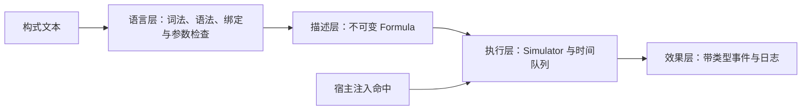

# 构式语言架构（Formula DSL）

更新日期：2026-10-14。范围：当前 `Pixel/Formula` 独立原型的实际架构和执行契约。整体玩法与后续方向见 [构式系统](FormulaSystem.md)，完整语法、示例与构建命令见 [模块 README](../../Pixel/Formula/README.md)。

“构式（Formula）”已同时用于领域与代码：类型 `Formula`、命名空间 `pixel::formula`、示例扩展名 `.formula` 和 `PixelFormula` 构建目标。2026-10-14 的迁移只统一名称；`cast` 语法及现有执行契约保持不变，迁移对照见系统文档。

## 1. 四层职责



| 层 | 责任 | 实际代码 |
|---|---|---|
| 语言层 | 解析文本、命名复用、管道展开、参数及源位置诊断；解析期间不执行效果 | [Parser.cpp](../../Pixel/Formula/Source/Parser.cpp) |
| 描述层 | 构造同一类型的不可变节点结构，支持共享与再次组合；打印可重解析表达式 | [Formula.h](../../Pixel/Formula/Include/Formula/Formula.h)、[Formula.cpp](../../Pixel/Formula/Source/Formula.cpp)、私有 [Node.h](../../Pixel/Formula/Source/Node.h) |
| 执行层 | 持有每次激活的状态、活动弹体、计划工作、独立 60 Hz 时钟和根激活 ID | [Simulator.cpp](../../Pixel/Formula/Source/Simulator.cpp) |
| 效果层 | 用带标签事件表示弹体、风、挖掘、命中、到期及诊断；当前输出给测试和 CLI | [Simulator.h](../../Pixel/Formula/Include/Formula/Simulator.h)、[Main.cpp](../../Pixel/Formula/Source/Main.cpp) |

这是直接解释不可变描述的领域语言原型，没有单独的字节码编译器、执行计划或 JIT。文件读取和命令行 I/O 在 Main，解释与模拟逻辑不依赖文件、引擎或 World。

## 2. 文本如何变成描述

程序先定义零个或多个 `let`，最后一个 `cast` 给出根描述。名称只能引用前面已经声明的构式，没有重新赋值、前向引用或递归。基础构造器、数值修改、顺序组合、延迟、重复、散射和命中装饰器都得到 `Formula`。

```text
let base = bolt();
cast base |> damage_add(5) |> damage_mul(2);
```

解析后等价于：

```text
damage_mul(2, damage_add(5, bolt(10, 60, 120)))
```

管道左侧成为右侧调用的最后一个参数，不引入第二套执行机制。`on_hit(carrier, payload)` 保持显式双参数，方便区分修改作用域。`Format` 展开绑定并输出规范表达式；加上 `cast ` 和 `;` 可重新解析。普通有限 `double` 包含次正规数；count/tick 使用精确的无符号十进制整数解析。

语法、未知名称、数量、类型或参数范围错误抛出 `ParseError`，包含从 1 开始的行列；CLI 额外打印文件名。错误不会被转换成 `empty()`。

## 3. 统一描述类型与所有权

公开 `Formula` 持有私有节点的 `shared_ptr<const Node>`。节点采用带标签联合体，覆盖 Empty、Bolt、Wind、Dig、Sequence、Modify、Delay、Repeat、Fan、OnHit。命名复用共享不可变节点，包装操作新建外层节点，保持原描述不变。

```text
构造器：合法参数 → Formula
修改器：合法参数 × Formula → Formula
装饰器：合法参数 × Formula → Formula
组合器：Formula × Formula（或列表）→ Formula
```

这保证描述能够连续组合，但不强迫每种效果拥有全部字段。弹体的伤害和速度、风的半径和脉冲、挖掘半径分别保存；运行中的实体也不混进表达式树。

多个 Simulator 可以使用同一个描述；同一 Simulator 可以重复激活。描述保存“做什么”，模拟器保存“这一次做到了哪里”。当前无多线程访问同一 Simulator 的契约。

## 4. 修改与事件作用域

解释器遇到外层修改器时保存其规则，到弹体叶子按反向顺序应用，实现内层先于外层。`damage_add` 每次运算后最低为 0；乘数非负。`seq`、`delay`、`repeat`、`fan` 都将当前作用域传给子项。

`on_hit` 将 payload 注册在当前 carrier 的弹体上，但不立即解释 payload。命中时建立新的激活上下文，只继承根激活 ID、事件位置和载体方向。伤害/速度修改规则与其他触发绑定不复制到新上下文。

```text
damage_mul(3, on_hit(bolt(), bolt(4, 30, 12)))
```

此例载体伤害为 30，子构式中的弹体仍为 4。要使两者都改变，需要显式修改两个分支。

wind/dig 不具有弹体属性，修改器对它们保持原效果并写诊断。它们也不能成为命中载体；相关 payload 不会因装饰器存在就自动执行。`empty()` 不输出任何效果或诊断。原型没有“全不兼容则拒绝整个程序”的编译策略。

## 5. 执行状态与确定性时序

Simulator 持有：绝对 tick、稳定入队序号、根激活 ID、弹体 ID、按时间排序的工作队列、按弹体 ID 索引的活动表，以及完整日志。工作队列只保存激活和寿命到期两类任务；碰撞由宿主显式回传。

| 操作 | 当前契约 |
|---|---|
| `Cast(formula, origin, angle)` | 将描述排到当前 tick，返回根激活 ID；不立即展开 |
| `AdvanceTo(tick)` | 处理包括目标 tick 在内的到期工作；拒绝时钟倒退 |
| `seq` | 当前时刻按书写顺序深度优先展开，不等待前项结束 |
| `delay(n, s)` | 从当前激活时间平移 n tick；0 保持立即展开 |
| `repeat(n, dt, s)` | 在相对时间 0、dt、2dt… 启动；0 份为空 |
| `fan(n, spacing, s)` | 围绕当前方向居中分布；spacing 是相邻角间距，单位度 |
| `Hit(id, position)` | 消耗仍存活的载体，按内层到外层排入各载荷，最早下一 tick 执行 |
| 自然到期 | 弹体在 `[spawn, spawn+lifetime)` 存活；到期不视为命中 |
| 同 tick 多工作 | 到期先于计划激活；激活按入队序排列，内部保持源码顺序 |
| 重复 / 未知 / 到期命中 | 返回 false，不生成载荷 |

每 tick 为 1/60 秒。位置单位为格，速度为格/秒，0° 向右，正角转向 +Y；当前位置由初始位置与经过时间解析计算，不存在真实物理步进或自动碰撞。延迟保存当次激活的原点和方向，不跟随宿主之后的运动。

相同输入事件下，一次推进至 N 与逐 tick 推进到 N 得到相同轨迹。该断言针对当前构建与运行语义，不承诺跨平台浮点逐位一致。

`Projectiles()` 返回存活弹体的值快照；`Trace()` 返回模拟器拥有的 vector 引用，继续运行可能使其元素引用失效。命中后旧到期任务会被忽略；已经排入的子构式独立于被销毁载体继续执行。

## 6. 输出与游戏边界

事件联合体包括 `BoltSpawn`、`WindImpulse`、`DigArea`、`ProjectileHit`、`ProjectileExpired`、`Diagnostic`。每条记录携带 tick、根激活 ID 和位置。

当前 CLI 打印规范描述与事件序列。`--hit-at N` 仅在 N 时刻对当时存活弹体逐个注入命中，不会使后续子弹体也自动命中。未来玩法适配层可消费相同类型的效果意图并回传实际碰撞，但日志本身不是已经接到 World 的命令总线。

当前模块不依赖 World、PixelRender、Axiom 或 GPU。它没有伤害结算、敌人、寻敌、场采样、地形修改或表现发布；这些需要各自的接入契约与测试。

## 7. 与历史提案的差异

| 主题 | 2026-10-12 提案 | 当前可执行原型 |
|---|---|---|
| 描述入口 | 主要由可视槽位生成，保存白名单结构 | 文本 DSL，直接构造不可变描述；没有导入隔离机制 |
| 目录 | 建议 `Pixel/Source/Spell`（历史名） | 实际 `Pixel/Formula` 独立 CMake 子系统 |
| 执行形式 | 校验、归一化、成本编译后执行计划 | 解析和参数检查后直接递归解释 |
| 到期与命中 | 曾建议同 tick 命中优先 | 生存区间右开，到期优先；到期后 Hit 被拒绝 |
| 载荷时间 | 结合未来世界提交阶段讨论 | 所有命中载荷统一排到下一 tick，再执行其内部 delay |
| 全不兼容 | 建议拒绝激活且不扣费 | 保留效果并诊断；不存在费用 |
| 时间与世界 | 单一游戏时钟、扫掠碰撞、领域命令、快照 | 独立时钟、直线轨迹、外部命中、事件日志 |
| 运行资源 | 根预算、版本、请求去重、重放与保存 | 尚未实现；CastId 只用于根来源追踪 |

这些差异用于区分建议和事实。将来改变语义时，应同时更新本页、原型说明和行为测试，不能只改文案或引用旧提案覆盖现行行为。

## 8. 验证依据与限制

[行为测试](../../Pixel/Formula/Tests/FormulaTests.cpp) 覆盖不可变复用、修改顺序、规范文本往返、混合效果、序列单位元与结合律、延迟重复和散射、时钟分段、载荷隔离与嵌套、重复命中、寿命边界、源位置和数值溢出。

2026-10-13 任务 `独立法术描述语言原型` 的最终验收记录：独立 CTest 2/2、根项目 CPU CTest 11/11、三个 CLI 示例成功；另一个审查者以警告和 ASan/UBSan 构建，2/2 通过。review 发现的次正规数往返、到期坐标溢出后仍能命中两项均已修复并复核。这是原型首次实现的历史验证记录。

2026-10-14 命名迁移后，由独立验证 Agent 重新配置并构建 `build-formula` 和 `build-cpu`：独立 CTest 2/2、根 CPU CTest 11/11 通过，三个 `.formula` 示例运行成功。重新配置后的测试为 `Pixel.Formula` 与 `Pixel.Formula.Demo`，没有旧测试名残留。12 个源码、构建和示例文件经迁移前后文本核对，差异仅为名称替换；本轮没有重跑 GPU 或 sanitizer。

原型采用直接递归、提前展开和不裁剪日志。未实现执行配额、深度限额、事务回滚或恶意输入隔离。数值无法表示时抛异常；此前已产生的效果不撤回，应丢弃出错的 Simulator 再重试。到期对象即使发生位置记录异常也不能重新命中。

当前最重要的后续验证是把效果应用到世界，并保持作用域、事件先后和时间一致性；是否增加编译计划、编辑器或其他节点取决于实际玩法实验。
