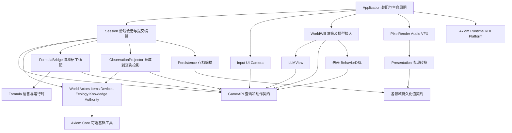
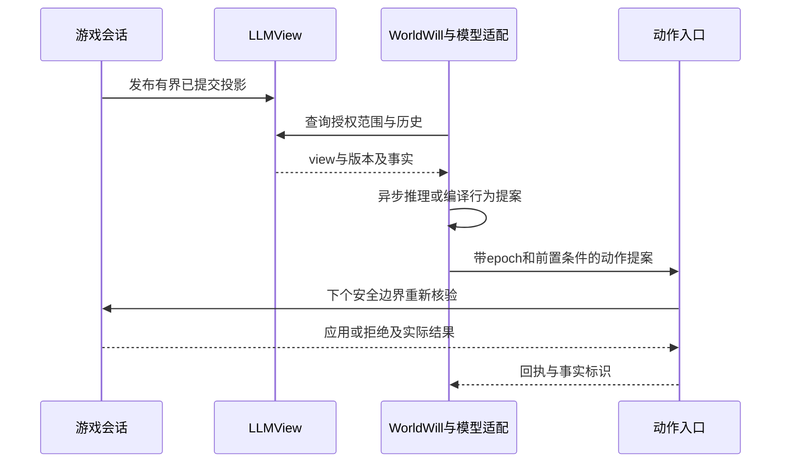

# Pixel 面向游戏愿景的架构规划

> 本文保留为 AWT 原始副本。执行任务和后续维护请使用 [Docs 中的架构文档](../../Docs/Architecture/GameplayArchitecturePlan.md)。

日期：2026-10-21。状态：已完成独立 subagent 审查与修订复核的架构提案，供后续实施与试玩选择；本文不表示相关能力已经实现，也不自动启动全部路线图。

建议沿现有纯 CPU 世界、独立构式原型和渲染快照继续演进为**同一进程内的模块化架构**。游戏会话编排推进，各领域拥有自己的状态；构式是可独立重设计的语言与执行子系统，经宿主适配器接入游戏；LLMView 是独立只读信息面板，LLM 的行动与未来逻辑程序经游戏的动作入口执行。Axiom 提供必要的平台与工具能力，游戏决定对象模型、规则、时钟策略和内容。

用户本轮补充优先于旧提案：构式仍是初步设想，可能采用函数式与命令式混合语言。当前不可变树、节点集合、60 Hz Simulator 和树形编辑器是可利用的原型，不是未来语言规范。游戏架构只固定接入边界，不固定其语法、IR 或执行器。“世界行为可以由构式组织”是一项待验证能力，不要求全部系统依赖构式。

## 1 设计依据与现状

代码基线为父仓库 `8819ba5cbde1ed227204177ca94c511535cc3e47`，本地引擎 `PixelMain` 为 `150ea98077aa9f0fb857229220917ebb98baa775`，与 AxiomVersion 一致；本次同时读取工作区内尚未提交的 GameDesign 总纲和相关文档整理。相邻 `../Axiom` 不作为修改或构建对象。

依据优先级是本轮用户约束、[游戏总纲](../../Docs/GameDesign/GameDesignVision.md)、实际代码与现行接口、专题实现记录，最后才是历史 DOCX/PDF。Gemini 讨论中的统一力场、工业规模惩罚和完全物理化等内容是启发，不直接成为规则或技术要求。风速与加速度必须保留各自单位；建设规模也不能自动触发惩罚。

| 当前事实与代码证据 | 架构意义 |
| --- | --- |
| [模块目标](../../Pixel/Source/CMakeLists.txt)、[World 目标](../../Pixel/Source/Runtime/Simulation/World/CMakeLists.txt)：World 只链接 Core 与 CPU 性能模块 | 保留无窗口、无 RHI、无 Formula 的底层模拟边界 |
| [World](../../Pixel/Source/Runtime/Simulation/World/World.h) 同时拥有地图、环境、流式与唯一玩家，并暴露大量具体风后端入口 | 后续多角色和设备不宜继续扩展此门面；逐步收拢为世界领域与宿主编排 |
| [GameSession](../../Pixel/Source/Runtime/Gameplay/GameSession/GameSession.cpp) 同时处理存档格式、创建/恢复、暂停、瞄准、风选择与构式 | 首先拆职责和依赖，不急于重写材料或求解算法 |
| [Environment::Tick](../../Pixel/Source/Runtime/Simulation/World/Environment/Environment.cpp) 持有累加器；风预推进后材料预算不足会延期 | 时钟迁移必须保留“成功步才推进其他系统”和同一步不重复风更新 |
| [FormulaRuntime](../../Pixel/Source/Runtime/Gameplay/FormulaRuntime.cpp) 每次激活拥有 Simulator；所有扫掠先完成，再提交各根效果 | 保留可观察顺序作为旧版契约，语言新版如改变须明确标记 |
| [FormulaDraft](../../Pixel/Source/Dev/Debug/FormulaEditing/FormulaDraft.h) 兼有编辑树与工作量分析；Gameplay 依赖 Editing | 将运行校验与 UI 草稿解耦，使无编辑器宿主也能执行程序 |
| [GameInput](../../Pixel/Source/Runtime/System/IO/Input/GameInput.cpp)、[DebugUI](../../Pixel/Source/Dev/Debug/UI/PixelDebugUI.cpp) 可直接调用 World、Session 与运行时 | 接入自动化、LLM 后需要统一操作入口，避免不同调用者绕过相同规则 |
| [WorldSnapshot 与流式契约](../../Docs/WorldRepresentation.md)、[呈现转换](../../Pixel/Source/Runtime/Render/PixelWorldPresentation.h) 已有区域版本与独立副本 | 复用增量思路；LLM 语义摘要不复用渲染像素缓冲，也不持有 WorldMapView |
| [构式基础版](FormulaGameplayV1Implementation.md) 当前不保存配方或运行实例；metadata 已为 v4 | 持久玩法必须补独立程序版本、运行状态与一致的存档边界 |
| [引擎运行接口](../../Axiom/Source/Engine.h)、[事件工具](../../Axiom/Source/Core/Events/EventDispatcher.h) 已存在 | 不另建全局服务框架；同步事件分发不是跨线程队列或模拟调度器 |

历史 [模块化设计](../../Docs/Architecture/PixelModularDesign.docx) 可解释拆分来源；其中移动链、旧世界所有权等细节按现行代码判断。[世界表示文档](../../Docs/WorldRepresentation.md) 文件格式段仍写 metadata v3，此处以 `GameSession::WriteMetadata` 和较新的构式实现记录中的 v4 为准。本轮不顺带改写历史材料。

## 2 先固定的边界与暂缓的决定

先固定状态所有权、依赖方向、提交时刻、查询语义、外部动作权限和持久身份。这些边界让语言、求解器、表现和内容能够分别变化。

暂缓统一 ECS、通用插件容器、运行时反射数据库、跨进程服务、分布式事务、全量事件溯源、全世界实时模拟和 JIT。已有显式对象组合足以完成第一个贯穿场景。领域目录不等于独立静态库；只有依赖或独立构建需要时才拆 CMake 目标。

| 玩法方向 | 必须留出的边界 | 首次验证载体 |
| --- | --- | --- |
| 探索、观测、规律学习 | 世界事实与玩家已知内容分开；观察、解析、复制、编辑权限分开 | 识别天然晶体的节奏与作用范围 |
| 构式创造与设备承载 | 语言程序、运行实例、承载对象分离；效果由领域解释 | 同一作用分别由天然晶体、设备和玩家触发 |
| 微气候家园 | 环境分辨率与材料格子独立；查询带单位、范围与采样方式 | 避风装置改变局部环境与植物条件 |
| 建造、库存与轻量生产 | 物品、实体、设施连接各有所有者；跨域操作定义原子范围 | 消耗物料放置设备，缺料时不生成半个设备 |
| 居民、生态与地方历史 | 行为状态机、低频环境响应、重要事件记录 | 设施建成后出现可解释的生态回应 |
| 世界意志与自主权 | 观测权、动作能力、区域控制权分开并由游戏裁决 | 祈祷后提出一次干预，保护设施能阻止或撤销它 |

## 3 模块与依赖

下面是目标职责，按阶段建立。箭头表示编译依赖；数据反馈通过返回值和契约传递，不增加反向依赖。



`Contracts` 表示各领域的小型值头文件，不建立包含所有领域对象的“总公共库”。表现数据契约与持久化契约也分别定义，图中合并展示其低依赖性质。Session 通过各域提供的导出/恢复入口组装存档；Persistence 不反向持有 Session。Formula 自身只依赖 C++ 标准库及自有宿主契约；FormulaBridge 转换游戏值与语言值。

### 3.1 状态归属

| 模块 | 唯一拥有的权威状态 | 向外提供 |
| --- | --- | --- |
| Session | 会话实例身份、固定步调度、提交版本、命令入口及明确的阶段顺序 | 生命周期、动作回执、已提交读视图 |
| World | 分块材料、空间基础场、环境求解状态、活动区域与驻留策略 | 受限范围查询、批量修改、物理推进、领域事实 |
| Actors | 玩家/生物身份、位置、运动、健康与基础行为状态 | 对象查询、运动意图、碰撞结果；角色规则不塞入地形 |
| Items | 物品定义引用、容器、数量和装备占用 | 可验证的物品转移与资源预留 |
| Devices / Construction | 设备实例、空间占用、连接图、工作状态和承载关系 | 放置/移除/连接/启停，定义对其他域的需求 |
| Formula | 程序表示、编译产物、实例内部状态与语义版本 | 编译诊断、运行步骤、宿主请求、状态导入导出 |
| Knowledge / History | 玩家发现、命名、重要事实与关系记录 | 可见知识与有来源的历史查询 |
| Authority | 区域控制、主体可执行能力、干预的范围/时限/撤销条件 | 每次提交时的准入判断与控制变化事实 |
| Observation / LLMView | 可重建的只读投影、快照索引与有限缓存 | 结构化查询、摘要、增量通知；无权威玩法状态 |
| WorldWill | 世界意志立场、已知记忆、待决请求和决策状态 | 拟议动作；模型供应商与网络适配留在外围 |
| Presentation / Assets | 外观规则、动画状态、已发布画面/声音数据与资源缓存 | 渲染、音频、UI；不回写领域对象 |

Actors、Items 等先以 Session 下的小领域模块开始，不为每个名词建立 `IManager`。`World` 的第一步迁移仍可保留已有封装，先禁止新系统经巨型门面访问具体后端；出现第二类角色时再把 Character 和角色集合移到 Actors。生态、生产用明确的调用与只读输入连接，不通过互相持有可变系统指针形成环。

对象存储按数据特征选择：像素继续分块列存储，弹体使用紧凑数组，设备使用稳定句柄与按类型分组的状态，设施连接使用局部图。不要为统一对象模型给每个像素建立 Entity 或虚函数对象。实体的持久 ID 与内存 slot/generation 分开；跨模块引用使用值 ID，不长期借用容器元素地址。

### 3.2 设计模式使用位置

| 模式 | 使用位置及价值 | 使用限度 |
| --- | --- | --- |
| 组合根与依赖注入 | Application 构造 Session、表现、模型连接；显式传递引用 | 不引入全局 ServiceLocator 或自动扫描注册 |
| Facade 与 Ports/Adapters | GameAPI 面向调用者；FormulaBridge 与模型接入转换协议 | 不把每个 getter 再包一层，也不让契约泄漏 World 指针 |
| Command | 玩家/设备/LLM 提交带来源和前置条件的动作 | 不给每次格子移动分配命令对象；内部热循环用批量操作 |
| Strategy | 已有生成器/风后端；需要替换时使用 | 选择在场域或批次级完成，像素内层不做动态分发 |
| State Machine | 设备启停、进程运行/挂起/终止、异步模型请求 | 首版 enum 与 switch 足够，不建通用图执行框架 |
| 只读投影与查询/写入分离 | LLMView、调试、信息 UI 使用稳定 DTO，写入经动作入口 | 一个进程与少量投影即可，不引入读写数据库体系 |
| Observer / 领域事件 | 提交后通知历史、知识和表现 | 事件记录“已发生”；不借同步回调链执行隐式模拟 |
| Compiler / Interpreter | 独立语言的前端、语义分析、运行器 | IR、VM 和优化由语言实验决定，不预建多层编译框架 |

### 3.3 从现有目录迁移

| 现有入口 | 建议落点与先后 |
| --- | --- |
| `Gameplay/GameSession.*` 的读写格式与文件路径代码 | M1 提取到 `Persistence/SessionStore.*`；Session 只协调保存与恢复时机 |
| `Input/GameInput.cpp`、`Debug/PixelDebugUI.cpp` 的世界写入 | M1 改为 `Gameplay/Actions/` 的类型化请求；相机、面板显隐继续直接调用表现接口 |
| `FormulaEditing/FormulaDraft.*` 的运行分析 | M1 先分离为无草稿依赖的验证组件；M3 按语义归属迁入 `Pixel/Source/Runtime/System/Formula`，游戏额度留在 Gameplay |
| `Environment::Tick`、`World::Tick`、Session 回调链 | M2 形成 `Gameplay/SimulationCoordinator.*` 与 World 一步推进接口，不同时改材料求解 |
| 新的查询类型与聚合 | M2 增加 `GameAPI/` 的低依赖值契约及 `Observation/` 投影；`LLMView/` 只依赖契约 |
| `Gameplay/FormulaRuntime.*`、`FormulaWorldAdapter.*` | M3 整理到 `Gameplay/FormulaBridge/`，与 `Pixel/Source/Runtime/System/Formula` 的宿主契约适配；碰撞与物理结果仍由游戏决定 |
| `World/Character.*` 与未来设备、库存 | M4 出现具体多对象场景时建立 `Actors/`、`Devices/`、`Items/`，不先搬出没有使用者的空库 |
| 模型连接、决策与未来 DSL | M5/M6 置于 `WorldWill/` 和独立 `Behavior/`；供应商 SDK 只在连接适配目标中出现 |

首批构建约束是去掉 `PixelGameplay → PixelFormulaEditing` 的运行依赖、增加无窗口的查询/宿主测试入口，保留 `PixelWorld`、`PixelFormula`、`PixelPresentation` 和 Runtime 的隔离。简单的动作处理和 SessionStore 可以暂与 Gameplay 同目标编译。无需为了目录图一次性改所有目标名。

## 4 GameAPI 与领域动作

GameAPI 是游戏定义的契约，包含查询、动作请求与动作结果；领域内部继续直接调用类型化 C++ 方法。统一入口主要服务 UI、玩家离散操作、设备启动、构式宿主以及 LLM，不要求全部内核工作绕一次消息总线。

三类数据必须分清：`ActionRequest` 是希望发生的操作；`EffectIntent` 是运行程序请求的基础作用；`DomainFact` 是已经提交的结果。一个风场建议不能作为“风已经改变”的事件发布。接口名字可以统一，payload 按领域定义，不建任意 `set_property(path, value)`。

建议首批动作是 `ActivateProgram`、`MineRegion`、`PlaceMaterial` 和显式调试用 `ConfigureWind`。以后再加入 `PlaceDevice`、`TransferItems`、`InstallProcess`、`RevokeIntervention`。高级动作可以展开为领域批次，语义与费用仍由游戏定义。模型不选择 WindStrategy，也不写材料数组或修改基础规则表。

每个外部请求包含运行会话 epoch、调用者会话内序号、动作种类、目标、参数和需要核对的版本。主体身份与权限由宿主附加，不能相信 JSON 自报的 owner 或 `is_admin`。返回 `Accepted / Applied / Rejected` 与明确原因、实际作用范围和结果版本；排队接受不等于成功执行。

同一动作无论来自原生玩法、构式还是 LLM，都进入同一领域规则。例如设备和玩家请求同类局部推力时，场的单位与叠加规则一致；承载对象、资源与控制权可以不同。不要求每个主体拥有同样能力。

跨域原子性只在需要的操作上定义：放置设备先核验空间、控制权与库存，预留数量和必需容量，在一个不可被查询穿插的提交段扣物料并创建实体；失败则两者都不发生。批量挖掘可以按格返回部分成功，但必须在接口中声明。不要用一个通用“事务对象”承诺任意系统回滚；预检后的内部不变量错误直接终止，不能捕获后继续使用半提交会话。

## 5 推进顺序与发布边界

### 5.1 当前行为与迁移约束

现有固定步顺序是风预推进 → 同步材料提案/裁决/提交 → 风反馈 → 角色 → 构式（全部扫掠、命中排序、效果提交）。命中子构式在下一个成功 tick 开始；新生球不提前运动，到期优先。暂停时新激活可在当前 tick 产生初始效果；渲染仍为帧首发布 → 输入与模拟 → Draw 消费旧发布数据，Skip 不推进。

第一阶段只收拢调用入口、提取存档与校验，不更改以上顺序。第二阶段将固定步累加器与“是否推进”策略移到 Session 的 `SimulationCoordinator`；Environment 提供“一步环境推进”而不驱动整个游戏。`FrameClock` 仍负责墙钟采样，不把游戏的 60 Hz、暂停和预算规则写入引擎。

### 5.2 目标单步协议

Session 保留单写者模型，后台只处理独立输入输出。每次安全边界按以下顺序工作：

1. 接纳已完成且仍属于本 epoch 的加载结果。确定活动范围与本轮输入集，之后冻结其生命周期。
2. 处理允许在边界执行的离散动作，依次重新核验目标、资源和权限。暂停时只允许明确定义的编辑/激活动作；未来自主决策默认不在暂停期间执行。
3. 如需物理步，沿既有环境 → 角色 → 构式顺序执行。先集齐同批碰撞查询，再提交效果。设备、生态等以后插入已命名阶段，并写明读取上一阶段还是步首状态。
4. 所有规定阶段成功后提交 `Tick + 1`。把实际结果、必要原因和来源写成事实；事件触发的新进程最早下一成功 tick 执行，防止同步递归放大。
5. 增加 `CommitRevision`，发布领域读模型和 LLM 查询投影；表现层在既有帧首入口取最近提交数据。按步刷新不要求每步重新生成所有摘要。

`Tick` 表示成功模拟步；`CommitRevision` 表示可观察的已提交状态变化，包括暂停编辑和接纳加载。同 tick 可以有多个 revision。每个动作批次有稳定次序，建议主线程入队序号 + 批内局部序号；涉及同目标争用时由领域定义优先级，不能依赖 hash 遍历或后台完成顺序。

为保留原型体验，暂停激活走安全边界的“当前 tick 初始求值”，只增加 revision，不伪造物理步，也不推进已有计时器。普通持续输入仍是每步读取的 `PlayerIntent`，相机和窗口控制在外围立即执行。

### 5.3 预算等待与一致性

当前已有“风已推进、材料未提交”的内部准备状态。迁移时把它作为 `PendingEnvironmentStep` 明确保存：成功前不得重新推进风、移动模拟域、接纳会改变该步输入的地图、执行外部世界编辑或推进角色/构式。只允许存储工作完成并释放不再需要的容量。对外继续提供最后一个完整提交视图，查询不得读取准备中的风。

初期沿用现有预算重试实现并补发布隔离；后续若能在步前精确预留材料 scratch，可以缩小延期状态，但不能以“理应够内存”为由去掉已有可重试预算契约。已能预知的资源不足返回等待或拒绝；真正分配失败、阶段违约等内部错误直接失败，不构建全世界回滚副本。

一个边界中先前已经独立成功的离散动作应先形成完整 revision，再开始可能延期的物理步。这样等待时仍有明确的最近提交点。存档只捕获完整提交点；等待中的步骤不能以旧 tick 混入已预推进的风或新的程序状态。

M2 有意改变当前 v4 允许保存 deferred 标记的行为：`Save` 在 PendingStep 期间立即返回 `Deferred`，不写出新的会话元数据，也不为了保存自行再推进一步。普通“保存并退出”或 R 重置遇到 Deferred 时保留当前会话并报告一次原因；不谎报成功，不无限等待，不尝试回滚整个世界。用户可消除容量不足后显式重试，放弃未保存修改的退出属于另一个明确操作。此前已经成功的自动块写入仍沿用旧存储合同；M4 一致检查点完成前不承诺跨文件崩溃恢复。

现有 `PixelGame::GameEnd` 在引擎主循环退出、回调断开后才调用 Save，此时已经无法留在可交互会话。M2 必须把“请求保存退出”的决定提前到 Application 的关闭请求阶段：键盘、窗口关闭按钮和正常程序退出都先询问应用是否允许结束；拒绝本次关闭时清除该请求并继续主循环，只有保存成功或明确放弃才进入 Shutdown。Axiom 只增加可选的关闭请求接受/拒绝钩子，默认接受以保持 AET；不理解 Save/Deferred。GameEnd 只做已批准的收尾，不再承担可能需要 UI 的保存决定。强制杀进程不属于可协商的正常退出路径。

旧 v4 导入需显式转换：保留已提交地图、角色、模拟时间及全部余量；若 deferred=true，由于 v4 本来不保存动态风或构式实例，按已保存配置与已提交模拟时间重建风，清除预推进标记，将尚欠的一步留在余量中由新协调器完整执行一次。新格式不持久化半步状态。这是旧存档导入策略，不是精确恢复旧动态风；M2 更新版本与延期存档测试，覆盖余量不丢、物理步不重复，以及 pending 期间保存/退出/重置均无新提交。

这不是跨平台逐位确定性承诺。可复现测试先限定同一构建、规则版本、初始状态、输入顺序与随机流。数值求解器的差异另行测量。

## 6 构式作为独立语言子系统

### 6.1 独立交付边界

保留 `Pixel/Source/Runtime/System/Formula` 独立配置、构建、CLI 和测试入口，将语言所有权逐步收拢到其中。建议职责包括 `Language`（源文件/模块/类型/诊断）、`Runtime`（程序与实例）、`Tooling`（编辑模型、格式化与调试信息）和 `HostContract`（可查询与可作用的能力）。这些首先可以是目录，只有必要时才分库。

现有 `FormulaEditing::Analyze` 中语言结构与工作量分析迁入语言工具或验证组件；游戏的激活数量、风效果额度和玩法费用留在游戏执行策略。现有 FormulaRuntime 和 FormulaWorldAdapter 属于游戏接线，迁往 FormulaBridge；语言不能为了得到地形、WorldPosition 或资源规则直接链接 PixelWorld。

独立测试用 fake host 提供有限世界样本和效果结果。一个最小宿主只需提供实例时间、已声明查询、宿主事件和效果接收接口，完全不需要 Axiom 或 ImGui。关闭 Formula 的 headless 场景仍能运行材料、角色和原生设备规则；如果产品玩法使用它，可在内容装配时显式要求该能力。

### 6.2 现在固定什么

固定四类边界值：`ProgramArtifact`（代码与语义版本的身份）、`InstanceState`（一次运行的状态）、`HostRequest`（查询或作用）、`HostResult/Event`（实际结果）。可执行版本在发布后不可被原位改写；是否用不可变 AST 表示它，由语言决定。命令式变量、局部控制流、挂起状态都属于实例，不意味着程序必须是当前纯表达式树。

推荐候选方向是“纯值/组合表达式 + 显式效果过程”：纯部分容易复用和分析，过程部分表达条件、等待、局部变量与有限循环。副作用必须经宿主请求，不能从表达式任意访问宿主内存。此处不定语法，不确定是否要字节码，也不强制函数式与命令式比例。

语言专题阶段需实际比较现有节点 DSL 与一个混合语言小原型，使用同一组程序验证：一次性挖掘、命中后续、周期晶体、库存达到阈值停机、外部事件唤醒。再决定类型系统、组合代数、持续过程模型、调试方式及编译产物。每个方案都要证明求值次序和副作用顺序可解释，不能把旧 `seq` 结合律直接套到带可变状态和查询的所有语句上。

### 6.3 宿主能力

语言执行器提出类型化查询与效果；FormulaBridge 将其映射到 GameAPI 和领域能力。同步纯查询只读本次执行阶段固定的视图；效果提交后的结果以明确的下一阶段/下一 tick 事件返回，不允许“读一点、写一点”意外改变其他实例的碰撞输入。

语言自身不必知道所有游戏效果。先注册少量带类型、单位、成本估计与版本的宿主操作，编译时核对所需能力，运行时宿主再次核验实际权限与资源。注册表属于会话装配且启动后稳定，不能由 LLM 新增任意 C++ 函数绑定。

不要以一个通用二维向量掩盖物理差异：基础加速度、空气速度、物体冲量、热源和物品转移是不同作用；各领域决定接收者如何响应。当前角色不受风、弹体不受风以及只支持 Coarse 脉冲，均是旧版事实，不能通过统一 API 文案假装已支持所有对象或后端。

### 6.4 程序版本与持续运行

程序资源用稳定资源 ID 加内容/语义版本标识；应用新版本只影响新实例，旧实例持有旧版本直至完成或显式终止。热迁移只有在定义了状态映射后才允许，否则在安全边界停止并重启；编辑器不能直接替换运行中指令指针。

承载者提供位置、主体、资源来源、控制范围与生命周期；语言实例拥有局部变量、调度、等待事件及随机状态。天然结构、设备和玩家可使用同一程序，规模差异来自宿主配置，不靠三套不同基础效果实现。

持续力场由 World 环境域拥有 `FieldSource` 状态，Formula 持有宿主返回的 EffectHandle 并请求更新/停止。不可每帧累加到永久 BaseForce 再试图在析构时减回；区域贡献在固定阶段按稳定规则合成，实例终止、承载者销毁、权限撤销均移除相应来源。宿主维护效果与实例/承载者的归属关系，语言对象释放不是唯一清理依据。

区域挂起时，宿主将关联持续效果从活动贡献集合移出，保存来源定义、剩余活动寿命和归属；恢复时先核验承载者与权限，再按持久来源 ID 恢复一次。场效果不能在实例冻结后继续消耗资源或越界施加影响，也不能因重复加载叠加两次。

运行预算包括单步指令/节点工作量、查询面积、活跃实例、排队事件、效果数量与宿主作用成本；玩法能量/材料费用另外定义。任意循环与递归不能仅靠“静态分析可能终止”保护帧预算。若选择命令式语言，必须规定可挂起点和每片额度。默认一片运行先缓冲宿主效果，达到合法提交点后才提交；超额作为程序陷阱，丢弃本片尚未提交输出并停止实例。已完成的挖掘、资源消耗等事实不回滚；仍由该实例拥有的持续来源、订阅和待触发任务则按终止合同清除。创建后独立存在的实体只有在对应动作明确定义独立生命周期且获准创建时才保留，不能通过随意解除归属逃避撤销。若语言专题选择可恢复挂起，须另外定义读视图有效期与恢复前置条件；不能无限阻塞主线程。

早期当前 DSL 与新版可以通过两种 artifact 版本/适配器短期并存，兼容范围只覆盖迁移需要的样例。允许一次破坏式迁移并更新测试；不维持永久旧 AST 包装层。

## 7 领域组合与远处世界

材料与环境继续使用各自的批量算法。温度、湿度等新场先选择适合玩法的粗网格与采样合同，不能因为现有像素地图存在就每格追加所有字段。反应规则由材料域定义，构式只能施加合法条件或请求已定义变换。观测指标必须说明实际测量方法，不能用一个“生态平衡值”替代尚不存在的系统。

Actor 碰撞查询地形接口，设备的空间占用索引由 Construction 维护，渲染组合两者；不把家具、人物与全部库存编码成特殊 CellType。设备配方既可用简单原生状态机，也可承载构式；连接网络提供端口/资源流，具体网络规则按物品、能量或控制信号区分。

远处规则先明确采用**冻结**：区域离开活动范围后，相关设备/构式实例挂起，不在重新加载时补算其间的材料、库存或物理过程。动态风仍按现有规则丢弃域外扰动。挂起的进程计时以自身 ActiveTicks/剩余延迟保存，不能用全局当前 tick 直接减过去的 dueTick，导致重载后瞬时补发所有事件。

活动岛首版跟随玩家；视觉加载不激活模拟，LLM 查询也不激活模拟。后来若要让家园持续生产，可增加有上限的活动岛或独立低频解析生产模型，并定义跨岛物流、资源守恒与时间推进。不要在未定义这些语义前“后台跑所有设备”。多岛实例仍在统一 Session tick 下调度，只在所属岛活动时消费本地时间；跨岛事件需要单独契约，首版拒绝跨冻结岛的即时效果。

居民行为先使用少量状态机与事件唤醒，环境统计低频更新；LLM 可以提供目标或解释，不逐角色逐 tick 决策。历史只记录可解释的重要事实和聚合结果，材料逐格移动留在可开关诊断中。

## 8 LLMView 统一信息面板

### 8.1 职责与 API 形状

LLMView 是游戏侧的独立只读子系统，不持有模型客户端、不生成权威事实、不直接改变世界。它消费 ObservationProjector 在安全边界导出的数据，把各领域信息按统一语义公开。信息 UI、调试工具也可复用相同事实，但观察主体和权限不同；渲染仍使用自身的高效快照。

第一版使用进程内 C++ 查询入口与 JSON 序列化适配即可，不建 HTTP 服务。建议最小入口如下，名称为设计示例：

| 入口 | 用途 |
| --- | --- |
| `DescribeCapabilities(observer)` | 返回该主体能看的 topic、schema、支持的分辨率/范围、字段单位与当前实现版本 |
| `OpenView(observer, scope, limits)` | 建立有界只读快照，返回 viewId、worldEpoch、tick、revision、覆盖与新鲜度 |
| `Query(viewId, topic, filter, cursor)` | 在同一快照分页查询区域、对象或汇总；无可变引用泄漏 |
| `ReadFacts(viewId, sinceSequence, limit)` | 获取有因果来源的已提交事实；明确是否有保留窗口缺口 |
| `CloseView(viewId)` | 释放快照租约；超限/过期由服务明确返回，不悄悄拼接新数据 |

查询 topic 分别为 World/Environment、Actors、Items、Devices、Programs、Knowledge、History、Authority、RuntimeStatus。领域尚未实现时能力目录标为 unsupported，不输出伪造的零库存、零温度或“正常生态”。Programs 可逐级暴露观察到的行为、已解析接口、可读取源码；有权观察不等于有权查看配方或修改。

### 8.2 查询合同

一个返回包必须说明：schema 版本、运行 epoch、稳定世界 ID、采样 tick/revision、topic、坐标范围、数据分辨率、单位、实际覆盖范围、数据是否完整、分页游标以及具体原因。示例用字符串编码大整数，避免 JSON 消费端损失 int64 坐标和身份精度：

```json
{
  "schema": "pixel.observation/1",
  "viewId": "view-12",
  "worldId": "world-example",
  "worldEpoch": "4",
  "tick": "360",
  "revision": "402",
  "topic": "environment.wind",
  "scope": {"x": "-64", "y": "256", "width": 128, "height": 128},
  "resolutionCells": 16,
  "unit": "cell/second",
  "availability": "partial",
  "sampledAtRevision": "400",
  "coverageFraction": 0.75,
  "missingReason": "not_resident",
  "data": {"meanVelocity": [2.5, 0.0]},
  "nextCursor": null
}
```

此例只是协议示意，数值不来自实际世界。`revision=402` 是视图的一致性截面，`sampledAtRevision=400` 表示其中风摘要在较早提交点采样。更新慢的投影不能冒充 402 时刻的精确风速；需要精确值时要求当前 revision 的按需查询，否则返回 unavailable。聚合的分母是已覆盖的面积，并明确未覆盖区域，不能把缺失区域当空气或零值。

“未知”“不允许看”“未驻留”“该系统不存在”各有明确语义；对无权主体是否区分对象存在与不存在由观察策略决定，不能通过统计总数、错误消息或能力目录泄漏隐藏内容。过滤在投影/查询边界执行，不能先生成全知摘要再删字段。世界意志可拥有比玩家广的视野，但“全知”也必须显式授予。

同一 viewId 的各次查询、分页和聚合均基于同一组冻结版本；游标绑定主体、查询形状、viewId 与 schema。查询 API 不触发世界加载。未驻留地区最多返回已有持久摘要，并标注最后采样时刻；请求完整当前状态可能直接不可用。显式侦察或加载是独立游戏动作，受活动范围和预算约束。

数据截面固定不代表观察权被永久租给调用者。view 还绑定观察授权版本，每次 Query/ReadFacts 及异步结果交付前核验当前授权；权限变化使受影响主体的旧 view、游标和待交付结果整体失效，返回 ViewRevoked 并要求重新打开。不得继续用创建时的权限分页，也不在旧 view 中悄悄改用不同可见范围。已经交付给模型的文本无法收回；后续动作仍按当前权限重新裁决。

### 8.3 数据量与生命周期

热数据先在领域端按变化区域维护廉价统计，再按请求组合。精细数据有矩形、对象数、字节数和工作量上限，摘要也计入总内存，不给每次模型请求复制整个世界。首版建议每主体最多一个活动 view，新的请求替换旧 view；精确上限经实际场景测量确定。

异步模型线程只拿自有 DTO 或不可变有界快照，不能持有 WorldMapView、span、裸角色指针或渲染 frame slot。view 过期、epoch 切换、缓冲超额时明确返回 ViewExpired/Unavailable。模型若已拿走 JSON，数据当然仍可用于推理，但其结果必须在提交时重新核验。

`ReadFacts` 使用有限事实环与持久重要历史分层。溢出返回 gap 和新的起点，消费者重新取得快照，不能从缺失增量拼出貌似完整的状态。LLM 自己的自然语言总结是派生记忆，附原始事实 ID/版本；不能回写成“游戏已发生”的事实。玩家名称、日志和模型文本按来源标识为数据，不能成为新增能力授权。

view 创建时固定 `factHighWatermark`，ReadFacts 只返回该上界以内且符合此视图权限的事实。新发生事实通过新的 view 查询；分页不会混入后来事件。环中历史被淘汰又未被该 view 保留时，明确返回 gap/ViewExpired，不跳过缺口继续返回“完整”列表。

## 9 LLM 行动与未来逻辑 DSL



模型耗时不进入固定步。网络失败可以使这次世界意志决策缺席，游戏继续按基础规则运行；不伪造成功，不无限重试，不把超时当游戏内部异常。每主体限制并发决策与待处理字节，过时结果可以丢弃并重新观察。

动作提交检查当前 epoch、主体能力、区域控制、对象代次、程序版本、资源和相关前置条件。不要要求任意一次全局 revision 增加都拒绝提案：读风的建议可要求局部采样不超龄，消耗物品要求容器版本不变，移除设备要求设备仍是原实例。前置条件由动作定义，不能交给模型自由删除关键条件。游戏最终决定执行时刻。

同一调用者会话内的 requestSequence 单调增长；入口记高水位及有限回执缓存，重复序号只能返回原回执或 DuplicateExpired，绝不再次执行。只允许当前入口分配的调用者会话；重连创建新会话，旧请求失效。加载/重置提升运行 epoch，并丢弃全部旧模型请求。这里解决当前运行中的异步重复，不承诺进程崩溃后网络请求的通用 exactly-once。

Authority 同时是玩法系统：区域屏障、供能条件、主体关系可以限制世界意志的某些能力。持续干预每步核验有效控制权，控制权撤销时移除相应 EffectHandle、停止实例并记录原因；不能只在安装时检查一次。叙事可以解释干预，真正权限由游戏状态决定，不能依赖模型自觉遵守。

### 9.1 两种语言保持独立

构式语言面向可组合的领域行为与玩家创造；未来 LLM BehaviorDSL 面向有权限、有时限的决策过程或运行中逻辑安装。二者可能最终复用解析工具、值类型或某种 IR，但本轮不合并语言、编译器或运行时。它们通过宿主 API 互操作，例如 BehaviorDSL 请求安装一个已编译且许可的 FormulaArtifact。

LLM 参与“逻辑构建”的第一种形式是组合现有动作与条件；更深一层是提出一个版本化行为模块，经编译与能力检查后在指定承载者上运行。这样可运行时新增过程而无需改 C++、shader 或基础物理规则。首版先验证结构化动作，不应以实现完整 DSL 为 LLMView 的前置条件。

未来 DSL 的必要限制是边界契约：无任意文件/网络/原生调用；没有任意指针与宿主反射写；循环与等待具有可检查/可强制的预算；订阅、局部存储、递归和输出均有界；随机源与游戏时间由宿主提供；安装产物有内容哈希、能力集合、执行额度、来源、状态版本及撤销入口。解析失败和程序陷阱返回诊断，宿主编程错误仍早失败。

模拟权限与作用范围必须覆盖全部后代任务、事件订阅、创建对象与延迟效果，不能通过 child process 获得更大范围。不可让模型程序更改自身预算、审查器或能力表。计算预算与玩法代价独立；创建长寿命逻辑不等于预付无限算力。

## 10 持久化与内容版本

长期积累首先需要存档可信。把 GameSession 的格式解析/文件组织移到游戏 Persistence；各域拥有自己的版本化保存 DTO，存档编排负责它们处在同一提交点。引擎可提供文件操作小工具，但不定义 Pixel 世界或构式实例格式。

保存内容逐步包括世界生成与材料、角色/库存、设备/连接、知识/控制权、已安装程序资源和必要运行状态。程序不能只保存源码后从头重跑：实例需保存执行位置、局部变量、剩余计时、等待事件、随机流、宿主效果归属与未完成工作；恢复前已提交的挖掘/消耗不能再次执行。

第一版运行实例保存可只支持明确可挂起的状态点和确定的语言版本；不支持的版本拒绝恢复并显示原因，或由显式离线迁移转换。开发阶段可以中断旧存档兼容，但不能静默当作新世界或删掉旧目录。动态风是否保存仍是独立取舍：可继续恢复背景场并说明扰动不保留，这不等于精确物理重放。

当增加库存和设备后，建议采用简单的一致检查点：在安全边界固定 revision、导出各域状态与世界块引用，后台写入新一代不可变数据，全部成功后替换小型 manifest/current 指针。块卸载写入的是未提交工作数据或新不可变 blob，不能改写旧检查点引用的文件；保存时收集包括已卸载修改在内的最新引用。否则“manifest 原子替换”仍挡不住旧存档被逐块覆盖。

第一版可以在 checkpoint 捕获和必要数据复制期间短暂停止模拟，写入完成后继续；记录所需内存峰值和停顿。以后再采用共享不可变块或按变化复制，不先实现通用数据库。临时文件失败可以保留旧完整检查点与内存状态；不需要在每个函数加 catch/restore。新方案不是现有 v4 的能力，实施前须为多域一致性编写中断保存用例。

物品、材料、设备与程序资源使用稳定语义 ID 和版本；内存句柄、数组位置、纹理层都不是持久身份。内容定义与表现资源分开：规则加载完成时检查引用和重复 ID，未知 ID 立即报错，不能用默认 Dirt 或空设备兜底。JSON 足以维护首批定义，暂不建设自有资产数据库。

## 11 引擎与游戏的分界

| 能力 | 归属与推进条件 |
| --- | --- |
| 窗口、输入采集与 UI 捕获、帧协议、RHI、纹理区域上传 | 已有 Axiom 基座，按真实缺口改进；不要再次把 Pixel shader 和快照搬进去 |
| 关闭请求与最终 Shutdown 分离 | M2 所需的最小通用 Application 钩子；引擎提供接受/拒绝机制，游戏决定是否已保存，AET 默认接受 |
| 容器、分配器、数学、类型化同步事件 | 复用 Axiom Core；事件工具的线程约束必须保留 |
| 小型稳定句柄/代次工具、一般预算计数器 | Pixel 先验证；出现独立于游戏语义的重复需求后可提入 Core，无需连带搬走实体模型 |
| 明确所有权的后台任务与主线程完成投递 | 当前 WorldStreamer 已有专用线程；模型 I/O 出现相同需求时评估提炼，首版不强推通用 job graph |
| 文件字节读取、临时文件原子替换、诊断工具 | 确有第二处使用时可在 PixelMain 增补小接口；世界检查点策略继续在 Pixel |
| 音频设备/声音资源播放、通用纹理/字体与资源能力 | 由实际场景驱动引擎新增；混音场景、环境声规则和艺术清单属于游戏 |
| Pixel 坐标、Chunk、材料求解、角色、设备、区域控制 | 留在 Pixel，不因“可能复用”进入引擎 |
| Formula、LLMView、WorldWill、BehaviorDSL、游戏存档 | 独立游戏子系统或可单独发布的库；独立于引擎不意味着属于引擎 |

可迁入 Axiom 的条件是：接口不出现 Pixel 类型或玩法策略；实际使用证明抽象范围；关闭该能力仍能构建无关目标；有独立 CPU/mock 或 AET 演示；不强制游戏使用某个 World、ECS 或调度方案。允许先在 PixelMain 破坏式改 API，但改动以可独立回合主线的小提交组织。

未来引擎修改只在本仓库 `Axiom/` 的本地 `PixelMain`，保持 AET 可构建/验证；父仓库同步 gitlink 与 AxiomVersion。相邻 `../Axiom` 始终只读。当前规划不要求先做一轮引擎大改才能继续游戏。

## 12 失败处理与性能原则

内部不变量失败，包括非法句柄代次、重复身份、阶段顺序错误、未知内部枚举、编译产物破坏、资源引用缺失，应在最近现场断言或传播致命异常。发布构建仍保留关键不变量检查，不能只依赖会被 NDEBUG 去掉的 assert。析构使用 RAII 释放资源，不以大量 Try/Recover 包装整个帧循环。

这里的非法句柄是已经通过边界核验、仍在约定有效期内的内部引用；外部提案携带的旧句柄或已销毁对象属于正常拒绝，不能由它触发宿主崩溃。程序陷阱也与编译器/运行器自身的不变量错误区分。

正常的领域结果需要显式返回：区域未加载、物料不足、控制权拒绝、前置条件过期、玩家程序编译错误、预算不足。可恢复外部故障只在对应边界处理，例如存档写失败保留数据并报告、模型超时放弃本次提案。三者不可混成 `catch(std::exception) -> return false`。

现有 FormulaRuntime 在推进、命中、提交、快照和 Apply 等位置广泛捕获 std::exception 并清理根。迁移时将它拆为明确的用户程序诊断与可预期宿主拒绝；内部逻辑错误不再被降格成“本次构式失败”。这是符合本轮要求的有意行为变化，需要专门验证，不能声称原样保留旧异常语义。

效率优先保留块内连续扫描、区域唤醒/版本、批量碰撞、按需快照、离线编译与不可变产物共享。运行时不在每个 tick 重新解析源码；也不在每个像素调用脚本、虚函数或 JSON 序列化。逐帧文本 trace 默认只保留有限诊断与重要事实，详细轨迹按需开启。

先单线程决定模拟顺序，只将存储、独立编译、模型 I/O 放后台。并行材料求解和多求解器调度需要独立性能证据。测量同时记录模拟 P50/P95、活动格/实体/进程数、分配和查询字节、快照保留容量、队列长度、DSL 预算消耗与停顿。相同种子、输入和构建下比较；现有数值不自动成为新模块的性能保证。

## 13 分阶段实施

每阶段交付可运行场景，不一次性建立全部远期模块。2026-10-21 已按用户后续要求，在 AWT 总任务“按游戏愿景推进模块化架构建设”下登记六个阶段、28 个执行任务；创建时全部未开始。具体代码入口、叶子依赖和任务链接见该任务 Doc 中的 ImplementationTaskMap.md，当前状态以 AWT 为准。下表保留阶段设计目标，不表示实现已经完成。

| 阶段 | 主要改动 | 完成依据 |
| --- | --- | --- |
| M1 收拢外部入口 | 提取 Persistence；首批 GameAPI 动作/回执；Input 与 Debug 迁入动作入口；运行分析脱离草稿 UI | 旧 CPU 行为、暂停激活、单步、重置、旧版本实例、相机/帧发布保持；无新增引擎依赖 |
| M2 时钟与观测基座 | Session 显式固定步编排；PendingStep 与延期保存；正常关闭请求钩子；CommitRevision；有界读投影与 LLMView 只读 API | 预算延期不重放、不暴露半步；保存/退出/旧档导入合同明确；同 view 多查询一致；无 LLM 网络也可独立演示 |
| M3 独立构式语言实验 | 现有原型与混合语言对照；宿主查询/效果；天然晶体、固定设备、玩家三种承载；定义挂起和版本 | 同类作用语义一致，旧实例隔离；fake host 独立构建；决定语言方向并记录弃选理由 |
| M4 持久设备与家园小场景 | 最小 Actors/Items/Devices；一个持续 FieldSource；冻结/卸载恢复；多域检查点与程序资源保存 | 离开再返回、保存重启后不重扣/重发；实际改变局部环境并产生可观察收益 |
| M5 世界意志动作 | WorldWill 与模型适配；授权观察、结构化提案、历史与区域干预能力 | 用 fake model 复现成功、过期、重复、拒绝和撤销；网络迟缓不阻塞模拟 |
| M6 运行时逻辑构建实验 | 独立 BehaviorDSL 或经实验选定的替代；可安装/停止的有界行为模块 | 在许可范围改变过程、保持基础规律；跨代次/撤权/超额/无限循环无法突破宿主契约 |

依赖为 M1 → M2；M3 的语言原型可与 M2 独立探索，接入依赖 M1/M2；M4 使用 M3 的保存与挂起合同；M5 的只读推理和 fake action 可从 M2 开始，持久干预依赖 M4。M6 只在 M5 的实际需求证明结构化动作不足后启动。音频、生态、完整自动化按贯穿场景加入，不作为先完成“大架构”的理由。

第一段最有价值的实现范围是 M1 加 M2 的只读垂直切片：同一个开采动作经 UI 和测试入口执行，LLMView 返回材料/风/玩家/构式原型摘要及原因，整个过程无需真实模型。然后单独开展构式语言专题设计，而不是从本规划直接推导完整新语法。

## 14 验证矩阵与接受标准

| 契约 | 关键场景 |
| --- | --- |
| 依赖隔离 | World 无 Formula/RHI/UI；Formula 无 World/Axiom；LLMView 无可变领域句柄和模型 SDK；无窗口场景可运行 |
| 统一动作 | UI、原生调用与语言宿主对同类操作得到一致领域结果；跨域放置失败不扣料/不留占位 |
| 固定步与发布 | 同样输入以不同帧时长分段；暂停/单步/Skip；预算延期与窗口重定位；仅成功步推进；观察看不到预推进风 |
| 构式语义 | 旧版命中/到期/顺序；新版变量、条件、等待、挂起与版本；程序编辑不改旧实例；同类效果三承载者一致 |
| 远坐标与未知状态 | 负坐标和 ±2^55 附近；JSON 大整数不丢精度；未驻留不是空气；查询不触发加载 |
| LLMView | 同一 view 分页期间游戏继续推进；权限撤销后旧游标失效；事实固定上界；快照过期、缓冲上限、增量缺口；隐藏对象不泄漏；低频摘要显示采样时间 |
| 异步与权限 | 提案返回时世界已换、物品已消耗、设备已删除重用、权限已撤销；重复请求只执行一次；子任务继承限制 |
| 持久化 | 多域 checkpoint 中断写入；已卸载脏块引用；程序等待/持续效果恢复；不重复扣资源或回放已提交效果 |
| 错误语义 | 外部非法程序得到诊断；预期 NotReady 不崩溃；内部阶段违约触发致命失败而非被吞掉 |
| 性能 | 相同内容对照有/无观测、有/无语言、不同活跃设备数；记录 P95、容量和上限触发，不只平均 FPS |

实施使用 [README 的构建入口](../../README.md)，主要为 `cmake -S . -B build-cpu -DAXIOM_BUILD_RUNTIME=OFF` 后构建/CTest，以及 `cmake -S Pixel/Source/Runtime/System/Formula -B build-formula` 的独立语言测试。涉及输入与表现增加 PixelRuntimeSmoke；改 Axiom 时增加 AET 构建和相应生命周期/RHI 验证。块存储变动沿用 chunk64 专项，性能使用 Release 显式基准。新增目标名随实施定义，不能把表格当作已经执行的测试。

本轮只核对设计、代码路径、文档引用和 AWT 状态，不执行 C++ 构建、GPU smoke 或性能测量。独立 review 提出的观察撤权、持续效果清理、延期保存/退出三项 P2 均已修订并复核关闭，事实查询上界的补充也已纳入，无未决重要意见。完整问题、处理和复核记录位于 AWT 任务“面向游戏愿景的架构规划与评审”的 Doc 索引。

## 15 需要通过实验决定的事项

构式语言的具体语法与范式、世界行为覆盖范围、持续过程与编辑体验由 M3 决定；LLM DSL 是否单独实现由 M5/M6 决定。远处持续生产、精确风场存档、跨平台重放、多人网络和更复杂的引擎实体框架都没有预先承诺。当前明确选择是有界活动区域、单写者推进、独立子系统与可观测的领域动作。

每次后续提案都应说明它解决的玩法问题、状态归属、输入/输出、作用时刻、卸载和保存行为，以及一个可以试玩的贯穿场景。若一个抽象无法用当前场景证明价值，就保留局部实现。
