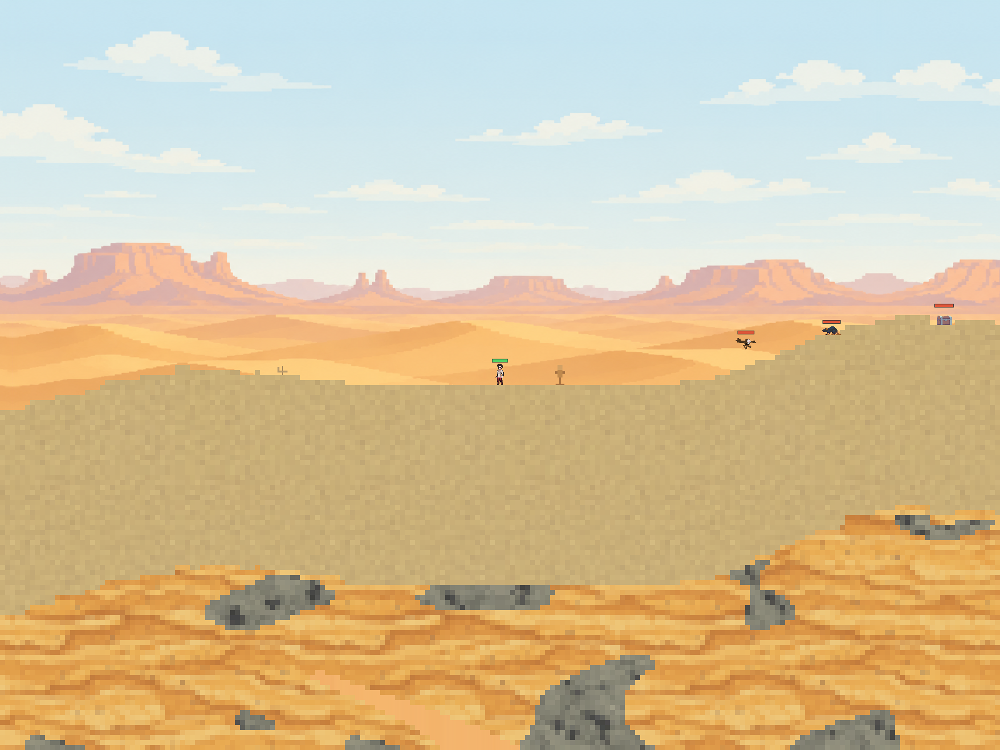

# 世界生态群落

2026-11-10。群落是由世界种子、生成版本与坐标决定的地区基线，统一解释地区地形、植被、生物分布和呈现。当前包含森林、沙漠、雪山；它不等同于运行时天气或风场。

## 所有权与查询

| 领域 | 入口 | 职责 |
|---|---|---|
| Simulation | `World/Environment/WorldBiome` | `BiomeId`、稳定气候采样、连续群落权重；不加载内容文件，不引用角色、图片、音频或 RHI |
| Generation | `BiomeTerrain` / `WorldGenerator` | 共用 `BiomeClimate`，混合地貌、地层、水体和树木；保持 Natural v2 的固定整数算法 |
| Gameplay | `Ecology/BiomePopulation` / `RegionalPopulation` / `GameSession/MonsterSpawning` | 生物适生比例、确定性筛选、安全放置与 Actor 生命周期 |
| Presentation | `CommittedWorldView` / `BiomeFrame` | 从提交的生成设置采样相机地区，输出背景权重和有界装饰几何 |
| Render assets | `ArtAssets.json` / `BackgroundAssets` | 图片路径、视差周期和纹理数组；Draw 只消费冻结帧 |

`World::SampleBiome(CellCoord)` 为世界规则提供查询；`CommittedWorldView::SampleBiome` 使用提交时复制的生成设置，供呈现读取。查询不加载区块、不推进随机数、不激活模拟，也不因开采或角色移动改变。公开输入遵守生成器坐标范围，非法坐标与未知群落立即报错；内部 `BiomeClimate` 允许湖泊、树冠采样进入原生成器预留的4096格安全边距。

`BiomeSample` 的 `Temperature`、`Moisture`、`Uplift` 是有符号 Q16.16 的气候指数，并非摄氏度或实测相对湿度。`ForestWeight`、`DesertWeight`、`SnowWeight` 为非负权重，和恒为 65536；`Biome` 是优势群落。当前为地表群落沿竖直方向延伸的地区，没有独立洞穴群落。

Natural v2 的气候通道、阈值、地层与植被参数保持原值，仍通过既有 golden vector 校验。`GenerationBiome` 和 `GenerationEnvironment` 作为旧诊断接口的别名保留。Flat v1 和 Natural v1 返回 `Regional=false`，保留既有场景分布与森林背景；不把旧世界的未生成区块升级成 v2。气候仍由种子及生成版本恢复；Gameplay自v5起另存地区候选完成记录、活动／休眠Actor和统一身份高水位；当前v6新增[手持物品保存](HandheldItems.md)。旧 Gameplay v1–v4 按固定出生锚点 x=511 标记旧候选，不围绕读档时的玩家坐标重新生成。

## 地区内容

| 群落 | 可交互地形／植被 | 当前前景装饰 | 居民候选适生率 |
|---|---|---|---:|
| 森林 | 丘陵、土和黏土、苔石、林湖、树干与树叶 | 小型草叶与野花 | 100% |
| 沙漠 | 沙丘、厚沙与砂岩、稀少绿洲 | 干燥灌木 | 20% |
| 雪山 | 岩脊、薄雪与浅层冰、无地表液态湖 | 覆雪小石 | 10% |

地形和树木仍是真实材料，归 Simulation；装饰是 Render 拥有的非交互几何，不写材料、不提供资源或碰撞。装饰锚点采用独立的 `biome-decoration-v1` 通道，按 64 格特征网格计算；只有提交视图内支撑完整且上方四格为空气才显示。采空、淹没、未驻留或遮挡会让装饰消失，恢复相同地形可以再次显示。每帧最多 256 个部件并预留内存；F1 不绘制。出生教学区保持净空。

怪物适生率在 `Monsters.json` 的 `Gameplay.BiomeWeights` 中配置，顺序固定为森林、沙漠、雪山，每项为 0～100 的整数。缺省值 `[100,100,100]` 保持旧清单兼容，未知种类、非法比例和不完整数组报错。

| 物种 | 森林 | 沙漠 | 雪山 |
|---|---:|---:|---:|
| mushroom | 100 | 0 | 0 |
| goblin | 80 | 35 | 10 |
| skeleton | 25 | 90 | 70 |
| flying_eye | 35 | 75 | 90 |
| slime | 100 | 0 | 15 |
| rat | 60 | 85 | 15 |
| bat | 65 | 20 | 100 |
| mimic | 25 | 65 | 40 |

候选通过概率是各群落适生率与当地连续权重的加权和。种子、物种与候选锚点决定 `biome-population-v1` 固定哈希，附近避障搜索不重抽概率；每个实际落点重新核验自己的群落。筛选后共用有界地表放置检查，拒绝缺失地形、无支撑、碰撞及已有 Actor 占用，不雕刻地形。当前只有已有的 `Resident` 一种居民，先使用上述地区出现率和简易人物呈现；育圃开发场景不额外放居民。

Natural v2 的地区生态版本为1：每512格一个固定锚点 `511 + region*512`，与物理区块大小无关。怪物清单的相对偏移和两个居民偏移形成候选；身份由绝对锚点、Actor类别及物种键组成，清单重排不会重新解释旧记录。初始化与成功模拟步提交前共用激活入口，相机加载、存档和暂停不会生成生物。

整个±16格避障搜索、身体及支撑范围必须驻留并进入模拟域。缺块、活动容量不足或临时Actor占位时等待；确定不适生或完整地形无落点才记录空候选。成功生成后保留候选与ActorId关联；死亡或显式移除留下墓碑，重访不会补生。

活动Actor仍限制为256个。生态对象完整离开模拟域时保存值状态并释放活动槽，回到驻留模拟域时优先以原ActorId恢复身体、生命和行为状态，再考虑新候选。玩家、木头人不参与生态休眠；装备构式、被运行构式引用、拥有设备或关联知识发现的对象保持原活动槽，直至其依附关系解除。

完成记录和休眠对象各最多16384条，检查点总量上限8MiB；达到记录上限会保留历史并延后新候选，不丢弃死亡记录。此上限是当前存档支持的规模，超大世界仍需要进一步做区域化生态存储；大量被依附关系固定的对象也可能占满活动槽。没有繁殖、迁徙或周期人口补充。

## 背景与后续声音

森林继续使用四层视差图。`ArtAssets.json/Background/Biomes` 配置 `desert` 与 `snow_mountain` 两张独立全景及各自的 `RepeatCells`，两者必须同时提供、尺寸必须与森林图一致。运行时首次加载后共六层共用纹理数组；帧间和切换群落不重新读取或上传图片。

帧首按相机中心世界坐标采样权重，在线性颜色空间混合三个背景，交界没有离散跳图。相机用于当前视景；未来 BGM 应依据玩家所在地区，通过独立的音频呈现配置映射稳定群落键，再以滞回和淡入淡出处理切换，不能由 GPU 背景层数决定。当前没有 BGM 资源或播放逻辑，单张沙漠／雪山全景也尚未拆成多层视差。

新增图片使用内置 image_gen，原图、完整提示词、2560×1440 运行制品及 SHA-256 位于 `RawData/Environment/Biomes`。运行时只读取 `Pixel/Content/Art/BiomeBackgrounds`，可执行 `python3 RawData/Environment/Biomes/install_runtime.py` 校验并恢复。Content PNG 沿用仓库忽略规则，RawData 保留完整制品。

## 环境规则扩展

将来“潮湿地区更难点火”等规则应由执行该动作的 Gameplay／Simulation 规则在目标世界坐标读取气候，明确概率、阈值、资源消耗和成功语义，再在固定步结算。不要从背景颜色、装饰是否可见或相机地区反推规则。湿度若会受天气、积水和场源改变，应新增独立动态环境状态，并定义更新、提交与保存合同，与这里的稳定气候基线叠加。

本轮不修改火焰生成、衰减、水火交互、温度传导或 BGM 切换。

## 验证入口

```sh
cmake -S . -B build-cpu -DAXIOM_BUILD_RUNTIME=OFF
cmake --build build-cpu -j4
ctest --test-dir build-cpu --output-on-failure -j4

cmake --build build --target Pixel Axiom PixelRuntimeSmoke -j4
(cd Pixel && ../build/tests/PixelRuntimeSmoke --biomes-only)
```

`Pixel.Biomes` 检查生成与运行时一致、负／远坐标、旧版本、交界概率、清单校验、三群落真实场景、居民呈现及拆除支撑。`Pixel.Population` 检查三群落探索、暂停／相机不生成、死亡重访、休眠存读、清单重排、累计超过256个对象、缺块／占位／容量重试、依附固定和旧档迁移。`Pixel.Generation` 保留 v1/v2 固定结果、分块裁剪、树冠和公开坐标边界；已有 GenerationSession、Monsters、ArtAssets、TerrainAssets 与 ModuleBoundaries 检查相邻合同。`--biomes-only` 验证新增图片与混合的实际 GPU 像素、镜像边界、地形遮挡、帧槽、相机移动、F1，以及生产自然场景的怪物与背景选择。


## 初次实现验证（审查修复前）

- 默认 CPU 全量 126/126 通过；首轮仅 TerrainAssets 的历史图片总数断言失败，新增两张背景后更新计数并重新构建，全量复测通过。
- `PIXEL_CHUNK_EDGE=64` 的 Release 专项 7/7 通过：Biomes、Generation、GenerationSession、Monsters、ArtAssets、TerrainAssets、ModuleBoundaries。
- Pixel、AET（Axiom）及 PixelRuntimeSmoke 最终构建通过；没有修改本地 Axiom 子模块。
- Apple M5 / MoltenVK 的 `--biomes-only` 通过：沙漠与雪山分别校验 34182 个 PNG 像素，三群落混合校验 38250 个像素；包含线性色彩／透明、镜像边界、地形遮挡、帧槽、相机与 F1。
- 同一 GPU 专项的生产 Natural v2 / seed 42 场景生成 3 个适生怪物，验证真实背景权重、运动、暂停和 F1；`--monster-gameplay-only` 平地回归确认全部 8 个怪物仍可放置和呈现。
- `git diff --check` 与背景制品 SHA-256 恢复脚本通过。工作区原有未提交改动保留，未创建 Git 提交。

GPU 首次沙箱内启动无法连接 macOS 窗口服务，终止该测试进程后在沙箱外完成验证。环境缺少 Vulkan validation layer；未重跑完整 GPU 生命周期、AET 运行或跨平台验证。天气和 BGM 尚未实现。地区生态生命周期由后续审查修复接入，修复验证另列。

实际沙漠场景（seed 42，生产呈现路径）：



## 审查修复验证（2026-11-10）

- Astra ultra 的 F1（只有出生场景生物）与 F2（内部采样误用公开边界）已修复。第二轮独立复核没有未解决意见，并实际重跑正负边界及128格Flat v1新旧放置对照。
- 默认CPU最终全量127/127通过。新增 `Pixel.Population` 累计探索275个Actor后仍可生成新地区对象，并验证三群落、暂停／相机、死亡墓碑、休眠状态、磁盘存读、清单重排、部分加载／占位／容量延迟、依附固定及旧档迁移。
- 64格Release专项10/10通过：Population、Biomes、Generation、GenerationSession、Monsters、Checkpoint、ArtAssets、TerrainAssets、WorldUnits、ModuleBoundaries。
- 最终Pixel、AET（Axiom）、PixelRuntimeSmoke构建通过。Apple M5/MoltenVK的 `--biomes-only` 通过106614个背景采样及真实Natural v2场景的3个适生怪物、运动、暂停和F1验证；`--monster-gameplay-only`确认平地8个怪物及相同呈现合同。
- 首轮全量出现旧格式DTO编解码往返失败，修复待迁移标记后全量复测通过；审查期间发现的128格旧场景放置回归也已修复并纳入测试。Vulkan validation layer缺失；未验证长时间高负载或16384条上限规模存档。没有修改Axiom子模块，也未创建Git提交。
