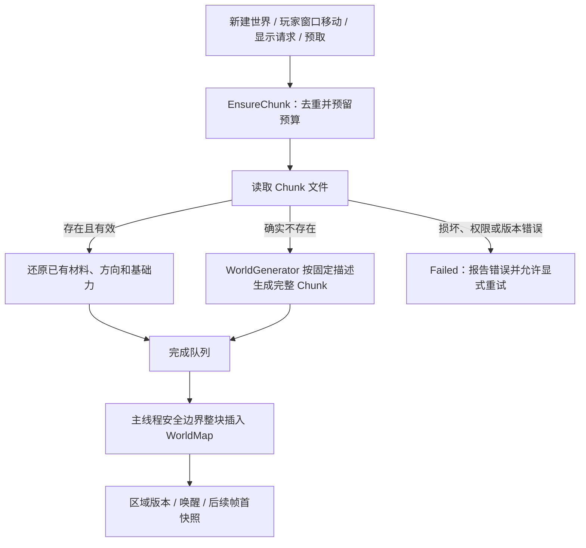

# 分块程序化世界生成方案

日期：2026-10-20。状态：已评审的设计基线，实现已落地。当前策略接口、固定参数、使用方法与验证入口以 [世界生成与自然材质实现](WorldGenerationImplementation.md) 和其中引用的Version1合同为准。本文保留实现前调查及建议，不能将历史验证状态当作当前结果。

本文将“多个柏林噪声分别生成地形、空洞和矿物，最后叠加草地”的想法细化为可实施的生成契约，并纳入地表湖泊与地下积水。目标是新建世界和探索新区域共用同一生成器，每次完整生成一个 Chunk，并保留已有存档、材料模拟及帧首发布规则。

## 1. 方案结论与范围

推荐采用 **固定世界描述 + 全局坐标采样 + 有序生成阶段 + 整块提交**：

1. 创建世界时确定种子、生成器版本、参数和出生点规则，之后保持不变。
2. 加载一个 Chunk 时先尝试读取存档；只有文件确实不存在才调用生成器。
3. 依次执行地表与湖盆规划、土层/岩层、洞穴、矿物、水体填充、地表覆盖和最终校验；全过程只修改尚未发布的 Chunk。
4. 所有噪声按世界坐标采样，同一用途使用稳定且独立的子种子。Chunk 只划分存储和工作，不划分噪声空间。
5. 最后在主线程安全边界一次插入 WorldMap；不向物理或表现层暴露中间阶段。

首版实现起伏地表、固定土层与岩石、地下洞穴、煤/铜/铁/钨/金五类矿石、有限地表湖泊、封闭洞穴积水，以及一格厚草皮。继续保留可下落的旧 Dirt。河流流域、海洋、泉源补水、潮汐、蒸发与水汽、侵蚀、地层坍塌、树木、建筑、大型跨块结构、生物群系、保证连通的地下道路和草地自然生长列为后续扩展。

水体先生成可蓄水的几何，再填入有限水量。噪声控制湿润分区、候选密度和湖盆细节，不能直接把全图某高度以下的Air改成Water。生成负责初始状态；真实游戏启用水体前必须完成第7.1节最小液体接入，未完成时只做离线生成预览。

这是一份后续实现的工程方案，参数是调试起点，不代表已经验证的视觉或性能效果。无需修改 Axiom 引擎，也不改变物理 Chunk 的默认尺寸。

## 2. 现状与真实接入点

以下以本次读取的工作区代码为准：

| 当前事实 | 代码入口 | 对方案的约束 |
|---|---|---|
| Chunk 默认 1024×1024，Region 为 64×64，14 MiB/Chunk | `WorldStorageConfig.h`、`WorldMap.h` | 生成/保存/发布单位仍为 Chunk；内部可按行或 Region 运算 |
| `WorldChunk::Initialize(surface)` 在固定 y 以下填 Dirt，基础力为 `(0,3600)` | `WorldMap.cpp` | 从容器初始化中分离地形规则；保留初始化全部载荷列的职责 |
| 后台 `ReadChunk` 文件不存在时调用 `Initialize(surface)` | `WorldStreamer.cpp` | 这是统一生成入口的替换点；读取失败不等于文件缺失 |
| `Update` 请求模拟窗口、显示窗口和低优先级预取环；单 worker，通常最多两个 pending 请求 | `WorldStreamer.cpp` | 不必另外编写“碰到地图边缘造地图”逻辑；已有请求机制就是无限延伸触发器 |
| `EnableStreaming` 立即加载从 `(0,0)` 开始的初始窗口 | `World.cpp` | 必须先准备生成描述和出生位置，再加载正确的初始窗口 |
| 出生位置及风边界仍来自固定 512/424 | `GameSession.cpp` | 起伏地形需要新的出生规则；原风边界不能继续宣称离地表恒定88格 |
| 仅定义 Air=0、Dirt=10，只有 Dirt 被材料模拟移动 | `CellType.h`、`Environment.cpp` | 矿石/固定地层必须成为正式材料，不能仅借用未知ID的偶然静止行为 |
| 当前碰撞把非Air都视为障碍，`CommitMaterialMoves`的目标写死为Dirt | `Character.cpp`、`WorldMap.cpp` | Water不能只新增枚举；需区分液体与角色固体，并修正移动提交的材料类型契约 |
| 右键对应 `TryRemoveDirt`，只允许移除 Dirt | `World.cpp`、Input | 新地层接入必须同时补通开采入口，否则地下内容不可访问 |
| 未注册材料的表现映射会抛异常 | `PixelWorldPresentation.cpp` | 新材料的CPU定义、开采和表现映射必须同时齐备 |
| metadata v2、Chunk 文件 v1；尚无地形种子/版本 | `GameSession.cpp`、`WorldStreamer.cpp` | 先扩展世界描述与兼容策略，再启用自然地形 |
| 新生成块目前 `Dirty=false`，可在没有编辑时卸载后再生成 | `WorldMap.h`、`WorldStreamer.cpp` | 确定性是正确性要求；不得靠首次生成顺序或时钟决定内容 |

当前规则和已验证范围见 [世界表示约定](../../Docs/WorldRepresentation.md) 与 [验证报告](../../Docs/WorldRepresentationValidation.md)。它们描述现有实现；本文的新增接口、材料和格式均是提案。

## 3. 两类初始化与统一生命周期

### 3.1 世界初始化：每个新世界一次

`GameSession` 建立不可变 `WorldGenerationDescriptor`，至少包含：

| 字段 | 用途 |
|---|---|
| `WorldSeed : uint64` | 用户显式输入时复现；未输入时创建一次并持久化，不能每块重新取随机数 |
| `GeneratorId / GeneratorVersion` | 如 `flat/0`、`natural/1`，锁定算法、阶段顺序及数学语义 |
| `NoiseVersion / MaterialSchemaVersion` | 固定噪声实现、标签、梯度规则和材料ID解释 |
| `Parameters` | 完整规范化参数副本：高度、土层、洞穴、矿物、湖盆/地下积水、草皮及出生区规则 |
| `WaterGenerationSettings` | 湖泊与地下水的独立标签、特征网格、尺寸/水位/容量上限、封闭性规则及出生区排除范围；包含在Parameters及摘要中 |
| `DescriptorHash` | 对规范化字段的稳定摘要，用于一致性检查；不能替代完整参数 |
| `ChunkEdge` | 存储兼容性约束；不得用它缩放噪声特征尺寸 |
| `SpawnDescriptor` | 出生锚点、平台高度、平坦区/过渡区及净空范围 |

`WorldId` 与 seed 分离：相同种子可创建两个独立存档。生成器不得读取墙钟、全局随机数、玩家位置、相机、当前风、已有 Chunk 内容或线程执行顺序。

新建/R重置流程：

1. 旧世界按原有契约成功保存后，准备新目录和新描述。
2. 计算出生描述，冻结参数，验证材料定义、参数范围和生成工作集预算。
3. 将新描述安全写入新世界 metadata；启动持有该描述快照的 Streamer。
4. 以出生点为中心请求初始模拟窗口，等待所需整块完成，验证人物碰撞盒净空及脚下支撑。
5. 初始化人物、风和暂停状态，保存初始会话，最后切换 `current.txt`。失败则不把半初始化目录设为当前世界。

重置过程有明确的 `Preparing → Active / Failed` 状态。步骤1保存成功后保留旧世界目录与完整恢复信息；进入Preparing后暂停模拟、编辑和普通/退出自动保存，只有初始化流程可以显式保存候选世界。当前 `EnableStreaming` 会清空旧Map，所以不能只保留旧 `current.txt` 就宣称回滚完成。候选目录、描述及World始终作为同一初始化上下文使用；候选初始化/保存成功并切换current后，在主线程无异常提交点一起成为Active。

切换current前任一步骤失败，终止候选worker、释放其结果及预算，从已保存的旧世界目录显式恢复World、描述、目录、人物与时钟，成功后再允许模拟及保存；无需同时保留两个完整驻留世界。恢复本身失败时进入Failed，禁止模拟、编辑及任何自动保存，展示错误并提供显式重试，绝不能把候选世界内容写入旧目录。首次启动没有旧世界时直接进入Failed。此处规定的是普通异常恢复，不增加跨文件崩溃事务承诺。

`EnableStreaming` 应接收初始窗口或初始位置，取消必须先生成 `(0,0)` 窗口的前提。有限 `World(width,height)` 和现有平坦测试夹具保留，显式选择 `flat/0`；不要让原有物理测试因默认自然地形改变含义。

### 3.2 Chunk 初始化：每个没有文件的块一次工作



玩家接近驻留区域边缘时，沿用当前窗口重定位与预取；不是移动到最后一列后才同步生成。加载已有块仅反序列化，不能再执行洞穴、矿物、补水或草皮阶段。重试缺失块使用同一描述；重试损坏文件不能退化为重新生成。

外部状态可继续使用 `Loading` 覆盖读取和生成，内部另记阶段与耗时供诊断。`Pending` 必须覆盖排队、运行和等待提交，保证同坐标没有重复任务。重置世界时先结束/丢弃旧 worker 结果；即使未来使用共享任务池，也必须按世界身份及描述摘要拒绝过期结果。

## 4. 坐标、噪声与确定性

### 4.1 坐标契约

正Y向下。格子坐标是 `int64`；所有生成阶段统一在格中心采样。设地表/湖床首个固体格为 `H(x)`，深度 `d=y-H(x)`：`d<0` 是待填的非固体空间，初始为空气，指定水域在G5填水；`d=0` 为地表或湖床，正值向地下增加。水位 `L` 是最上层Water格的整数Y；地表湖水占据 `L<=y<H(x)`，地下水则占据G5验证的地下空腔分量。不能因Y向下而把不等号写反。

局部格转换为世界格必须使用受检整数运算：

```text
world = chunkCoord * ChunkEdge + localCoord
chunkCoord = floorDivide(world, ChunkEdge)
localCoord ∈ [0, ChunkEdge)
```

相邻块采样同一条连续函数。禁止给每个 Chunk 单独随机 seed，禁止把 localX/localY 当作世界噪声坐标，禁止按 Chunk 做 min-max 归一化或根据每块统计结果调阈值。

### 4.2 首版数值实现

采用有固定梯度表和五次平滑插值的二维梯度 Perlin 噪声；高度使用其一维截面。经典插值形式参考 [Ken Perlin 的参考实现](https://cs.nyu.edu/~perlin/noise/) 和 [作者对 Improved Noise 的说明](https://developer.nvidia.com/gpugems/gpugems/part-i-natural-effects/chapter-5-implementing-improved-perlin-noise)。下述种子、坐标和定点约束属于本项目设计，不是直接复制该参考实现。

首版做以下取舍：

- 梯度由 `StableHash64(seed, channelTag, octave, latticeX, latticeY)` 选出；规定输入字节序、无符号模2^64算术和常量。不能依赖 `std::hash`、标准库随机分布实现或256格置换表循环，避免版本差异及显眼的短周期重复。
- 全局坐标先做整数商/余数，再将有限局部余量转成定点数。首版每个octave的尺度限制为 `[8,16384]` 内的2的幂，保留格中心的半格偏移；该上限保证半格偏移可在Q16.16中精确表达，超范围拒绝配置。远处也不执行 `double(worldX)*frequency`。
- 噪声值、插值、fBm叠加及阈值统一用有符号 Q16.16；乘积用64位中间值，乘法后明确向负无穷除以65536，不依赖负数右移。五次 fade 为 `6t^5-15t^4+10t^3`，按指定次序逐次定点乘法；固定整数梯度、归一化系数和范围裁剪，使输出严格位于 `[-1,1]`。
- 全部中间值上下界、舍入顺序及合法参数在实现阶段作为 `NoiseVersion=1` 的规范与 golden vectors 固定。不能只写“使用double基本一致”；若跨平台 golden vectors 尚未通过，自然生成器不得作为兼容版本发布。
- 各 octave 用稳定标签派生种子，频率倍增、幅值递减。参数文件以整数或精确定点分子保存，禁止把十进制解析差异带入阈值判断。
- 第一版不加入 domain warp，避免在大坐标与性能尚未验证时扩大复杂度。后续若加扰动，用整数格点加有界局部偏移，不能把巨大绝对坐标相加成一个浮点数。

例如每层 `seed_i=Hash(WorldSeed, "terrain-height-v1")`。新增矿物应有自己的持久标签，不从共享PRNG顺序取种子，从而不影响既有矿种的噪声场；矿物之间的覆盖竞争仍属于生成版本变化。

同一描述、同一世界范围在串行/并行、逆序生成、不同加载路线及不同内部tile切分下得到逐格相同的材料、方向和基础力。可比较不同 ChunkEdge 下的公共区域生成结果，但两个尺寸的存档仍不能互读。模拟推进后的世界不承诺与未模拟基底相同。

## 5. 生成流水线

所有空间尺度均以“物理格”为单位，与纹理像素和 ChunkEdge 无关。以下范围用于小规模离线调参，最终数值随描述冻结。

### G0：准备与参数验证

校验坐标范围、参数上下界、噪声版本、完整材料注册和工作集上界。分配唯一输出载荷，方向统一初始化为 `(0,1)`，基础力统一为 `(0,3600)`。这两列属于空间，不跟随材料搬迁；不要把岩石格的重力清零来阻止下落。

按列计算高度 `H(x)`、土层厚度 `T(x)`，并准备相邻列所需的窄边带；生成器只访问自身描述及纯采样函数。

### G1：地表轮廓

建议高度由不同尺度的低频与细节场相加：

```text
Hraw(x) = 512 + round(48*Nheight0(x/1024)
                    +12*Nheight1(x/256)
                     +4*Nheight2(x/64))
Hdry(x) = ApplySpawnPlateau(Hraw, SpawnDescriptor, x)
H(x) = ApplyLakeBasins(Hdry, LakePlans, x)
```

公式中的除法只是数学表示，实现遵循第4节整数拆分；`round` 明确定义为 `floor(value+0.5)`。`Hraw/Hdry` 范围为 `[448,576]`，出生区只在该范围内插值；湖盆只降低地表（增大Y），首版最大下切24格，因此最终H的保守范围为 `[448,600]`。若改变这些限制，需同步重算风边界和出生校验。

多个低频场建立山谷/丘陵，较高频场只做轻微轮廓变化。不要逐格白噪声抖动地表。首版使用单值高度场，因此没有天然地表悬挑；地下洞穴提供复杂空间。地形能否跳跃跨越需结合当前2×4角色验证，不能仅看缩略图。

#### G1a：有限湖盆规划

湖泊不能等矿物生成后才随机挖坑。G1先规划湖盆并修改最终H，G2按最终H生成土壤与岩石，G3保留湖底隔水层，G5最后填水。湖面本身水平，不随噪声起伏；水波只是表现。

首版每个512格宽的**世界特征区间**最多一个湖泊候选：`featureX=floorDivide(worldX-256,512)`，区间原点的256格偏移固定在生成版本中。用独立 `lake-placement-v1` 标签确定候选中心（区间中心偏移不超过64格）、半宽16～64格和目标深度2～8格；再用尺度2048的湿润噪声门控是否启用。包含保护边带的支撑区必须完全落在特征区间内，因此相邻候选不相交。该区间与物理Chunk无关；固定偏移避免支撑区总被锁在1024格Chunk内部，湖泊可以跨64或1024格Chunk边界。

候选接受条件和构造：

1. 整个支撑区不与出生平台及其过渡带再扩展64格的干燥区相交；只依据冻结的出生描述判断。
2. 取左右边岸 `a=c-r, b=c+r`，按完整区间的Hdry检查两岸高度差不超过8格、区间起伏不超过12格；不满足就放弃候选，不能逐块选择不同的替代位置。
3. 设 `L=max(Hdry(a),Hdry(b))+1`，使两岸固体至少高出水面一格。在 `[a,b]` 内使用固定定点平滑权重 `w(x)`，端点为0、中心为1，向下刻出盆形：`H(x)=Hdry(x)+round(w(x)*max(0,L+D(x)-Hdry(x)))`；端点保持Hdry，`D(x)`由低幅噪声调节并限制在2～8格。区间外H不变。
4. 校验所有列下切量不超过24格、水深不超过8格，`{x | H(x)>L}`构成唯一非空连续区间，且包含至少8列；否则整湖拒绝。水域由 `L<=y<H(x)` 唯一定义，不另掷逐格随机数。该限制使湖水底部全部有支撑，也避免每个Chunk生成不一致的小岛和水位。
5. 按整个水域外包矩形向左右及底部扩展8格生成 `LakeSolidProtection`。G3在其中不得雕刻原有固体，但不把原本的Air补成岩石；这保证起始湖盆不会被后续洞穴打通。玩家以后开采湖底时不再保护或修补。

规划只读取Hdry及有界噪声，不读取G3或驻留地图；有界校验失败就没有该湖，不能因当前Chunk仅看见一部分水域而接受。暂不模拟真实汇水面积与河流入流，也不保证每个特征区间都有湖。

### G2：土层与岩层

`T(x)=clamp(18+round(6*Nsoil(x/256)),12,24)`。

| 条件 | 初始材料 |
|---|---|
| `d<0` | Air（G5可在指定范围填水） |
| `0<=d<T(x)` | 固定地层土 `GroundSoil` |
| `d>=T(x)` | Stone |

首版地层不使用动态 Dirt 填充全部地下。泥土、草皮和岩石必须有明确的固定/可移动属性，见第7节。粘土夹层、沙土和气候分类等可以以后添加独立场及宿主条件，不因已有美术素材就立即引入未设计的物理行为。

### G3：洞穴雕刻

用两个独立场分别控制洞室与通道，并用低频门控场降低遍地蜂窝的感觉：

```text
chamber = NcaveRoom(x/128, y/128) > roomThreshold(d)
tunnel  = abs(NcaveTunnel(x/256, y/64)) < tunnelWidth(d)
          && NcaveGate(x/512, y/512) > gateThreshold
carve   = d>=48 && !LakeSolidProtection(x,y) && (chamber || tunnel)
```

首版尺度均为二次幂，**规范化后保存的实际值才是生成依据**。配置若不满足限制应拒绝，不能由运行时默默取整。

建议初始 `roomThreshold=0.45`、`tunnelWidth=0.06`、`gateThreshold=0.0`，通过规定的十进制定点转码形成实际常量。`d=48..96` 之间平滑减弱雕刻，`d>=96` 使用常量；判定前仍强制 `d>=48`，确保地表与土层下存在完整岩层顶板。深度曲线先用有界深度区间计算，避免巨大深度进入乘法。

只把 G2 的 Stone 改成 Air，其他列和基础力不变。首版没有洞穴突破地表；玩家通过开采进入。噪声洞穴不能保证全图连通、每个 Chunk 有洞、入口可达或通道适合角色通行；这些若成为玩法需求，应加入有界洞口/通道特征，不以阈值微调冒充连通保证。

不要按 Chunk 独立 flood fill、删除小连通区或对边缘强制封口。这些操作会改变跨块洞穴。后续局部滤波需明确有限依赖半径，并以全球坐标重复采样；无法有界的全局连通处理不得塞进单块生成器。

### G4：矿物替换

矿物在洞穴之后生成，只替换仍存在的 Stone，不填回洞穴，不替换草土或空气。每种矿物独立定义深度、矿区场和矿簇场：

```text
candidate_i = d>=minDepth_i
              && NoreRegion_i(x/512,y/512)>regionThreshold_i
              && NoreCluster_i(x/scaleX_i,y/scaleY_i)>clusterThreshold_i(d)
```

大尺度场控制“哪些地方富矿”，中尺度场形成连片矿簇；不能用每格随机概率替换而形成椒盐点。拉开X/Y尺度可产生方向性矿脉。深度按当前列地表计算，首版不设最大深度；进入更深处后阈值保持有限常量。

| 矿种 | 起始深度建议 | 簇尺度X/Y建议 | 相对分布目标 |
|---|---:|---|---|
| CoalOre | 40 | 32/16 | 浅层较常见、矿簇较大 |
| CopperOre | 80 | 32/16 | 浅中层 |
| IronOre | 160 | 32/32 | 中层 |
| TungstenOre | 384 | 16/32 | 深层较稀疏 |
| GoldOre | 320 | 16/16 | 深层最稀疏 |

具体门槛先经多seed统计确定；Perlin数值不是均匀概率，阈值0.8不能解释为20%产率。统计应按“该深度仍可替换的Stone”作为分母，并报告最终竞争后的各矿种占比及簇尺寸。

同一格多矿种命中时，显式优先级 `Gold > Tungsten > Iron > Copper > Coal`，只写一次。优先级是首版玩法选择，不依赖容器遍历顺序；版本更新时不得悄悄改变。矿脉跨块自然连续，但不保证每块都有矿；若以后要求出生区保底资源，采用描述中有界、确定的保底特征，而不是重掷整个 Chunk。

### G5：水体填充

G5只把已确定空腔中的Air替换为Water，不改写固体、矿物、空间方向或基础力。首版采用**一格一份水、没有无限水源**的体素表示；湖泊与地下水都生成有限初始水量。`WaterBodyId=Hash(WorldSeed,typeTag,featureCoord)`用于规划缓存和诊断，不需要每格额外存一个ID。

| 水体 | 几何来源 | 水位 | 初始范围 |
|---|---|---|---|
| 地表湖泊/池塘 | G1a的有界湖盆 | 每湖固定整数L | 计划中的 `L<=y<H(x)` 且G4仍为Air |
| 地下积水 | G3洞穴中通过封闭性检查的有限低洼连通区 | 每候选固定整数L | 从确定种子出发、位于水位以下且完整封闭的Air分量 |

地下积水不采用“所有洞穴低于某高度都灌水”的全局地下水位。首版使用原点偏移为 `(256,256)` 的512×512世界特征网格，每格最多一个候选；`groundwater-placement-v1`与低频湿润场决定候选位置和启用情况。检查窗口最大128×128，连同一格查询边带必须位于本特征格内，相邻候选窗口不重叠。候选顶部水位L须在窗口各列最终H以下至少96格；不满足则跳过。

对每个候选，按固定顺序执行一次有界检查：

1. 取完整窗口 `B=[x0,x0+W)×[L,L+Q)`，`W,Q<=128`，仅从 `SampleBaseMaterial(...,through=G4)`查询Air/固体，不能把未知驻留区域当墙。
2. 在窗口中心列自底向上寻找首个Air为种子；没有则拒绝。使用**四邻接**，只遍历B内 `y>=L` 的Air，求出该种子分量C。
3. C触及左右边界列或底边行就拒绝整个候选，不截断水体、不补人工墙。顶边 `y=L`允许接触，但必须至少有一格与 `y=L-1` 的Air相邻，且体积至少32格；否则拒绝。这样初始水体有自由表面，下面及两侧不会通过同高度或更低位置漏出检查范围。
4. 检查图必须与第7.1节的四邻接液体传输一致；若未来允许穿对角角隙、上行压力或跨格流动，要同步改变封闭性规则和生成版本，不能沿用此证明。
5. 验证通过才将完整C作为水体掩码，每个物理Chunk只写其交集。规划需要临时访问窗外纯基底，不要求实际加载那些Chunk。窗口超界或工作量上限无法满足时显式拒绝参数/候选，不能留下半个水体。

所有水体计划及验证都针对未编辑的程序化基底。地表水、地下水的深度与保护范围相互分离；首版候选支撑区不交叠，因此无需靠生成先后来裁决不同水位。若后续放开重叠，必须先定义统一合并/拒绝规则，不能用“后生成覆盖前生成”。

同一湖泊或地下水体跨块时，两个Chunk重复计算同一计划和完整验证结论，得到同一L与掩码。载入已经被玩家排空的块直接恢复文件；不得因为旁边新块刚生成了水就把旧块补满。

```text
G1a 计划湖盆并修正H
  → G2 固体地层 → G3 洞穴（保留初始湖底）→ G4 矿物
  → G5 水体规划验证与Air填充 → G6 干燥地表草皮 → G7 整块校验提交
```

### G6：地表覆盖

首版草皮只覆盖 G1 确定的天然最上层：

```text
if y==H(x)
   && BaseMaterialAfterG5(x,y)==GroundSoil
   && BaseMaterialAfterG5(x,y-1)==Air:
    material = GrassSoil
```

草皮为一个实体格的材料变体，替换顶层 GroundSoil，不在上方额外堆一格实体。首版不在洞底、洞顶、被水覆盖的湖床、任意空气相邻面或新开采面自动长草；`y==H(x)` 是天然地表约束，不能仅靠“上方为空气”判断。干燥岸边仍可长草；湖床保留GroundSoil，沙岸/淤泥/水草留作后续材料扩展。

`BaseMaterialAfterG5` 是不读取驻留世界的纯查询，包含已经验证的水体计划。块上边缘需要查询上一个块时，对全球坐标评估同一基底函数，不触发邻块加载。水体有界检查按计划缓存，不能每查询一格草皮就重复flood fill；后续若加入洞口，查询必须纳入所有主体阶段。

“主体后叠加”指阶段顺序，不要求新增一份覆盖层数组。首版用 `GrassSoil` ID 避免改变14字节/格载荷；若以后同格叠加雪、苔藓和植物，再设计独立状态与持久化格式。

草皮是初始生成结果。玩家盖住草皮时，表现层可按快照邻域隐藏顶面装饰，缺失邻域保持保守显示；不在本轮引入草地死亡/扩散模拟，也不把地下新挖出的土自动改为草。任何后续材料转换均通过WorldMap更新版本并标脏。

### G7：校验与提交准备

确认全部材料已注册，载荷列初始化完整，坐标和数量合法；统计各Region非空气数，初始化活动/版本元数据，生成阶段计时与材料计数。只调用一次完整 `Recount` 或在填充过程中累加等价统计。

完成后交由主线程 `WorldMap::Insert` 统一分配区域版本、重建索引并唤醒邻域。未插入的候选块失败时丢弃，禁止把半成品放入Map。不得对每格使用公开 `SetCell` 触发百万次索引更新。

新生成且未经编辑的完整基底允许保持 `Dirty=false`，没有文件时可确定重建；后续任何编辑、材料移动和基础力改变继续标脏。载入已有文件时不再执行生成校验以外的内容改写。

## 6. 跨块依赖与未来结构

首版干燥地形、岩层、洞穴和矿物使用点/列采样，草皮查询上方一格及包含水体计划的基底；湖泊与地下积水额外使用G1a/G5规定的有界特征检查。水体所需范围不能用一格halo替代，但仍只查询全球纯基底，不访问驻留邻块。不能为了生成A而同步等待B完成，否则首次加载或双向邻块会死锁。

未来树木、洞口或遗迹使用独立的世界特征网格，不能直接以物理 Chunk 为随机单位：

1. 用特征网格整数坐标和稳定类型标签确定锚点、尺寸和方向，规定最大影响半径R。
2. 每个 Chunk 枚举与其范围扩展R后相交的所有锚点；从冻结的前置阶段验证放置条件。
3. 仅写特征与本 Chunk 的交集，不向已加载邻块补写。
4. 冲突按固定阶段优先级、特征ID、锚点顺序裁决；每个Chunk计算相同结论。

R和候选上限必须进入配置验证和预算；超过上限拒绝描述。大型全局连通图与不限长度的递归生长属于另一类生成任务，不能承诺用一个格子的halo解决。

## 7. 材料行为、开采与表现

直接给当前 Dirt 地下挖洞，会使洞顶沿基础重力落入空洞。把基础力设为零也不合适：力属于空间，后续落入该处的泥土同样失重。因此首版明确采用固定地层，保留松散材料玩法：

| 材料 | 固体碰撞 | 材料步移动 | 初始来源 |
|---|---|---|---|
| Air（已有0） | 否 | 否 | 地表上方、洞穴 |
| Dirt（已有10） | 是 | 是，保留现行规则 | 玩家放置/原平坦世界 |
| GroundSoil（新增） | 是 | 否 | 固结土层 |
| GrassSoil（新增） | 是 | 否 | 顶层覆草土 |
| Stone、五种Ore（新增） | 是 | 否 | 岩层与矿物 |
| Water（新增） | 不阻挡角色；占据材料格 | 是，独立液体规则 | 有限湖泊、通过检查的地下积水 |

新增稳定ID不得复用0/10。把材料相态、角色碰撞、可移动、可开采及风场遮挡分别定义为 `CellInfo` 的语义属性，完整注册每一类；保持材料ID与纹理索引分离。Water说明“非Air”“角色固体”“风场障碍”不能再共用一个布尔判断。固定地层可以开采，不自动塌落。大规模挖空后悬空地层在首版允许存在，后续若实现坍塌，应引入独立结构稳定性规则。

缺失/未就绪区域不是一种材料。当前 `WorldMapView::AtLocal/AtIndex` 以 `UINT32_MAX` 作为缺失占位；迁移到材料属性时，应先通过 `TryAtLocal`/驻留状态或显式占位分支处理不可用格，对碰撞和数值几何继续按障碍处理，再对真实材料调用 `GetCellInfo`。占位值不能进入材料注册查询、生成输出或存档；未知的真实存档ID仍应报错，不能与“暂未加载”混为一类。

右键开采需要统一 `TryRemoveMaterial` 或等价语义入口，按材料可开采属性判断；Water不可直接作为矿块删除，调试清除水使用显式工具操作并标脏。保留旧 `TryRemoveDirt` 兼容包装的原语义；现有输入改用新入口。首版只移除可开采格子，不顺带实现掉落物、背包、开采时长或工具等级。左键继续放置旧Dirt，首版不允许直接覆盖Water以免无声删除水量。

各风后端需要按语义分别处理“静态固体遮挡/阻力”和“动态Dirt运动反馈”。当前Coarse实现的阻力扫描有Dirt专用分支，不能只加枚举就认为全部风策略已经支持岩石。保留旧Dirt耦合，补测静态地层影响；World仍不包含纹理、RHI或shader类型。

表现层为每个新增ID提供明确映射，初期纯色也可用于验证。现有 [自然材质素材](../../ArtRaw/Materials/NaturalBlocks/README.md) 是候选外观，尚未成为物理材料。64/256像素图片尺寸与物理格尺度无关；草皮贴图只用于表面表现，不能整张逐格铺满地下。世界坐标连续UV、顶面遮罩和边缘变体属于Pixel表现层后续工作。

### 7.1 水体启用前的最小运行时契约

本节限定生成结果接入游戏的必要行为，不把完整流体求解器混进WorldGenerator：

- **有限水量**：一格Water是一份固定体积，Air与Water互斥；不存连续压力、速度或半格水量。液体步只在驻留模拟窗口中进行，暂停和窗口外冻结，初始生成后不调用生成器补水。
- **传输图**：首版仅四邻接，优先向下，其次受液面差规则约束横向扩散；禁止上行、跳格或穿对角角隙。横向平衡的具体势差和休眠策略需在液体模块中固定并验证，不能每步无条件左右摇摆。未完成该行为及验证前，自然水域不得默认启用到游戏中。
- **提交与守恒**：Water只申请步首Air，同目标按稳定源坐标裁决；与Dirt共享目标冲突处理，统一批量提交。当前 `WorldMap::CommitMaterialMoves` 把目标写死为Dirt，需要携带并验证步首材料类型，使提交保留源类型；空间方向/基础力不搬迁。没有显式编辑时Water数量严格守恒，Dirt先不与Water交换或沉降，不能因扩展了移动类型而改变旧Dirt规则。
- **液体不借用风力移动**：基础力列仍按空间保存，Water的首版下落/横向规则由液体模块执行；Dirt保持原有基础力与风耦合。水面波动、风生流与两相动量交换留待后续。
- **角色与风分离**：角色不把Water当墙，但需要识别浸水比例并提供最小浮力/阻尼和上浮控制，以便进出深水；首版无溺水伤害。风域可将Water作为不可进入的液体边界，不能沿用角色的非固体属性让空气求解穿入水中，也不把它作为Dirt运动回馈。
- **已加载边界**：未加载/未模拟区域继续封闭，不推送水到不可用格、不扣除源水量。相邻块接纳后唤醒交界一格及关联Region，让现有水继续流动；逐格流动会改变两个块的版本和Dirty。液体模拟结果允许受冻结窗口历史影响，只承诺初始基底不受生成路线影响。
- **视觉**：水顶面只在Water上方是Air时绘制，缺失邻域使用保守状态；材质连续采样或轻微波纹不改变真实水位。透明度、颜色与水面shader属于Pixel表现层，不能把背景图上的水当作世界Water。

湖床被开采后水可排入新通道；若目标Chunk未加载则等待。水离开后湖床不自动长草，也不会被G1a的初始隔水规则重新封堵。首次启用前必须跑水量守恒、静水休眠、边界唤醒、玩家入水与上浮回归。

## 8. 出生点、风与玩家体验

首版保留水平锚点 `x=512` 附近出生，在描述中固化一个小平台：

- 采样锚点原始高度作为平台高度；中心左右16格平坦，之后64格用固定平滑权重过渡至原始地形，边界属于全局生成公式。
- 平台内人物2×4碰撞盒上方至少8格净空，脚下至少4格固定支撑；洞穴已有48格保护深度。湖泊支撑区避开平台及过渡带再扩展64格，地下水位至少深96格；净空校验要求Air，不能仅以“非角色固体”接受Water。平台范围跨Chunk时仍由各块独立求同一结果。
- 角色水平原点为平台中心减半宽，垂直原点为平台高度减角色高。运行前等待碰撞盒及相邻落脚格所在块完成。
- 对候选生成后再做一次实际净空/支撑检查。违反则新建失败并报告描述问题，不在主线程随机挖洞修补，否则加载顺序会影响基底。
- 从存档恢复时保留存下的人物位置与修改，不能再执行平台整平或出生清场。未来“人物卡在玩家建筑中”的脱困应是独立玩法策略。

首版风仍用当前水平矩形域，并默认Empty。按本例 `Hmin=448`，新自然世界默认 `WindBoundaryY=Hmin-88=360`，确保地表上方至少88格无风；山谷处距离会更大。旧世界保留其存下的边界（默认424）。这意味着自然世界的近地风暂未跟随起伏地表。

真正随地形变化的风域/高度遮罩属于后续风系统改造。若用户手动提高风边界，固体遮挡仍必须正确，不能依赖默认无风带掩盖材料接入缺失。

## 9. 存档与版本策略

### 9.1 生成参数是世界身份的一部分

建议 metadata v3 加入完整生成描述；窗口大小、内存预算等运行参数仍可覆盖，但不能覆盖旧世界的seed、生成版本、矿物阈值、水体开关/水位规则或出生规则。修改这些参数创建新世界，避免新旧块边界突变。本方案尚未发布生成器，水体纳入首次冻结的natural/1；若已有实验存档使用旧natural描述，不能复用原版本强行接入水体，应使用新的生成版本/世界目录。

已有 `world.meta v2` 映射到兼容 `flat/0`，缺失块继续使用公开版本的 `SurfaceY=512`、Air/Dirt及原基础力规则，不能在加载时无提示升级为自然地形。当前v2没有保存SurfaceY；非标准工具创建的自定义平面存档无法自动推断其值，需显式迁移配置，不能声称可无损恢复未保存的数据。

保存已有v2世界时，可在完整解析及校验后原子写为v3并持久化 `flat/0`；不重写其Chunk内容。测试夹具显式使用flat配置，新增自然世界测试独立创建。

### 9.2 内容优先与格式演进

对于已存在块，文件内容就是权威状态。开采、放置和模拟产生的结果原样恢复；不能根据当前生成参数“修复”材料，也不能在加载后重新涂草或补水。旧flat/0世界不加入湖盆、地下水或液体填充。

首版继续完整Chunk保存，不立即引入“基底+增量”新格式。三个载荷列及枚举宽度不变时，Chunk v1物理布局可以保留，由metadata v3声明材料schema并在读入时校验ID；以后增加每格覆盖状态等再升级Chunk格式。未知材料、未知生成器、参数摘要不符均显式失败，不能降级为Air或另一生成器。旧程序拒绝新的metadata版本。

全新且未改动块可不落盘；再次请求生成同一基底。任何水移动都标脏源块和目标块，排空的湖泊/洞穴块也必须保存，不能把全Air块当作“没有存档”。离开后的水不会因地图重新加载而恢复初始水位；尚未生成的相邻块仍按基底产生其原有水量，接纳后再与已编辑区域流动，这不是向旧块补水。保存失败保留脏块并阻止淘汰。

生成用的WaterBodyId/验证掩码是可重算计划，不是运行时水量权威，也不驱动自动补水。只保存每格Air/Water即可还原本版液体状态；如果未来引入体积分数、压力、速度或水源状态，必须扩展存档和兼容策略。要区分暂停、风时钟与液体步：首版液体和Dirt使用同一60 Hz固定步提交，不能在保存时漏掉独立未提交的液体子步。

metadata与 `current.txt` 采用同目录临时文件完成写入后替换，防止普通写入中断破坏原文件；Chunk写入也建议同样处理。原子替换不等于跨文件事务或断电持久性，本轮不承诺跨文件崩溃恢复。对支持平台分别核实替换行为。

## 10. 模块接口建议

文件可以先放 `Pixel/Source/World/Generation/`，由PixelWorld编译，不建立新的通用引擎层：

| 组件 | 职责 |
|---|---|
| `WorldGenerationDescriptor` | 纯数据、参数验证、规范化与版本 |
| `GenerationNoise` | 整数坐标与固定语义的噪声、子种子、golden vectors |
| `WorldGenerator` | 有序阶段、纯基底查询、整块输出 |
| `WaterFeaturePlanner`（可先作为生成器内部函数） | G1a湖盆计划、G5地下有限连通检查；只依赖前置基底和不可变描述 |
| `WorldStreamer` | 查文件、调用生成器、预算、任务去重与结果接纳 |
| `GameSession` | 创建/恢复世界描述、出生与持久化 |

```cpp
// 建议接口，尚未实现；参数类型、错误类型按现有工程风格落地。
class WorldGenerator {
public:
    explicit WorldGenerator(WorldGenerationDescriptor descriptor);
    GenerationMemoryEstimate EstimateWorkingSet() const;
    std::unique_ptr<WorldChunk> GenerateChunk(CellCoord chunk) const;
    SurfaceSample SampleSurface(int64_t worldX) const;
    CellTypeId SampleBaseMaterial(CellCoord cell, GenerationStage through) const;
};
```

`SampleBaseMaterial` 有显式阶段上限，覆盖层只能查询前置阶段；不允许“草皮查询包含草皮的最终结果”引起递归。湖盆规划只读Hdry；地下水检查只读G4；草皮才查询含水的G5。批量路径可以缓存列数据与水体掩码，但要与纯采样规则共用语义并逐格对照，避免两个算法漂移。逻辑上的纯查询不意味着每格重跑水体验证：每个生成任务拥有受预算限制的临时计划缓存，禁止无界全世界缓存。

把目前 `ReadChunk(directory,coord,surface)` 拆成三态读取结果 `Found / NotFound / Error`，由加载编排调用 `GenerateChunk`。读取不得吞掉异常，生成器不承担磁盘I/O。无需先做可热插拔stage框架：首版直接用有名字的函数按固定顺序调用。

## 11. 性能、预算与失败处理

1024²意味着每块约105万格。先保证离线纯CPU结果正确，再量测阶段耗时。当前128 KiB工作余量不能自动覆盖新增噪声缓存。

- 仅保留一份14 MiB输出载荷；高度/土层按列缓存，洞穴/矿物按格或窄行临时值求值。不为五种矿和洞穴各建1024²浮点图。
- 新增水体后，原纯噪声版本64 KiB scratch目标不再适用。128×128地下检查需要材料分类、访问位和最多16384个索引的队列；按每特征最多一次遍历、串行复用队列、按位保存已接受掩码，默认1024块的额外生成scratch暂定上限256 KiB。实现必须证明列缓存、候选数、所有存活掩码和队列峰值符合上限，其他ChunkEdge按实际容量估算；不能继续假设原128 KiB工作余量够用。调度时将生成scratch另行预留并同步提高最小预算校验，计算完成后只保留输出载荷和原I/O/索引余量。
- 生成一个Chunk时枚举其相交的有限特征网格，候选数由世界范围与512格网格直接求上界；每个地下候选最多检查16384格，并可在边界泄漏时提前拒绝。参数使窗口变大或候选无界时拒绝配置，不允许静默截断搜索后接受水体。
- 原有队列限额包括等待提交的结果；运行、结果队列、错误保留及取消路径都计入预算。未来提高worker数时重新计算峰值，不以平均内存判断。
- 高空全空气、深层不需地表细节等可依据已证明的上下界跳过部分场计算；不能根据当前采样碰巧为空就跳过未采样区域。
- 生成失败不发布块，释放对应scratch与预留，记录坐标/描述摘要/阶段；用户重试使用原描述。
- 新世界启动可等候初始窗口并显示进度；移动时后台生成，未完成区域继续阻挡角色/编辑并显示占位。普通行走路径不调用同步 `LoadNow`。
- 单worker中保存与生成共队列，必须测量保存等待和高速移动的加载延迟；不预先承诺“完全无卡顿”。必要时提高保存/必需块优先级，并在内部行/Region边界检查取消，完整Chunk才可发布。

测量项：各stage毫秒数、总耗时p50/p95、生成与文件读取次数、排队到可用延迟、取消次数、峰值工作集、玩家遭遇未就绪边界的持续时间，以及水体候选/接受/泄漏拒绝数、完整验证遍历格数。分别测空中块、湖岸块、地下积水块、深层多矿块及快速跨界。定点算法和有界flood fill的吞吐必须实测，不能从公式或窗口大小推断。

## 12. 实施顺序与验收

| 步骤 | 实施内容 | 离开该步骤前的条件 |
|---|---|---|
| A | 分离生成与读盘，加入描述和flat/0兼容 | 原平坦世界、已有存档及有限地图测试不变；新旧路径共用调度 |
| B | 正式新增固定材料、Water属性、开采和CPU表现映射，核对风策略 | 所有新ID可保存/加载/显示，开采仅针对可开采材料；旧Dirt仍下落 |
| C | 确定性噪声、地表与岩层，出生平台 | 数学golden vectors、大坐标、跨Chunk和不同tile划分一致 |
| D | 湖盆规划、洞穴保护、矿物、水体填充和草皮阶段 | 宿主/深度/水位/封闭性/优先级/干燥地表约束及阶段检查通过；可做离线水域预览 |
| E | 最小液体传输、材料提交泛化、角色入水及风边界语义 | 同步守恒、静水休眠、窗口边界唤醒和上浮验证通过后，才启用游戏水体 |
| F | 自然世界完整生命周期、流式预算和交互验收 | 旧档延伸仍平坦；新档可行走、开采、入水、重载、继续延伸；预算峰值可解释 |

实现阶段至少覆盖以下测试，本文本身未运行这些新增测试：

1. **确定性**：固定多个seed，生成3×3块，正序、逆序、乱序、多worker（启用后）、取消重试的材料/方向/力逐格一致；同描述跨平台golden hash一致。
2. **分块等价**：按全局采样获得参考，再按64/1024块和不同内部tile拆分生成，公共范围一致。比较重叠halo在同一坐标的值，不能错误要求边界两侧不同坐标值相等。
3. **坐标**：`-1/0`、正负Chunk边界、±2^55附近及合法范围边缘；无整数溢出、无大坐标量化台阶、无每256噪声格重复假设。
4. **阶段约束**：干燥地表上为空气，水域只按计划填Air；土厚范围、洞穴只雕刻允许岩层且不穿初始湖底保护区、矿物只占剩余Stone、各矿优先级稳定、GrassSoil只在干燥天然地表，水下湖床无草；空中/深层/跨顶边Chunk专例。
5. **物理语义**：洞顶和矿石模拟600步保持固定；旧Dirt下落与冲突规则保持；开采/放置只更改材料，基础力留在原位置；各风策略静态地层阻挡或阻力符合其后端模型；未加载邻块继续阻挡风与角色，不能因查询缺失占位的材料属性抛异常。
6. **持久化**：自然seed/完整描述往返一致；开采整块为空后保存/卸载/加载仍为空；重新加载不补矿不长草；旧v2缺失块仍flat/0；未知版本/材料、损坏/权限失败不重新生成。
7. **生命周期**：R先保存、旧目录保留、新世界与其seed正确绑定；生成描述未成功持久化时不切current；在候选生成、出生校验、初次保存和current替换分别注入失败，验证旧世界恢复后目录/描述/材料/人物/时钟一致；再注入恢复失败，确认禁止模拟、编辑和退出自动保存；出生跨块与加载失败；恢复存档不清理玩家建筑。
8. **预算与发布**：1024默认及64块构建、最低合法预算/不足预算、取消/失败/排队结果计量、保存失败保留脏块；生成中读取只能看到NotReady，提交后Region版本与快照完整。
9. **内容统计与视觉**：多seed固定区域输出逐阶段图片、深度分桶矿率及洞穴率；检查跨块拼接、草皮位置、角色实际尺寸、悬空固定地层与开采体验。阈值分布不等于概率保证。
10. **水体生成**：湖跨水平/垂直Chunk边界、负坐标及64/1024块划分时L与每格水掩码一致；同湖无斜水面，岸边与床底闭合；出生干燥区无Water；地下候选触侧边/底边或无自由表面时全部拒绝，顶面接触合法；四邻接角隙、不同高度的上部通路、不连通候选及极深坐标专例。对规划后的湖水与地下水做四邻接基底包围检查，确认初始液体无向下或同水位出口。
11. **液体与持久化**：静水连续600步不自增、不蒸发、不永久左右振荡；开挖湖底后排水，批量Dirt/Water争用目标不把Water变成Dirt；入水/上浮/出水操作可达；未加载边界阻挡且接纳后唤醒；排空、跨块流动后保存/卸载/恢复不补水，water数量与文件一致；暂停、预算延期和固定步重试不重复转移。
12. **水体成本**：记录最大候选数、每候选遍历量、临时掩码峰值；同水体在草皮/邻域查询中不反复遍历；统计湿润场与封闭检查后的实际水体接受率。允许拒绝个别候选，不允许多seed实测中地下水实际为零却把该类型标为已交付。

跨块测试须覆盖真实边界：默认地表位于448～600附近，地表湖可跨64格垂直边界及1024格水平边界，但不会天然跨1024格垂直边界。后者使用合法测试配置整体平移地表基准，并同步重算风/出生等关联边界；不能仅用默认seed把这项覆盖标为通过。

复用现有入口：

```sh
cmake -S . -B build-cpu -DAXIOM_BUILD_RUNTIME=OFF
cmake --build build-cpu -j4
ctest --test-dir build-cpu --output-on-failure
```

新增生成测试目标后加入默认CPU回归，并按README的 `PIXEL_CHUNK_EDGE=64` 构建再次验证。实现影响新材料显示时才做相应运行时/GPU检查；文档评审通过不等于这些测试已通过。

## 13. 设计边界与后续决策

首版主动固定以下选择，避免实现时各自猜测：天然地层固定、旧Dirt动态；湖盆先规划、矿物后填水、干燥顶层最后覆草；无洞口保证；矿物用独立场和显式优先级；地表湖与地下积水有界、有限水量且不自动补水；新世界固定seed/参数；旧世界保持flat/0；暂停仍加载；初始生成不依赖可见邻块。

后续需靠原型数据决定的是噪声阈值与视觉尺度、矿物产量、水体密度/接受率、液体横向平衡策略、入水体验、最小可通行洞穴比例和生成耗时目标。引入河网/海洋/泉源、压力与体积分数、蒸发水汽、地层坍塌、近地风、树木/结构、草地生长或多人同步之前，另写对应契约，避免混入本次生成器职责。

## 14. 本次文档验证记录

已进行：阅读项目AWT上下文、World/Streamer/存档/材料步/表现映射及相关测试源代码；核查Perlin原作者资料；检查既有素材与物理材料的区别。文档本地链接、代码围栏、空白及AWT上下文完整性检查通过。

基础版已按用户要求由不继承作者对话的 `gpt-6-astra`、`xhigh` 子代理独立审查。首轮未发现阻断性实质问题；两项P3建议（缺失占位不能进入材料注册查询、R重置失败后的内存会话恢复）均已纳入第3.1/7/12节。基础版复核确认两项闭合，无未决意见；该结论不自动覆盖之后的水体增补。完整覆盖、修订和限制记录保存在AWT任务“分块程序化世界生成方案设计”的Doc索引。

水体增补另由 `fork_turns="none"` 的 `gpt-6-astra`、`xhigh` 子代理独立审查全文及增补diff，结论为无新增P1/P2/P3修改项。已明确跨1024格垂直边界的测试配置条件。审查覆盖湖盆/地下水封闭性、阶段和跨块一致性、Water材料接入、有限水量/存档以及预算；记录见同任务Doc索引中的“水体生成方案Astra独立评审”。

未进行：自然生成器编码、参数预览图、运行时启动、CMake/CTest、跨平台确定性或性能实测。本次交付仅为方案及其评审。
