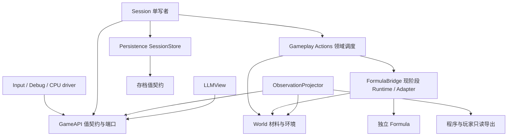

# 首个贯穿场景与 GameAPI 契约

日期：2026-10-21。对应 AWT 执行项：M1.1「定义首个贯穿场景与模块接口契约」。

本文固定后续实现使用的场景、值语义和验收输入；**本轮只交付契约，没有实现 GameAPI、提交版本或 LLMView**。M1 收拢动作入口，M2 建立提交与观测，M3 再决定构式语言。本文的类型名是接口规格，不是已经存在的 C++ 声明。

依据：[架构规划](GameplayArchitecturePlan.md)、[游戏设计总纲](../GameDesign/GameDesignVision.md)。核对代码基线：父仓库 `bece49022a796c8f79e0b010a557fc1ca576f7c3`，本地 Axiom 锁定版本 `150ea98077aa9f0fb857229220917ebb98baa775`；本轮不修改引擎。

## 1 场景：观察地层，开采一格，再观察结果

玩家在暂停状态下查看附近地层，选择一格可开采材料，通过 Shift＋右键开通一个缺口；随后读到该格变为空气及动作的实际结果。构式变化样例是在相同场景中右键激活基础球，用单步观察运动。它验证“观察 → 行动 → 解释变化”，暂不引入库存奖励、知识解锁或天然晶体。

确定性 CPU 夹具沿用无持久化 `GameSession`：1024×1024，Superflat，y<512 为空气、y>=512 为 Dirt，Empty 风策略，暂停，玩家左上角 `(511,508)`。应用仍默认 Natural；试玩可以在 F2 选择 Superflat 后按 R 创建，不改变默认生成策略。

下列版本号为验收夹具指定值，不是当前 API 输出：`WorldId="slice-world"`、`WorldEpoch=7`、`Tick=0`、`CommitRevision=10`。

| 步骤 | 输入 | 预期结果 |
| --- | --- | --- |
| 观察 | 打开范围 `[504,504,32,16]` 的 view A，查询 `(520,512)` 的材料、空气格 `(520,510)` 的风、范围内玩家及该主体已应用程序摘要 | 目标材料为 Dirt；空气格风策略为 Empty、速度为已知零，并标明采样点位于风域外；玩家位置保持分段坐标；程序显示版本与运行数量，不自动公开源码 |
| 开采 | 调用者 `local-player` 的序号 1，`MineRegion{cell=(520,512)}`，前置材料为 Dirt | `Applied`，changed=1，材料变为 Air；Tick 仍为 0，Revision=11；一个 `MaterialRemoved` 事实关联该请求 |
| 对照 | 重读 A，再打开 view B 查询同格 | A 保持 Revision=10 的 Dirt；B 为 Revision=11 的 Air；观察操作不触发加载或推进 |
| 重试同请求 | 再提交相同调用者、epoch、序号 1 | 返回原终态回执，不再开采、不新增事实、不增加 Revision |
| 新请求开采空气 | 序号 2，仍以 Dirt 为前置条件 | `Rejected/PreconditionFailed`；若请求不带前置材料，则为 `Rejected/Blocked`；两者都不修改状态 |

当前 UI 没有上述 view、版本或事实面板；M1.4 增加同类型动作的 Debug/测试入口，M2.4/M2.5 完成只读投影与离线对照。每项实现任务分别验收，不能用本文或现有 CPU 测试代替新行为验证。

构式变化样例使用全新夹具：`ActivateProgram` 指定当前已应用版本，目标 `(600,510)`。基础球半径 0.35 cell、速度 60 cell/s；暂停激活后中心为 `(513.6,510)`，不移动已有弹体；一次成功单步后，新球 X 增加 1 cell，Tick 增加 1。延迟或 Empty 程序可以成功激活而没有可见球，回执不能据此报失败。Apply 新版本只影响后续激活；现存根及其命中、延迟后代继续使用原版本。

## 2 当前调用链与迁移边界

| 当前代码与行为 | 后续职责 |
| --- | --- |
| [GameInput](../../Pixel/Source/Input/GameInput.cpp)：事件先经 `CanEditWorld`；左键直调 `PlaceDirt`，Shift＋右键直调 `TryRemoveMaterial`，右键调 `CastFormulaAt` | Input 只做事件过滤、事件尺寸选格和请求转换；世界修改进入 Session 动作端口 |
| [PixelDebugUI](../../Pixel/Source/Debug/PixelDebugUI.cpp)：风、暂停、单步、保存、重试各自调用；[FormulaDebugUI](../../Pixel/Source/Debug/FormulaDebugUI.cpp) 直接 Apply/Clear | Debug 与输入复用领域动作和会话控制端口；草稿、相机、面板、外观仍由对应模块管理 |
| [GameSession](../../Pixel/Source/Gameplay/GameSession.cpp)：持有 World/Runtime，检查发射路径、保存/恢复、管理暂停和成功步回调 | Session 拥有动作入口、主体上下文和阶段编排；存档格式提取到 SessionStore |
| [World](../../Pixel/Source/World/World.cpp)：开采返回 Applied/Blocked/NotReady；放 Dirt 只允许空气且避开玩家 | 领域继续决定实际材料结果；不在 GameAPI 复制一套材料规则 |
| [FormulaRuntime](../../Pixel/Source/Gameplay/FormulaRuntime.cpp)：每根独立 Simulator；先完成全部扫掠，再排序命中，再按根提交效果 | 保持旧版执行次序；用宿主意图与结果连接语言，世界不依赖语言 |
| [FormulaWorldAdapter](../../Pixel/Source/Gameplay/FormulaWorldAdapter.cpp)：圆形开采按格部分成功；风仅限 Coarse 且网格≤1024 cells | 适配器负责坐标/单位转换，调用同一领域规则；不把受限风脉冲描述成通用物理冲量 |
| [World::Tick](../../Pixel/Source/World/World.cpp)、[Environment::Tick](../../Pixel/Source/World/Environment/Environment.cpp)：风预推进→材料→风反馈→角色→构式 | M1 保留顺序；M2 由协调器明确成功提交与 PendingStep |
| [PixelGame](../../Pixel/Source/Application/PixelGame.cpp)：帧首发布后接收输入/推进，Draw 消费已发布副本；GameEnd 保存 | 保留帧协议；M2 将可拒绝的保存退出提前到关闭请求阶段 |

当前 `FormulaRuntime::WorldEpoch()` 只是构式运行时的局部计数；当前 `Version()` 只是应用程序版本。它们都不能直接充当所有领域、所有 Session 实例的身份或提交版本。当前没有统一 CommitRevision、事实流、调用者会话或跨查询 view。

## 3 所有权与依赖

- Session 独占会话身份、调用者入口、提交顺序与运行中实例的装配。World 继续拥有地图、环境和当前玩家；M4 再提取 Actors，不为本切片先建实体框架。
- Actions 是 Session 内的类型化处理代码，可以继续编入 PixelGameplay；GameAPI 放标准库值类型及小端口，不持有 World、Simulator、ImGui 或 RHI 对象。
- Projector 在安全边界复制有界领域值，LLMView 只消费冻结副本；渲染继续使用独立区域快照。领域事实与动作回执通过返回值交还 Session，不通过同步事件回调执行下一次世界修改。
- SessionStore 接收保存 DTO、返回加载 DTO；不反向持有 Session，不规定固定步或世界退出策略。块 I/O 继续由 WorldStreamer 承担。
- Formula 只依赖标准库与自身宿主契约。游戏的坐标、材料、资源和权限在 Bridge 适配；程序内部 AST、IR、VM 和新语法留给 M3。

实际构建依据：[模块顺序](../../Pixel/Source/CMakeLists.txt)、[Gameplay](../../Pixel/Source/Gameplay/CMakeLists.txt)、[World](../../Pixel/Source/World/CMakeLists.txt)、[Editing](../../Pixel/Source/FormulaEditing/CMakeLists.txt)、[Input](../../Pixel/Source/Input/CMakeLists.txt)、[Presentation](../../Pixel/Source/PixelRender/CMakeLists.txt)、[独立 Formula](../../Pixel/Formula/CMakeLists.txt)。当前 `Input→Presentation→Gameplay→FormulaEditing→Formula`，World 只链接 Core/Performance。M1.3 去掉 Gameplay→Editing；M1.4 让写入口依赖 GameAPI。Input 的相机表现依赖可以保留，不为缩短依赖图重写相机。

## 4 公共值、身份与坐标

| 值 | 定义与有效期 |
| --- | --- |
| `WorldId` | 不透明字符串，标识持久世界；M1 可由现有 `world-*` 存档目录名映射，有限夹具由宿主指定。不解析字符串推导规则 |
| `WorldEpoch` | uint64，运行宿主分配的会话化身编号；新建、加载、恢复或替换世界时分配新值，包括重新打开同一 WorldId。进程内跨 Session 对象不重用；进程重启时所有旧调用者会话/view 先失效，不提供跨进程请求去重 |
| `Tick` | uint64，成功完成的 1/60 s 模拟步；暂停编辑不增加。构式根内的局部 `formula::Tick` 独立计时，不混作会话 Tick |
| `CommitRevision` | uint64，当前 epoch 内完整可观察提交的单调版本；初始完整状态为 1。每个实际改变状态的离散动作批次或成功物理步增加一次；接纳加载、修改暂停/已应用程序、发布新的领域事实等可观察状态也增加。拒绝、重复、查询、纯 UI 操作不增加 |
| `CommitStamp` | `{worldId, worldEpoch, tick, revision}`；不同 epoch 的 revision 不可比较。Tick 恢复于存档的成功步时钟，Revision/view/回执缓存不作为 v4 持久数据 |
| `CallerSessionId` / `RequestSequence` | 宿主登记的调用者会话 token 与 uint64 递增序号；重连建立新 token。主体、来源及能力由宿主绑定，payload 不能自报管理员 |
| `ProgramRef` | `{resourceId, version}`，不可变已发布程序的资源身份与版本。M1 可把现有应用程序放入会话资源槽；M3 再确定产物/语义版本及持久化格式 |
| `InstanceRef` | `{worldEpoch, instanceId}`；instanceId 在 epoch 内不重用，M1 可映射现有 CastId。弹体另用 `{instanceRef, projectileId}`，不使用数组地址或索引作为跨模块身份 |
| `FactId` | `{worldEpoch, sequence}`；事实序号在 epoch 内单调递增。一个提交可有多条事实；它不是 Tick 或 Revision |

计数器溢出属于宿主不变量失败，应致命终止，不能回绕重用身份。Tick 从 v4 时钟转换及 deferred 导入由 M2.3 定义并测试，不在 M1.2 提取格式时暗改。

交付顺序也限定接口字段的可用性：M1.4 先实现请求键、类型化动作结果和同步去重，验证三入口领域结果一致；M2.1 才将协调器产生的 CommitStamp 加入正式回执，M2.4 再附事实 ID 并导出冻结查询。M1 的内部结果类型不作为下文完整 schema 对外序列化，不用零 Tick/Revision 或临时 Runtime 计数冒充已实现的提交版本。第1节完整场景在 M2.5 验收。

坐标正 X 向右、正 Y 向下，单位 cell。`CellCoord` 是两个 int64；矩形是 `{origin, uint32 width, uint32 height}` 的半开范围。调用边界检查加法溢出、尺寸和工作量，不能先溢出再裁剪。第一版不对外暴露物理 ChunkEdge。

连续位置 DTO 为 `{anchorCell: CellCoord, offset: [double,double]}`，规范化 offset∈[0,1)。Bridge 与现有 Chunk＋Local 的 [WorldPosition](../../Pixel/Source/World/WorldCoordinates.h) 转换；远坐标保持整数差加局部小数，不先转成绝对 double。JSON 中 int64/uint64 坐标、身份和计数均用十进制字符串；uint32 范围尺寸可用数值。API 坐标合法范围还受当前 WorldPosition 能力限制，超出返回 `InvalidArgument`，不承诺整个 int64 域都能模拟。

风速与风脉冲 deltaVelocity 单位 cell/s，基础加速度 cell/s²，时间用成功 tick，半径 cell；分别命名字段。基础球 Damage 当前只是元数据，未实现健康结算；角色与弹体当前都不受风。

## 5 三类消息与最小端口

端口形状为 `Submit(callerContext, ActionRequest) → ActionReceipt`，由主线程在安全边界执行；`callerContext` 来自宿主登记。持续移动使用每步采样的 `PlayerIntent{horizontal,jump}`，清理输入也经 Session，避免外部再直调 World；它不逐 tick 分配离散动作对象。

### ActionRequest：外部希望执行什么

公共信封为 `{schemaVersion=1, worldEpoch, requestSequence, payload}`；调用者会话由端口参数携带。payload 是类型化变体，按动作定义前置条件，不提供任意字段写入或可自由删除的必要校验。

| 动作 | payload 与结果 | 规则与原子范围 |
| --- | --- | --- |
| `MineRegion` | 首版 `{cell, expectedMaterial?}`；结果含该格原/新材料与 changed/blocked/notReady 计数 | 首版外部操作只开采一格；可选期望材料用于“对所见材料操作”，不要求全局 revision 恰好相等。检查驻留与 `IsMineable`，Applied 才改为空气；不产出物品。程序的有界圆域批次复用同一开采规则 |
| `PlaceMaterial` | `{cell, materialId=Dirt}`；结果为实际位置和材料 | 首版只支持 Dirt，其他 ID 返回 Unsupported；仅空气且不占玩家身体时应用，不覆盖水。材料/角色判定与实际写入在同一边界 |
| `ActivateProgram` | `{programRef, targetPosition}`；结果含激活 ID/版本及当前产出概况，瞬时 Empty 可无存活 instance | 必须指定当前应用版本，否则 StaleProgram；核验玩家、发射路径及配额。瞄准为零距离沿用上次有效方向，新会话默认向右。成功启动不保证未来命中或效果成功 |
| `ConfigureWind` | 仅 Debug 能力：`SelectStrategy{kind}` 或 `SetBoundary{y}`；结果含实际策略/边界 | 复用现有七策略与重建语义；Reference/Adaptive/LBM 自动暂停，基础力与模拟时钟保持。不接收求解器指针或任意参数路径；后续新增设置用独立值 DTO |

这四个动作保持 M1 现有玩法：暂停允许编辑/激活，不新增距离限制、库存费用或视线判定；程序 Dig 仍限模拟域，鼠标开采/放置仍允许已驻留的可视区域，不暗改为只允许玩家窗口。M5 再按主体能力和区域控制收紧自动化范围。

M1 还应提供类型化会话控制端口，迁移现有 `SetPaused`、`RequestStep`、`Save`、`Reset`、`RetryStreaming`、`TryRecover`、下一世界生成设置、`ApplyProgram` 和 `ClearRunning`。这些不是开采/风作用，保持各自结果：保存为 Saved/Failed（M2 增加 Deferred），重置为 Replaced/Failed（M2 增加 Deferred），程序 Apply 返回新 ProgramRef 或编译/额度诊断。M1 的 Apply 适配可接收当前不可变 Formula 值，放在依赖 Formula 的游戏适配头中，不能让 GameAPI 公共头依赖编辑草稿。Clear 不触发命中或延迟后代；被清理实例不会退还本帧已退休风额度。

### ActionReceipt：入口结果与去重

回执包含请求键 `{worldEpoch, callerSessionId, requestSequence}`、`status`、类型化 reason、实际结果、`resolvedAt: CommitStamp`、有界 factIds。`Applied` 表示本次操作已经完成，不表示一定生成弹体或改了一格；若无状态变化则可保持原 revision。`Rejected` 不允许留下该动作的半次修改。批量部分成功通过 Applied＋各类计数表达，不把局部拒绝伪装成完整成功。

`Accepted` 只表示已接纳排队，必须以后产生唯一终态回执；M1 使用同步端口，只返回 Applied/Rejected，不为预留异步能力增加队列。M5 引入实际异步调用后再实现有界接纳与终态领取；收到 Accepted 的调用者不能推断世界已改变。

同一调用者会话按序列号递增提交。M1 同步入口保留高水位和最近 64 条终态回执，调用者数量由宿主装配固定；等于或低于高水位的请求只返回缓存原回执，已淘汰则 `DuplicateExpired`，永不再次执行。重试必须保留原 payload；改参数使用新序号。旧 epoch/失效调用者先拒绝，不命中当前世界缓存；重新打开同一存档也不重用旧 token。此机制不承诺进程崩溃后 exactly-once。

检查顺序固定为：调用者/epoch → 去重 → 信封与 payload 合法性 → 当前会话可写阶段 → 动作能力 → 目标/程序/局部前置条件 → 容量预检 → 实际提交。合法新序号的终态拒绝也计入去重高水位；格式坏到无法识别请求键的输入在解析端直接返回诊断，不进入入口。

| 拒绝类别 | 触发与处理 |
| --- | --- |
| `InvalidArgument` / `Unsupported` | 非有限参数、范围溢出或超过上限 / 请求的操作或材料尚不支持；不崩溃、不加载 |
| `StaleEpoch` / `CallerExpired` / `DuplicateExpired` | 世界化身或调用者过期 / 重试记录已淘汰；旧请求不改新世界 |
| `SessionUnavailable` / `WaitingForBudget` | 恢复失败未 Ready / 已有 PendingStep；拒绝世界写入，不隐式排队重试 |
| `NotReady` / `Blocked` | 缺失材料数据 / 已知材料不可开采、目标非空气或占玩家身体；不可将缺失当空气 |
| `PreconditionFailed` / `StaleProgram` | 当前已知材料与所见前置条件不同 / 应用版本改变；调用者重新观察或选择版本 |
| `LaunchBlocked` / `LimitExceeded` | 发射路径被固体/缺失/模拟边界截断 / 根、效果、风或激活配额不足；不创建运行根 |
| `PermissionDenied` | 宿主未授予该动作能力，尤其 ConfigureWind；不能通过 payload 的来源字符串提权 |

`NotReady` 优先于材料前置条件比较，避免用不存在的材料做判断。内部代次违约、阶段顺序错误、未知内部枚举、不可变产物损坏是致命错误；不捕获所有 `std::exception` 后伪装成上表拒绝。外部非法程序得到诊断；存档 I/O 在持久化边界报告；M1.5 删除 Runtime 中吞内部错误的宽泛 catch。

### EffectIntent：程序希望宿主施加什么

Bridge 接收 `{instanceRef, programRef, emissionSequence, cause, payload}`，主体、承载者和预算来自已登记实例，不能由语言输出覆盖。首版只定义 `DigDisk{position,radiusCells}`、`WindPulse{position,radiusCells,deltaVelocityCellsPerSecond}`；现有球的产生/运动保持 Runtime 的游戏执行与快照，不为此重定语言 IR。

Dig 半径 0 开采所在格，非零按圆内格中心，半径≤16；按 `(y,x)` 遍历，分别报告 applied/blocked/notReady，域外计 notReady。Wind 半径≤16、速度模≤600，只适配启用的 Coarse 和≤1024 cells 网格；零半径、低于 1/256 cell、零速度、场外、未启用或后端不支持各自返回明确跳过原因，不取消同根后续球。这里的 partial 是逐格效果合同，外层未提交意图片段没有通用回滚保证。

宿主结果按意图顺序返回；材料变化事实只在实际改格后产生。现有 `FormulaWindResult::Applied` 仅表示脉冲已提交后端：Coarse 的小半径可能未覆盖任何速度面，或速度已饱和，返回成功与内部风版本增加均不证明数值变化。首版据此记录 `WindPulseSubmitted`，不发布 `WindChanged`；被跳过的效果只写诊断。需要确认风场响应时重新查询已提交风样本，不用请求值当实测值。

同一激活内所有当前碰撞查询先完成；命中按 `(fraction,castId,projectileId,cellY,cellX)` 排序，再按根激活次序提交其内部发出顺序的效果。命中子构式最早下一个成功 tick 生效。M3 若改语言顺序，必须采用新语义版本并重写相应样例。

### DomainFact：已经发生了什么

最小信封为 `{factId, committedAt: CommitStamp, cause, payload}`。cause 为外部请求键，或 `{instanceRef, emissionSequence, parentFactId?}`；实例创建记录关联其激活请求，链路可追溯到来源。程序诊断里的局部 tick 另行命名。

首批事实为 `MaterialRemoved/MaterialPlaced{cell,oldMaterial,newMaterial}`、`ProgramActivated{programRef,activationId}`、`WindConfigured{old,new}` 和成功提交的 `WindPulseSubmitted{position,radiusCells,requestedDeltaVelocity,instanceRef}`。风事实记录实际发生的后端提交，position/radius 是请求覆盖圆，不表示测得的受影响范围或风速增量。程序激活事实只证明求值已启动，不证明球命中或矿物已采出；Empty 激活也可产生一次激活事实。每个独立提交按稳定顺序分配序号，事实在相关 revision 完整提交后才可见。

事实不是逐格物理移动日志；连续模拟默认不为每个像素产生事件。圆域挖掘最多输出有界变化列表/摘要；查询可通过变化范围复查材料。首次实施为事实数、字节数和保留窗口设置上限，溢出返回 gap，不能静默丢条后报告完整。日志文本和模型总结是派生资料，不可回灌为权威事实。

## 6 提交与只读查询

M1 同步动作在主线程非模拟阶段执行，完成后才返回；保留既有帧首发布→输入/推进→Draw 的延后一帧消费关系。M2 为其补全以下提交协议：

1. 安全边界接纳加载和离散动作，每个实际改变可观察状态的批次形成完整 revision；随后才开始可能延期的物理步。
2. 固定输入与活动范围，沿风→材料→风反馈→角色→构式顺序运行。所有阶段成功才 Tick+1、Revision+1，并发布事实/读模型。
3. 若风已预推进而材料等待预算，保持 PendingStep；不再次预推进风、不接纳改变输入的加载、不移动域、不编辑世界或推进角色/构式。查询保持最近完整提交副本，不能现场采样预推进风。
4. 等待时 `RuntimeStatus` 可另外报告实时等待原因，但必须标明这是提交外的服务状态；不得把它混入同 view 的冻结领域结果，或为一次状态轮询伪造新 revision。

M1.2 提取 SessionStore 保持 v2/v3/v4 读取与当前 v4 deferred 保存行为。M2.3 才改为 PendingStep 下 Save/正常退出/Reset 返回 Deferred、不写新元数据、不自行推进，保留可交互会话供显式重试；关闭协商由 PixelMain 通用钩子支持。旧 v4 deferred 导入保留已提交地图/角色、时钟和全部余量，按配置重建风、清除预推进标记，欠步由协调器完整执行一次。M4 再建立多域检查点；当前不承诺跨文件崩溃恢复。

只读端口沿架构规划的 `DescribeCapabilities / OpenView / Query / ReadFacts / CloseView`，M2 首个范围限定为材料、空气风速、玩家和已应用程序/运行数量摘要。查询结果包至少包含 schema、viewId、CommitStamp、topic、范围、分辨率、单位、实际覆盖、availability、sampledAtRevision、reason 和 cursor。返回拥有自身内存的值，不借用 WorldMapView、角色指针或渲染缓冲。

材料按格精确读取；`environment.air_velocity` 固定在**已知空气格中心**采样，即已提交截面等价于 `SampleWind(CellCoord,.5,.5)` 的原始空气速度，不使用 `SampleForMaterial`（材料受风规则）、合成力或 F1 归一化颜色。插值遵循该截面的后端 `Sample` 语义，响应附 backendKind、采样合同版本及后端网格间距；输出分辨率1 cell 不意味着求解网格也是1 cell。投影只能在提交边界采样，后续查询不能再调用实时求解器。

第一版风查询支持 resolutionCells=1 或16，其他值 Unsupported。16格摘要使用以世界 `(0,0)` 对齐、负坐标向下取整的16×16分箱，只取分箱与请求范围交集：对已知空气格中心的 **X/Y 分量分别等权算术平均**，不平均方向或标量速度。每箱返回 requestedCellCount、residentCellCount、airSampleCount、nonAirCount 和 unknownCellCount；coverageFraction=resident/requested，均值分母为 airSampleCount。固体/水是已知 nonAir，不作为零风样本；缺失格是 unknown，不进均值。无空气样本且 unknownCellCount=0 时才返回 `not_applicable`；未知格>0时为 `partial/not_resident`，这两种无样本结果均不提供均值。已知空气格在风域外、Empty或disabled时是带明确原因的已知零，仍计入空气样本，并分别报告其数量。低频缓存还需附 sampledAtRevision，不得用当前实时值填补旧截面。

首个验证夹具的查询限额为：每主体一个活动 view、范围≤64×64 cells、精细材料分页≤256 cells、最多16页，保留总量≤1 MiB/view，最长存活120个宿主服务帧。宿主主线程每次帧服务迭代递增一次服务帧，空闲、暂停和预算等待期间照常递增；headless 驱动显式推进服务帧，不按 Query 次数或模拟 Tick 计租约。这些是 M2 的起始上限，须在能力目录公开并以实际保留内存测量修订；超额返回 LimitExceeded，不隐式降采样或扩大范围。

同 view 的主题、分页、聚合都固定于创建时 revision，`factHighWatermark` 固定创建时事实上界；cursor 绑定 view/主体/topic/过滤与 schema。程序摘要只承诺当前已应用版本与数量，源码读取需独立能力。权限变化使旧 view/游标整体 ViewRevoked；epoch 替换或租约过期为 ViewExpired。新 view 替换同主体旧 view，不能把新页悄悄拼到旧快照。

| 查询状态 | 数据语义 |
| --- | --- |
| `available` | 范围与字段全部已知；Empty/disabled 风明确返回状态及已知零速度，不能据零速度推断没有后端 |
| `partial / not_resident` | 精确标出缺失子范围；缺失材料不是 Air，未知风不是零。报告 coverage，均值按 topic 定义的已知样本作分母；空气风除以 airSampleCount，零样本不提供均值 |
| `unavailable / not_sampled` | 没有满足请求时效的样本；低频缓存保留实际 sampledAtRevision，要求当前精确值时不能用旧摘要冒充 |
| `unknown / not_discovered` | 系统存在且允许告知“尚未掌握”，但该主体没有知识；与未加载分开 |
| `not_applicable` | 空气风速点查为已知非空气材料，或聚合中没有空气样本且没有未知格；返回材料分类/计数，不伪造零风 |
| `PermissionDenied` | 当前主体无观察能力；不返回隐藏对象总数或通过原因泄漏存在性，按观察策略统一屏蔽 |
| `unsupported` | 温湿度、库存、设备等尚未实现；不填虚假的零值或“生态正常” |

查询不触发加载或活动岛激活。`ReadFacts` 在固定上界内读取，事实环淘汰而 view 未保留时返回 gap/ViewExpired，消费者重开快照；不能跨缺口拼接完整历史。范围超限和权限拒绝也不触发隐式侦察动作。

## 7 验收样例与验证映射

下表的新契约用例都是后续实施要求，本轮不宣称已经跑通 GameAPI。

| 样例 | 具体输入与预期 | 实施/现有复用入口 |
| --- | --- | --- |
| A 同一开采 | 三个独立同状态夹具，以 Input、Debug、CPU driver 提交 `(520,512)`；领域结果一致，M2补全后的stamp、事实内容一致，来源不同 | M1.4/M2.1/M2.4；复用 [MouseEditing](../../UnitTest/Gameplay/PixelInputTests.cpp) 与材料规则 |
| B 不覆盖与未知 | 放 Dirt 到水/玩家身体→Blocked；缺失格查询→not_resident，开采→NotReady；可见驻留域外格仍可鼠标开采 | M1.4/M2.4；World 编辑、流式夹具；程序 Dig 域外仍不得开采 |
| C 版本与重复 | 本文第1节；额外使序号1回执被64条后续回执淘汰，再重试→DuplicateExpired；新 epoch 下旧请求→StaleEpoch | M1.4/M2.1；新入口用例 |
| D 暂停与单步 | `(600,510)` 激活得到 `(513.6,510)`；暂停帧位置不变；Step 后 X+1，Tick+1；Apply 新版本不改旧根/后代 | M1.4/M2.1；[FormulaInputAndContinuousAim](../../UnitTest/Gameplay/PixelInputTests.cpp)、[DefaultAndVersioning](../../UnitTest/Gameplay/PixelFormulaGameplayTests.cpp) |
| E 物理次序 | 到期优先于末段碰撞；所有根先扫掠后挖掘；命中载荷下一成功 tick；不支持风仍保留同根后续球 | M1/M3；FormulaGameplay 的 SweptGeometryAndExpiry、ImmediateHitsAndMapConsistency、WindBoundariesAndDelayedConfiguration |
| F 预算等待 | 预推进后压满 scratch；两次读取同 view 风值相同；拒绝编辑/激活；释放预算重试只完成一次，不丢时间余量 | M2.1/M2.4；[DeferredStepKeepsStreamingDomain](../../UnitTest/Gameplay/PixelPersistenceTests.cpp)、SuccessfulSingleStepBacklogRoundTrip；新增读副本断言 |
| G 保存与退出 | M1.2 继续通过 DeferredStepSurvivesSave；M2.3 将该旧断言替换为 Save/退出/R 均 Deferred，元数据不更新、原会话保留；旧 v4 导入不重复步 | M1.2/M2.2/M2.3；[Persistence](../../UnitTest/Gameplay/PixelPersistenceTests.cpp)，需关闭钩子测试 |
| H 查询一致性 | A 打开后开采、推进或加载，A 不变、B 见新值；rev10 的 view 只读创建时事实上界；暂停120个服务帧过期 | M2.4/M2.5；新 CPU 离线样例与投影测试 |
| I 权限与上限 | 撤权→旧游标/ViewRevoked；65×64范围→LimitExceeded；已淘汰事实→gap；unsupported库存不输出0 | M2/M5；新查询测试，首版可用 fake observer |
| J 远坐标与选格 | `(2^55+17,-2^55-17)` 的 cell 字符串往返精确；局部 offset=.125 保留；鼠标使用自身窗口/framebuffer尺寸 | M1.4/M2；[DistantCoordinates](../../UnitTest/Gameplay/PixelFormulaGameplayTests.cpp)、Input连续远坐标用例；新增 JSON 往返 |
| K 错误分类 | 外部 NaN/超限参数→诊断；外部旧实例→拒绝；已验证的内部阶段/句柄违约→进程失败，不能伪装普通构式失败 | M1.5/M3；按真实错误路径建立隔离进程验证 |
| L 风查询与事实 | 同箱两个已知空气格速度 `(2,0)`、`(0,4)`，一格固体、一格缺失→均值`(1,2)`、coverage=3/4、airSampleCount=2；全缺失或固体+缺失且无空气→partial/not_resident、无均值，全已知固体→not_applicable；小半径后端提交但速度不变→仅WindPulseSubmitted，无WindChanged | M2.4/M3宿主；投影fake样本与Coarse无面覆盖夹具，非现有测试声明 |

复用的 [SessionAndPublicationContracts / FixedClockAndLatchedJump](../../UnitTest/Gameplay/PixelSessionTests.cpp) 继续覆盖暂停、固定步、帧发布所有权、帧时长分段和跳跃锁存；[SessionRoundTrip / ManualSaveFailureCanRetry](../../UnitTest/Gameplay/PixelPersistenceTests.cpp) 覆盖保存恢复、失败保留内存及显式重试。单纯文档契约不需要新增镜像实现的测试。

后续代码验证命令沿 [README](../../README.md)，输入/表现实现还需 runtime smoke；改引擎关闭钩子时追加 AET 与引擎生命周期验证。本轮的实际命令、结果和独立 review 记录写入该 AWT 任务，不把表格当作测试报告。
