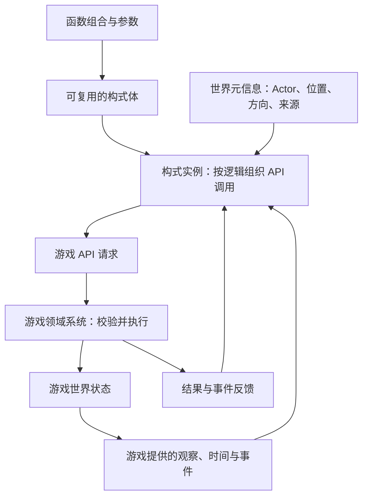

# 构式系统（Formula System）

更新日期：2026-10-26。本文关注构式系统的工作层级、函数式组合、统一的函数接口与封装、世界元信息及运行机制。游戏整体目标见[游戏设计总纲](GameDesignVision.md)。

**本文区分设计方向、候选规则与当前实现。** 2026-10-26 已交付 `formula/2` 的最小完整函数组合与世界绑定，复用有界过程执行核心，并保留 `process/1` 源码及存档的原语义。实际函数签名、时序、Actor 绑定与版本合同见[实现说明](../Architecture/FormulaComposition.md)，实现范围见第 9 节；伪代码中的并发散射等扩展仍是候选设计。

## 1. 定位与基本边界

> **构式根据游戏世界的上下文和自身的组合逻辑，决定何时、以什么参数、针对什么对象，调用哪些游戏 API。**

构式（Formula）是可复用、可组合的游戏行为描述。玩家通过它组织游戏提供的能力；世界现象、天然结构、设备和角色也可以使用同一套构式机制。构式承担 API 调用逻辑，具体操作的合法性、实际状态变化及后续模拟由游戏领域系统负责。

本轮确认以下方向：

- **作用范围仅限游戏世界。** 构式的世界效果必须且只能经由游戏明确提供的 API 产生；玩家设计的构式不能获得操作玩家电脑上游戏之外状态的能力。游戏自身管理存档等宿主功能，不因此向构式开放任意文件、网络或进程操作。
- **以直观的游戏概念组织能力。** 当前不以构建一门通用编程语言为目标，也不要求玩家通过大量可变变量和过程控制来完成日常配置。
- **采用函数式风格的构造与组合。** 基础作用、变换和组合均通过函数表达；已有描述保持不变，组合得到的新描述能够继续参与组合。本版具体语法与类型体系见[formula/2 合同](../Architecture/FormulaComposition.md)。
- **构式具有世界归属。** 在世界中存在的构式需要元信息（metadata），表达附着的 Actor、世界位置等游戏信息，不能仅有脱离上下文的逻辑描述。
- **统一的函数语义。** 基础函数与通过组合定义的函数遵守相同的接口、调用、封装和复用规则。函数的实现方式不改变其在构式中的地位。

构式能够读取游戏允许提供的世界信息、形成中间值并维护运行进展。这些过程为调用游戏 API 服务；一次执行可以等待、被拒绝或结束，不要求每次求值都改变世界。构式也不限定于力的传递或某种具体物理模型：可涉及的领域取决于游戏实际开放的能力。

## 2. 在游戏中的工作层级

| 层次 | 职责 | 边界 |
| --- | --- | --- |
| 游戏领域系统与 API | 提供观察和操作能力，校验请求并完成实际状态变化 | 材料规则、碰撞、运动、资源和对象状态仍由对应系统负责 |
| 构式逻辑 | 组织条件、事件、时序、目标、参数及调用之间的关系 | 只能使用游戏提供的能力；发起请求不等于请求必定成功 |
| 世界绑定与运行宿主 | 提供位置、来源、承载条件、事件及运行生命周期 | 将构式实例接入真实世界，管理等待、归属效果和恢复等状态 |
| 构式装配 | 组合函数并绑定参数，形成完整构式体 | 装配结果遵守同一套组合语义，构造描述本身不产生世界作用 |

例如，构式决定在某个位置请求开采；能否开采、移除哪些材料、产生什么物品，由游戏规则执行。构式决定何时施加推力；物体之后如何移动、碰撞，由基础模拟负责。

下图表示目标职责关系，不规定具体的编译方式、类或代码接口：



这一定位延续现有模块边界：通用构式机制位于 `Runtime/System/Formula`，游戏接入位于 `Runtime/Gameplay/FormulaBridge`，领域模拟位于 Simulation。System 不引入游戏领域类型；World 和 Axiom 不依赖 Formula，Pixel 专用构式效果与渲染不进入引擎。世界观上的共同原理不要求所有基础模拟都由构式解释执行。

## 3. 函数式构造与组合

### 3.1 构造描述与执行作用

组合阶段通过函数计算值和构造行为描述；构式在世界中激活后，运行宿主依据描述、元信息和上下文调用游戏 API。定义、组合或复用函数本身不应触发其中描述的世界作用。

函数式风格重点保留以下特征：

- 构式体及其组合值保持不可变，变换产生新描述，不把修改累积回原件。
- 函数的输入、输出和适用范围明确，函数组合可以定义为新函数并继续复用。
- 同一构式体可被多个世界实例共享，每次执行的运行进展独立。
- 函数式描述不意味着世界无状态；等待、事件、持续作用和资源结果仍有运行状态。
- 描述可共享不等于世界作用可以省略、合并或交换次序。组合必须保留玩家能够观察到的时序与因果。

formula/2 已明确 number/cells/speed/acceleration/ticks/action 类型和最小组合规则；通用目标选择与更丰富的变换仍待专题设计。旧原型的全部 `S → S` 规则、隐式作用域和语法不自动成为新设计的合同。

### 3.2 函数承担的作用

以下按用途列举候选函数，具体清单尚未定案。所有函数都遵守第 5 节的统一接口与封装规则：

| 角色 | 作用 | 概念示例 |
| --- | --- | --- |
| 基础作用 | 描述游戏可提供的一项世界操作 | 发射载体、施加推力、开采、维持场源 |
| 变换与参数构造 | 为作用提供参数，或从已有描述得到新描述 | 方向调整、范围调整、目标选择、空间分布 |
| 组合关系 | 组织多个调用的触发与时间关系 | 同时发生、依次发生、延迟、周期、命中后发生 |

条件和时间关系应当有可解释的游戏含义。函数接口需要明确所需的输入、参数与上下文；具体表示方式另行设计，不影响组合语义本身。

### 3.3 组合示例与作用域

下面是设计伪代码，名称、数值及语法仅用于说明组合关系，**不能作为当前 `process/1` 源码执行**：

```text
冲击 = 推力(强度: 20, 范围: 3)

冲击弹 = 命中时(
    载体: 弹体(速度: 30),
    作用: 冲击
)

三发冲击弹 = 散射(数量: 3, 角度: 15, 构式: 冲击弹)
```

这里的名称表示不可变描述的绑定。激活后，由游戏生成载体、处理碰撞，并在符合触发条件时执行后续作用。

一个可理解的组合必须说明：由哪个对象产生事件、后续作用使用什么位置与方向、触发一次还是多次，以及失败时如何反馈。修改载体速度应当明确作用于载体，不能让玩家猜测它是否也改变了命中后的子构式。

formula/2 已定义命中子描述固定命中位置、继承实例方向，并在完成后恢复外层空间上下文；同一根顺序执行。散射与并行分支仍待后续合同，本例不表示它们已经实现。

## 4. 构式体、元信息与运行状态

为落实构式在世界中的存在，设计上区分以下三个概念；它们不要求一一对应代码中的三个对象：

| 部分 | 描述内容 | 例子 |
| --- | --- | --- |
| 构式体 | 可复用的 API 调用逻辑与参数结构 | 周期性释放定向推力 |
| 世界元信息 metadata | 本实例的世界身份、绑定与上下文 | 附着到某个晶体，位于局部偏移处，作用朝向与晶体相关 |
| 运行状态 | 本次执行已经进行到哪里 | 剩余等待时间、已收到的事件、存活的效果引用 |

元信息是有运行含义的游戏数据。同一构式体可以绑定到天然晶体、玩家装备或世界中的固定位置，其空间行为与存续条件随绑定而变化。

### 4.1 空间绑定

已确认需要表达附着 Actor 或处于世界位置。以下两种定位方式作为后续设计的起点，字段名称和存储格式尚未确定：

| 定位方式 | 候选信息 | 需要表达的行为 |
| --- | --- | --- |
| 附着定位 | Actor 引用、局部位置偏移、局部朝向 | 根据附着对象取得实际世界位置与方向 |
| 世界定位 | 世界位置、世界朝向 | 在指定世界位置运行，不隐式跟随某个 Actor |

实例的定位方式必须明确。若同时缓存 Actor 和世界坐标，应定义哪个是绑定依据、哪个是计算结果。构式描述保持不可变，不妨碍游戏根据 Actor 运动更新实例的实际作用位置。

来源与附着对象也应分别表达。例如，玩家发出的构式可以附着到岩石上：来源用于解释因果，岩石用于确定空间关系。来源信息本身不授予修改世界的权限，实际可用能力由游戏提供。

### 4.2 组合中的绑定与生命周期

候选规则是由外层构式提供默认世界上下文，内部函数通过显式关系使用或派生位置、方向与目标。涉及“发射”“命中后附着”“在某处留下作用”的函数，需要说明其描述的行为是否创建新的绑定。

例如，命中岩石后在命中点留下持续作用，与将作用附着到岩石上，应当是玩家可以分辨的选择。岩石移动时，前者保持原世界位置，后者随岩石移动。formula/2 已支持 Gameplay 装配时附着 Actor；命中后自动附着对象尚未开放。

本版选择：Actor 销毁或离开授权范围取消根并清理效果，区域不活动则冻结并按剩余时间恢复；组合子描述属于同一根，命中位置通过词法上下文栈保存。运行中重绑定、脱落和转移尚未开放。详细规则见 formula/2 实现说明。

## 5. 统一的函数接口与封装

基础函数与通过组合定义的函数使用同一套接口约定。所有函数均可按其签名参与调用和组合；是否能够连接或替换，由输入输出类型和行为合同决定。统一接口约定允许不同函数具有不同的参数与返回类型。

每个函数的接口需要说明：

| 接口内容 | 需要明确的信息 |
| --- | --- |
| 输入与输出 | 接收哪些值，返回什么值；返回值如何作为后续函数的输入 |
| 参数 | 参数含义、类型、合法范围，以及需要时提供的默认值 |
| 上下文 | 使用哪些位置、方向、目标或事件信息，如何取得这些信息 |
| 作用域 | 参数和变换影响哪些内部作用，哪些边界需要显式传递 |
| 求值与效果 | 如何计算值或构造行为描述，所描述的游戏 API 调用在何种条件下执行 |
| 失败反馈 | 参数不合法、上下文不可用和游戏操作被拒绝时如何报告与传播结果 |

函数封装通过命名与参数声明表达一段计算或组合逻辑。内部表达式可调用其他函数，调用方通过声明的输入、输出和上下文依赖使用它。formula/2 通过不可变 let 和固定部分参数的具名包装函数表达复用。

例如，可以定义以下函数；这仍是设计伪代码：

```text
冲击弹(速度, 强度, 范围) = 命中时(
    载体: 弹体(速度: 速度),
    作用: 推力(强度: 强度, 范围: 范围)
)
```

`冲击弹` 与 `弹体`、`推力`、`命中时` 使用相同的函数调用规则。调用 `冲击弹(30, 20, 3)` 得到的行为描述可以继续传给 `散射` 等函数。

函数封装应保留内部组合的调用顺序、触发条件和作用范围；在相同输入与上下文下，按定义展开应保持等价。复用同一函数定义不共享各次执行的可变状态；世界绑定和执行进展仍由构式实例与宿主维护。本版具体签名、参数绑定、作用域和版本格式已在 formula/2 实现说明中规定。

## 6. 世界运行与实例绑定

世界中的构式需要拥有承载或定位依据、运行条件和可观察结果。天然现象、设备与玩家能力通过同一套 API 及组合语义参与世界，在资源、环境和承载条件上可以不同。

以周期推力晶体为设计场景：

1. 元信息将构式绑定到晶体，并提供位置与方向。
2. 构式逻辑根据游戏提供的时间、事件或条件决定释放时机和参数。
3. 构式请求游戏执行施力操作，游戏校验并应用实际效果。
4. 基础模拟处理材料或对象的运动，世界变化为下一次观察提供依据。

同一构式体也可以绑定到装备或固定设备。组合逻辑保持一致，各实例依据自己的元信息解析位置、方向与目标，并使用宿主提供的资源和能力执行请求。

构式的运行可以持续存在，也可以在特定事件后启动。不同承载者使用相同的组合规则；不要求每个像素或每项基础物理计算都运行一份构式。

## 7. API 调用、反馈与运行边界

世界状态查询、事件输入和效果输出均由游戏明确提供。运行宿主将构式逻辑解释为受控的 API 请求；通过效果请求与游戏适配层完成调用，符合“构式只通过游戏 API 改变世界”的边界，不要求构式中的函数直接持有原生游戏对象或原生函数指针。

设计上需要保持：

- 构式发起请求，游戏决定是否允许以及实际结果；资源不足、目标失效等情况必须能够反馈。
- 玩家能够理解作用的来源、目标、范围、时机和未生效原因；复杂组合也应保留可追溯的因果。
- 等待、事件订阅和持续效果需要明确归属及终止规则。函数式构造不消除运行状态，也不允许取消实例时任意撤销已经形成的世界事实。
- 玩法资源代价与运行计算预算分别设计。描述复用不等于执行免费；具体费用、冷却、额度和公平调度规则另行确定。
- 暂停、区域冻结、保存与恢复不能被“重新执行一次构式”含糊替代；应按实例和宿主效果的实际状态延续。

formula/2 已明确编译与执行额度、拒绝传播、取消清理、冻结和恢复合同。相关验证覆盖已实现的能力，不代表对任意输入或未来扩展的完全证明。

## 8. 当前边界与后续设计

最小函数组合、参数绑定、事件时序、世界/Actor 定位和保存策略已实现。后续按玩法证据扩展并行散射、通用目标选择、命中后对象附着、运行时重绑定、配方获取与成长；这些能力不属于本次交付。Actor 目前没有旋转姿态，本版附着只跟随平移。

## 9. 当前实现与新设计的关系

截至 2026-10-26：

| 主题 | 已实现能力 | 边界 |
|---|---|---|
| 函数接口 | formula/2 带类型参数与返回值的函数、不可变 let、统一调用、纯数值与 action 组合 | 定义先于引用，无递归或可变变量 |
| 组合 | sequence、delay、repeat、on_hit、if_credits、on_wake；描述可传参、返回和继续组合 | 顺序组合，无并行散射；命中子描述固定位置并恢复父上下文 |
| 世界 API | dig/wind/bolt/field 经共同 Gameplay 宿主校验和提交，保留回执与原始调用位置 | 领域权限、实际资源与几何仍由游戏判定 |
| 元信息 | 独立来源、明确 World/Actor 绑定、局部偏移、方向、权限与额度 | Actor 失效/越权取消，离域冻结；已安装效果不隐式跟随 |
| 编辑 | F4 Compile/Apply 接受新旧源码；默认程序、设备、晶体和援助已使用新描述 | 发布仅影响新实例；草稿不保存 |
| 保存 | 新实例保存命中上下文栈，宿主保存绑定与回执来源；恢复不重放 | 旧 process/1 保持原语义/指令布局，旧宿主载体明确迁移为 World 绑定；未知格式拒绝 |

当前入口：

- [formula/2 实现合同](../Architecture/FormulaComposition.md)：准确语法、函数表、事件、绑定、版本与成本。
- [构式模块 README](../../Pixel/Source/Runtime/System/Formula/README.md)：使用、示例与独立构建。
- [验证记录](../Architecture/FormulaCompositionVerification.md)：独立 CPU、sanitizer 检查与实际边界。
- [过程运行时](../../.awtcontext/GlobalDoc/FormulaProcessRuntime.md)、[FormulaBridge](../../.awtcontext/GlobalDoc/FormulaBridge.md)、[状态与编辑](../../.awtcontext/GlobalDoc/FormulaStateAndEditing.md)：执行核心及历史演进，版本差异以新合同为准。
- [工程 README](../../README.md)：游戏操作和验证入口。

旧 cast 系统没有恢复，也没有引入单独的模块或半成品类别。验证结论只对应实际运行的测试。

## 10. 历史依据与维护入口

| 时间 | 历史决策或实现 | 追溯入口 |
| --- | --- | --- |
| 2026-10-12 | 提出不可变描述与封闭组合 | [早期法术编程系统设计](SpellProgrammingSystemDesign.docx)；AWT 任务“法术编程封闭组合系统设计” |
| 2026-10-13 至 10-14 | 确认“构式（Formula）”命名并迁移原型命名 | AWT 任务“构式系统工程知识整理”“构式代码命名迁移与提交” |
| 2026-10-20 | 旧 cast 原型接入真实世界及树形编辑器 | [旧基础版设计](../../.awtcontext/GlobalDoc/FormulaGameplayV1Design.md)、[旧基础版实现](../../.awtcontext/GlobalDoc/FormulaGameplayV1Implementation.md) |
| 2026-10-22 起 | 建立 process/1 运行时、世界承载者与状态合同 | 第 9 节列出的现行实现入口 |
| 2026-10-25 | 移除旧 cast、Simulator、树形编辑器与相关实验代码 | [历史语言架构](../../.awtcontext/GlobalDoc/FormulaLanguageArchitecture.md)中的历史声明及工程 README |
| 2026-10-26 | 明确 API 调用逻辑层、函数式组合、统一函数接口与封装、世界元信息 | AWT 任务“明确构式定位与函数式组合设计” |
| 2026-10-26 | 实现 formula/2 函数组合、Actor 绑定、命中作用域和兼容保存 | AWT 任务“升级构式系统的函数组合与世界绑定”及[实现合同](../Architecture/FormulaComposition.md) |

旧语言的封闭组合、作用域、额度及测试记录仅说明当时实现，不直接约束新组合系统。本文负责维护构式系统设计，工程文档负责描述实际运行合同；两者通过[游戏设计目录](README.md)和[项目文档索引](../../.awtcontext/GlobalDoc/DocIndex.md)关联。后续实现使用 AWT CLI 维护任务状态和实际验证证据。
