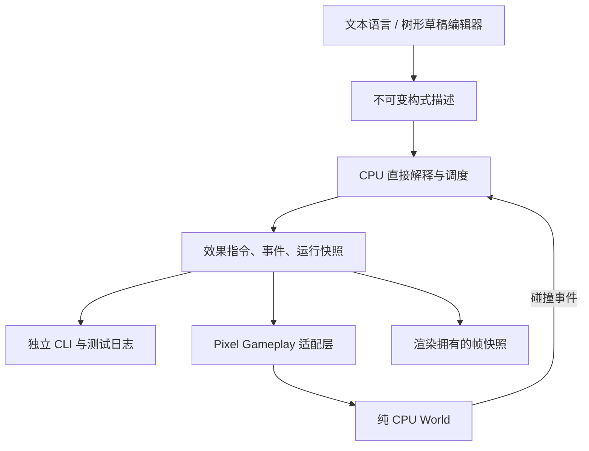

# 构式系统（Formula System）

更新日期：2026-10-20。本文是 AWT 下的系统设计入口，汇总最初的封闭组合想法、整体玩法方案、语言原型和已确认命名。具体语言与实现边界见 [构式语言架构](../../.awtcontext/GlobalDoc/FormulaLanguageArchitecture.md)，语法及运行命令见 [原型说明](../../Pixel/Source/Runtime/System/Formula/README.md)。

2026-10-20 已按[独立评审通过的计划](../../.awtcontext/GlobalDoc/FormulaGameplayV1Design.md)完成游戏基础版：人物前方朝鼠标激活基础 Bolt 描述、独立树形 DebugUI、成功固定步、扫掠碰撞及受控世界效果。小球是完整描述求值后的结果，不要求预先显示输入实体。操作、代码职责、额度及验证见[基础版实现](../../.awtcontext/GlobalDoc/FormulaGameplayV1Implementation.md)。

## 1. 名称与概念

用户于 2026-10-13 确认，以 **构式（Formula）** 替代“法术”，强调数学构造、程序组合与科幻技术风格。后续设计、讨论和面向玩家的文字统一使用“构式”；“构式语言”是描述这些组合的领域语言。

| 统一术语 | 含义 | 现有代码或历史名称 |
|---|---|---|
| 构式 Formula | 可复用、可组合、可执行的行为描述 | `Formula`；早期提案称 `SpellExpr` |
| 构式系统 Formula System | 从组合、执行到世界反馈的整体玩法 | 法术系统 |
| 构式语言 Formula DSL | 构式的文本描述语言 | `Pixel/Source/Runtime/System/Formula`，`.formula` 文件 |
| 激活 / 执行构式 | 接受一次运行请求并启动描述 | `cast`、`Simulator::Cast`、`CastId` |
| 子构式 payload | 事件发生后独立启动的完整构式 | 子法术；`OnHitNode::Payload` |
| 构式运行实例 | 一次激活产生的弹体、调度项与局部状态 | 与不可变 `Formula` 描述区分 |
| 修改器 / 装饰器 | 改变参数 / 增加时间、复制与触发行为 | Modifier / Decorator，名称保留 |

2026-10-14 按用户要求完成代码命名迁移：`Spell` → `Formula`、`pixel::spell` → `pixel::formula`、`Pixel/Spell` → `Pixel/Source/Runtime/System/Formula`、`PixelSpell*` → `PixelFormula*`、示例扩展名 `.spell` → `.formula`，测试名同步为 `Pixel.Formula*`。当前头文件入口为 `Formula/Formula.h` 与 `Formula/Simulator.h`，独立构建目录使用 `build-formula`。这次直接迁移原型名称，不提供旧类型、目标或头文件的兼容别名；调用方应更新引用。`cast`、`Simulator::Cast` 与 `CastId` 的激活语义保持不变。

历史任务 ID 和原始 DOCX 保留，以便追溯。执行器、能量等其他科幻设定尚未命名定案。

## 2. 核心玩法与设计目标

构式是本游戏的核心玩法方向。玩家通过“获得基础组件 → 组合与复用 → 执行实验 → 观察环境反馈 → 调整结构”获得新的能力。玩法原型来自 Noita 的组合思路；本项目独立定义组合代数、作用域和调度规则，不承诺复刻其牌堆或内部执行方式。

玩家改变的不只是数值，还包括空间和时间结构：一个弹体可以加速、扩展为一组、延迟启动，或在命中后执行另一套完整构式。泥土、风场和力场为组合提供可观察的环境响应。

优先验证两个问题：玩家能否预测某个修改器影响哪些效果；玩家能否通过改变组合结构得到新行为，并解释其因果。费用、冷却、槽位和风险属于后续玩法取舍，尚不是当前原型规则。

编辑体验有两层：文本 DSL 便于验证语义；游戏内独立 Formula Editor 通过树形草稿和参数控件生成同一不可变描述，Apply 后成为新版本，旧实例保留旧描述。槽位、卡牌或其他玩家界面仍待试玩决定。

## 3. 封闭组合契约

令 S 为有限、结构良好、参数合法的构式描述集合。基础构造器产生 S 中的值；固定合法参数的修改器与装饰器是 `S → S`；多输入组合器如 `seq`、`on_hit` 接收多个 S，仍返回 S。一个组合的结果因此能继续作为另一个节点的输入。

封闭对象是**行为描述**。正在飞行的弹体、世界事件和已产生的效果指令是执行结果，不承担表达式组合接口。分裂通过描述中的组合节点表达，延迟和触发通过描述中的行为节点表达，不需要把输出类型改成“弹体数组”或“回调函数”。

约定如下：

- 描述不可变，可以共享无环子结构；每次激活独立持有运行状态。复用一个构式不会将修改累积回原件。
- 修改器复合满足函数复合的结合律，通常不满足交换律。伤害 10 先加 5 再乘 2 得到 30，交换顺序得到 25。
- `empty()` 是合法的空构式，是 `seq` 的行为单位元；它是值，不是恒等变换 `Id(s)=s`。
- `seq` 在可观察执行上满足结合律，但分支顺序不能随意交换；世界副作用更不能因结构可重新分组就任意重排。
- 类型与结构封闭不代表所有组合都有有效作用，也不代表无限精度、无限资源或无限递归。非法参数产生错误，不能伪装为空构式。

## 4. 作用域、载体与子构式

修改器作用于当前层的兼容效果，穿过组合、延迟、重复与散射。在 `on_hit(carrier, payload)` 中，它只进入 carrier；payload 是独立子构式，必须显式修改。

| 规则 | 当前原型行为 |
|---|---|
| 伤害、速度修改 | 作用于弹体；按内层到外层执行，对应管道从左到右 |
| 不兼容效果 | 保留原效果并记录诊断，例如给 `wind` 加伤害修改器 |
| 命中载体 | 当前只有弹体；给瞬时风或挖掘加 `on_hit` 不会凭空产生碰撞 |
| 多个载体 | 每个弹体都得到自己的触发；不是“整组只触发一次” |
| 命中继承 | 子构式继承根激活 ID、实际命中位置和入射方向 |
| 不继承的属性 | 载体的伤害、速度修改与其他触发绑定；子构式使用自己的描述 |
| 触发次数 | 当前一次命中消耗整个弹体；其各触发绑定按内层到外层启动 |
| 子构式的闭包 | payload 可以包含新的组合、延迟、修改器或 `on_hit` |

“全部不兼容时禁止激活且不扣费”是早期产品建议。当前允许执行并诊断，尚无收费或严格模式；树形编辑器已经实现。游戏运行时另持有 WorldEpoch、根/球身份与全部后代的工作量预留，owner、team、随机种子仍属后续方案。

## 5. 系统分层



`Pixel/Source/Runtime/System/Formula` 仍可在没有 Axiom 引擎、窗口和 GPU 的条件下独立构建。游戏依赖为 `PixelGameplay → PixelWorld + PixelFormulaValidation → PixelFormula`；编辑器也使用共享的宿主校验，但Gameplay不链接编辑器。World 和引擎不依赖 Formula，游戏参数/额度留在纯CPU验证组件，ImGui 位于 Debug 层。Gameplay 提交世界效果，表现层发布独立圆形数组，Draw 不读取实时模拟状态。

后续编译器可以在描述与运行时之间产生规范化执行计划、能力信息、费用和上界；当前没有独立字节码、计划缓存、`PlanId` 或成本编译阶段。优化应以原型测量为依据，不因长期架构预先引入完整框架。

## 6. 已验证的贯穿示例

```text
let carrier = bolt() |> speed_mul(1.5) |> damage_add(5);
let impact = seq(wind(8, 120), dig(3), delay(2, bolt(4, 30, 12)));
cast on_hit(carrier, impact) |> fan(3, 10);
```

| 时刻 | 原型可观察行为 |
|---|---|
| tick 0 | 三颗弹体，方向 −10°/0°/+10°，伤害 15，速度 90 格/秒 |
| tick 6，显式注入命中 | 三颗载体消耗，记录命中位置，排入子构式 |
| tick 7 | 每个命中位置产生半径 8、强度 120 的风脉冲指令，以及半径 3 的挖掘指令 |
| tick 9 | 每个命中位置生成伤害 4、速度 30、寿命 12 tick 的弹体 |
| tick 21 | 三颗子弹体寿命到期，未自动触发新的命中 |

此表是独立 CLI 示例，命中由 `--hit-at 6` 测试操作提供，CLI 不改变地形或风场。游戏基础版已实现真实扫掠碰撞与世界效果，实际命中 tick 取决于场景，不预设为6。

早期 DOCX 的简化三发风脉冲示例使用演示费用 `3 × (2 + 1 + 1 + 4) = 24`，不是本原型的收费，也不能直接套用于上面额外包含挖掘、伤害修改和子弹体的程序。

## 7. 游戏基础版的世界契约

Pixel 玩法层消费指令并回传事件，World 保持纯 CPU 领域模型：

- 弹体为半径0.35格的独立运行实体，不占用地图材料；扫掠圆精确处理格面、格角和闭集切线，未知/缺失域无触发退场。
- 同 tick 全部弹体先查询同一已提交地图，再稳定排序提交效果。到期优先，新生球不提前移动，命中载荷下一成功 tick 才开始。
- Dig 按格中心圆距离开采 Mineable 材料，不删除水；半径0只处理中心格。缺失块和模拟窗口外不写入。
- Wind 仅对启用的 Coarse、网格≤1024调用领域脉冲；其他后端、域外和过小半径给出跳过诊断，不暗中开启风场。弹体尚不响应风，临时力场也未实现。
- 输入锚点从人物前方朝鼠标；用人物中心至枪口的扫掠拒绝堵枪口。渲染在风效之后、角色之前合成不透明黄色球，F1隐藏球表现。
- Environment 保留固定步累加器，角色和构式只在成功提交步内更新。单步优先消耗既有积压；预算失败保留同一预推进风场，等待时冻结模拟窗口/风域但继续存储轮询。
- 实际世界替换提升 Epoch 并清空根与队列；Apply仅影响后续激活。v4允许完整非deferred积压并兼容v2/v3，配方与运行实例不保存。

详细数值、边界与失败路径以[基础版实现](../../.awtcontext/GlobalDoc/FormulaGameplayV1Implementation.md)及代码/回归为准，不沿用历史提案的三时钟或未接入状态。

## 8. 费用、执行预算与保存

用户在独立原型阶段要求优先验证玩法与语言。基础版现已加入结构、后代工作量与会话额度，未引入玩法费用或通用恶意输入沙箱；以下长期方案须与当前已实现限制区分。

**玩法费用**与**计算预算**分别建模。早期提案倾向最坏分支费用一次预付、未触发不退款，根冷却只计算一次；是否采用以及参数需要试玩。组合费用可相加，重复与分裂按激活次数放大，条件取最大分支，触发载荷按兼容载体数与触发次数估计；共享描述不等于共享执行费用。

当前游戏预算覆盖根激活及全部命中后代：64节点、16层、每根64基本效果，会话16根/256预留效果、每帧最多8次激活；全部活跃与同帧退休根的最坏风预留合计不超过64。其余参数和时域限制见基础版实现。DOCX内128节点、32层、256实例仅为历史讨论，不能替代现行额度或推定完整帧性能。

基础版已有不可变描述版本、Epoch/Cast/Projectile身份、重置提升WorldEpoch、无触发清理与256条诊断环。请求去重、配方语义版本及运行中保存仍未实现；若增加保存，需要实体、事件队列和资源状态，不能仅存描述后从头执行。

重放必须固定初始世界、输入 tick、规则版本和需要的随机种子。构式当前无随机机制、配方/运行实例存档或联机；同一构建下的调度一致性测试不能替代跨平台逐位一致性保证。

## 9. 当前状态与后续路线

| 能力 | 状态 | 依据或下一步 |
|---|---|---|
| 文本 DSL 与不可变组合 | 已实现 | `Pixel/Source/Runtime/System/Formula`，详见语言架构 |
| 时序、散射、命中子构式 | 已接入游戏 | 真实碰撞、次tick载荷、旧版本隔离 |
| 语义/玩法回归与独立 review | 最终验证通过 | 根CPU53/53、独立2/2、chunk64专项5/5；Astra两项P2修订复核关闭 |
| 结构及全部后代额度 | 已实现 | 游戏草稿预检与运行时预留；独立CLI不采用游戏额度 |
| 规范化执行计划、费用 | 未实现 | 按玩法测量需求逐步加入 |
| World适配、真实碰撞 | 已实现 | Mineable开采、Coarse受限风脉冲、精确扫掠 |
| 游戏公共时钟、v4兼容 | 已实现 | 成功固定步、单步积压、预算重试冻结域，兼容v2/v3 |
| 树形编辑、弹体显示 | 已实现 | 独立ImGui窗口及实际黄色球读回，完整GPU/UI回归通过 |
| 追踪、反弹、穿透、条件、伤害结算 | 未实现 | 新增玩法需单独定义契约 |
| 配方/运行实例保存、网络 | 未实现 | 世界材料及环境配置/时钟已保存，动态风扰动不保存 |

后续从基础版试玩出发选择内容；费用、装备槽、配方保存和其他风后端适配尚未自动创建为执行任务。

## 10. 决策、来源与 AWT 接续

| 日期 | 决策 / 状态 | 来源 |
|---|---|---|
| 2026-10-12 | 以不可变描述承载封闭组合，形成整体设计提案 | 历史任务 `法术编程封闭组合系统设计` |
| 2026-10-13 | 先实现简单独立语言与验证原型，安全及生产控制延后 | 用户实现请求；任务 `独立法术描述语言原型` |
| 2026-10-13 | 完成语言、模拟器、示例、测试与 subagent review | 上述原型任务的需求、验收和 TaskLog |
| 2026-10-13 | 正式名称采用“构式（Formula）” | 用户在命名选项中的明确选择 |
| 2026-10-13 | 将系统设计与实际语言架构整理为 GlobalDoc | 任务 `构式系统工程知识整理` |
| 2026-10-14 | 代码类型、命名空间、路径、构建目标及示例文件统一为 Formula | 任务 `构式代码命名迁移与提交` |
| 2026-10-20 | 完成已评审的游戏基础版、独立代码审查修订及CPU/GPU/UI验证 | 任务 `实现构式基础版游戏与编辑器`；[基础版实现](../../.awtcontext/GlobalDoc/FormulaGameplayV1Implementation.md) |

原始 [系统设计 DOCX](SpellProgrammingSystemDesign.docx) 保留为 2026-10-12 历史提案。本文负责维护当前设计状态，[语言架构](../../.awtcontext/GlobalDoc/FormulaLanguageArchitecture.md) 负责解释已实现语义，[模块 README](../../Pixel/Source/Runtime/System/Formula/README.md) 提供实际运行入口。出现差异时先核对当前代码和已接受决策，不从历史文档推定能力已实现。

通过 AWT CLI 查询历史任务与当前整理任务，状态以 CLI 返回为准。后续进入构式工作时可显式装入两个设计文档：

```sh
../AIWorkTask/awt task list --project .awtcontext
../AIWorkTask/awt context build 构式系统工程知识整理 --project .awtcontext \
  --docs workspace:Docs/GameDesign/FormulaSystem.md,context:GlobalDoc/FormulaLanguageArchitecture.md
```

新功能以相应任务维护需求、验收和实际证据；不要修改历史验收来表示新版本已通过。工程知识保持本文、语言架构和索引同步，执行状态通过 AWT CLI 维护。
