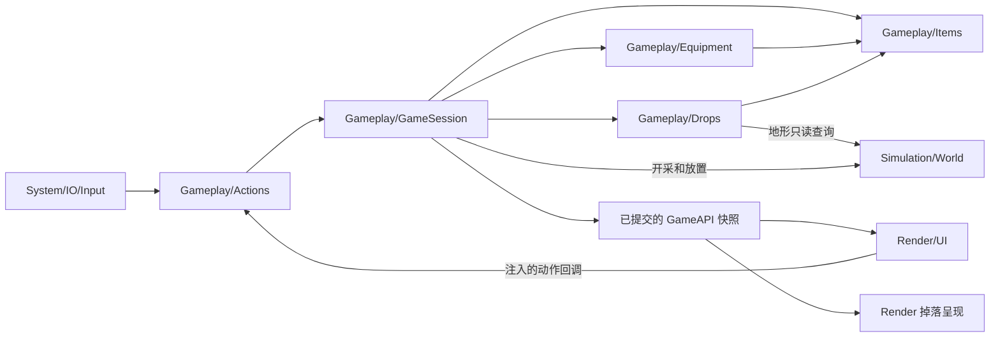

# 背包、装备与自动拾取系统设计

日期：2026-10-27。状态：设计提案，尚未实现；以下默认值用于首轮试玩，不代表 Terraria 的原版参数，也不是已经测量的性能结论。

## 目标与范围

让玩家在探索、开采和构式实验中自然积累物品：开采或其他合法来源产生世界掉落，玩家走近后吸附入包，材料用于建造，装备扩展行动能力。整理物品应当简单，满包、换装失败与掉落去向应当可解释。

参考 Terraria 的快捷栏、格子背包、独立装备栏及满包时保留掉落的体验。Pixel 的物品数量、拾取距离、装备效果和实现边界单独定义。首版覆盖材料、装备实例、世界掉落、自动拾取、整理与穿脱；怪物死亡掉落只定义接入口，不在本轮引入敌人或战斗系统。

首版不做重量、装备耐久、随机词缀、货币/弹药专用栏、垃圾槽、箱子网络、自动售卖或多套装备切换。死亡惩罚、跨世界角色库存与联网争抢另行设计。默认游戏仍按当前 Temporary 会话规则重新启动创建新世界；本设计不改变保存开关。

## 已核对的现状与必须迁移的行为

| 当前代码 | 本设计的变化 |
| --- | --- |
| `Items/Inventory` 按 `ItemId` 汇总数量，玩家容量为 4096；没有格子 | 玩家使用 50 个物品格；设备燃料容器保留按数量容量 |
| 七种材料有稳定 ID；`ItemDefinition` 只有 ID、名称、版本 | 保留既有 ID，增加分类、堆叠上限、放置规则和可选装备定义 |
| `Actions/Mining::MineCell` 在删地形前直接入包；满包不能开采 | 玩家开采先保证掉落能够承接，再移除地形；满背包不阻止开采 |
| 玩家构式绑定 `MiningCollector{Inventory, PlayerBag}` | 玩家构式与手动开采调用同一产出规则，都生成世界掉落 |
| 无收集者的环境构式删除地形但不奖励物品 | 保持显式环境销毁模式，避免自然循环凭空刷出资源 |
| 左键放土消费 soil；设备成本、煤槽转移使用预留和整批操作 | 保留成本与守恒，底层改为按格分配预留并适配玩家容器 |
| `GameSession::Tick` 环境成功后才推进角色、构式、设备并发布 | 掉落运动与拾取接入成功固定步，等待预算时不得提前更新 |
| 1–4 选择元素笔刷，B 切换设备工具，Escape 退出 | 标准模式数字键改为快捷栏；笔刷移入 F2；面板先消费 Escape |
| `PixelGameplay 3` 保存汇总库存，默认应用不保存进度 | 持久会话需要新格式与旧格式导入；Temporary 行为保持现状 |

依据为本次工作区实际源码，包含已有未提交改动；较早的 [Items 合同](../../.awtcontext/GlobalDoc/Items.md) 和验收记录仅说明当时行为。本文不会把待实现规则写回为“现行合同”。

## 玩家规则

### 背包与快捷栏

背包共有 **50 格，第一行 10 格就是快捷栏，下面 4 行各 10 格**。快捷栏保存实际物品，不建立第二份库存。只记录一个选中索引；移动物品后选中索引不变，手持内容随该格变化。空格表示没有选中物品；首版保留当前基础开采与基础构式操作，避免空背包无法开始游戏。

| 类别 | 建议堆叠上限 | 规则 |
| --- | --- | --- |
| 土、石、矿石等材料/方块 | 9999 | 同定义、同内容版本才可合并；数量对应实际开采元胞 |
| 消耗品 | 99 | 首版保留定义能力，尚无用途的内容不放进可玩清单 |
| 工具、武器、护甲、饰品 | 1 | 每件都有独立 `ItemInstanceId`，同名也不能合并 |

自动入包顺序固定为：补齐已有兼容栈（快捷栏到背包，按格号）→ 背包区空格 → 快捷栏空格。不会替换物品、挤走选中格或自动穿装备。材料大栈适合逐像素采掘；一格上限与容量以后均由配置调整，UI 不写死 4096 的旧总量限制。

允许部分拾取。例如背包只剩一个 9990 的石头栈且没有空格，地面有 20 个石头，只收 9 个，余下 11 个留在原掉落中。没有任何可容纳数量时不吸附，首次显示短暂的“背包已满”；同一包版本下限频，不逐帧弹窗。

支持整栈移动、右键取半栈（向上取整）、右键放 1 个、同类合并、不同物品交换、快捷栏与背包间快速移动。目标不能接收完整交换时保持双方不变；只有明确的合并操作允许部分转移。整理只整理背包区，按分类、物品 ID 和原格序稳定排序，不重排快捷栏。

Alt+单击收藏格中物品：收藏不阻止使用、建造扣料、补栈与手动移动；它阻止丢弃和自动整理移动。分栈继承收藏状态，合栈对收藏取逻辑或；空格不保留收藏。首版没有快捷销毁，防止整理时误删装备。

拖拽首先是 UI 的移动意图，源物品仍在原格。释放到合法目标后提交原子移动；按 Escape、关闭面板或释放到面板外取消，不产生“游标上独立持有的物品”。这样关窗口、重置和保存都无需回收临时游标库存。丢弃通过明确的按钮或 Q 操作，Q 丢 1 个，Shift+Q 丢整栈；拖拽中禁用 Q。

### 装备

| 装备槽 | 数量 | 生效规则 |
| --- | --- | --- |
| 头部、身体、腿部 | 各 1 | 只接收匹配部位的护甲 |
| 饰品 | 5 | 接收饰品；同一 `UniqueEquipGroup` 只能装备一件 |
| 手持工具/武器 | 使用选中的快捷栏格 | 不额外复制到装备栏；切换快捷栏决定主动使用对象 |

装备在背包中没有穿戴效果，自动拾取也不会自动装备。右键护甲与对应部位交换；右键饰品优先空槽，全部占用时提示玩家指定目标槽，不能偷偷替换第一件。卸下时自动找背包空格，满包则拒绝；拖到指定格时按明确交换处理。背包全满也能用来源格与旧装备直接互换，两件物品在同一次提交中交换位置。

换装验证部位、实例身份、装备组冲突、资源锁定和版本后整体提交。装备栏与背包是物品的两种位置，不是两份副本。装备不纳入建造材料扫描；穿脱不改变物品 ID、不刷新其未来可能拥有的冷却状态。

首版以两件可见收益验证装备系统：`磁石饰品`把吸附半径从 6 提高到 10 格，`轻行靴`作为饰品提供 15% 水平移动速度。三个护甲槽完成类型检查、交换和展示，使用测试护甲验证，不宣称已有防御收益：当前 Actors 没有生命/伤害结算。防御、套装和构式强化要在实际消费者存在时再加入。

派生属性由基础值和当前装备重新计算，避免反复穿脱造成累计加成。首批只需要 `MoveSpeedMultiplier` 与 `PickupRadiusCells`，相同装备组不叠加；数值为有限、合法范围，配置启动校验。默认移动速度乘数为 1，建议上限 1.5；吸附半径范围 0–16 格。保留来源明细用于装备比较。Actors 接收移动参数，Drops 接收拾取参数，都不反向读取装备容器；更换装备从下一个成功固定步开始影响运动和拾取。

### 世界掉落与自动拾取

**世界材料与物品掉落是两种对象。** 正在滑落的土、流动的水仍由 Simulation 模拟，不会因为靠近玩家就进入背包。只有成功开采或其他显式产出将材料变成物品。水、蒸汽、火按现有规则不产生可拾取物；采集液体需以后定义容器玩法。

首批产出来源为玩家手动开采、玩家构式开采和主动丢弃。Debug 可通过可信测试动作生成指定材料或装备，必须标明测试来源。未来生物死亡、宝箱或奖励调用相同的 `SpawnLoot` 接口，传入已经决定的物品；Drops 本身不决定概率、不根据物品名称猜来源。测试木头人默认不产出奖励。

| 参数 | 首版建议 |
| --- | --- |
| 世界单位 | 使用元胞格；当前玩家碰撞体约为 2×4 格 |
| 吸附/放弃追踪距离 | 6 / 8 格；磁石为 10 / 12 格 |
| 接触拾取距离 | 掉落中心到玩家 AABB 最近点 ≤ 0.75 格 |
| 新产出等待 | 6 个成功固定步，约 0.1 秒 |
| 自己主动丢弃的禁拾 | 60 个成功固定步，约 1 秒；只针对丢弃者 |
| 掉落合并 | 相距 ≤ 1 格、同内容和兼容拾取限制，不能穿固体墙合并 |

距离按玩家实际身体计算，不按镜头位置或屏幕像素。玩家进入范围、已过等待期且背包能容纳至少一个单位时，掉落加速靠近玩家；到接触距离才真正入包。吸附是运动意图，不是已经获得物品，过程中背包可能被其他操作填满，到达时必须重新计算可入包数量。

首版掉落使用约 0.5×0.5 格的小碰撞体、重力和地面阻尼；建议重力沿用 90 格/秒²量级，吸附速度上限 30 格/秒，位移使用扫掠或受限子步，不能高速穿地形。休眠掉落在附近地形变化或开始吸附时唤醒。首版不受风场、不被火烧毁，液体不吞掉物品；这些相互作用以后独立验证。

吸附与最终拾取均要求到玩家身体最近点的路径不被固体阻挡。隔墙不吸取；不做自动绕路寻路。吸附失败、超出释放距离或背包无法再接收时回到普通掉落状态。若地形移动把物品埋住，有限半径内按固定次序查找可容纳位置；找不到则原位保留并标为阻塞，等待地形改变，不能删除或跨越未知区域瞬移给玩家。

同一区域的多个候选按距离、`DropId` 排序，同一提交内逐个重新检查容量。合并选择较小 `DropId` 为保留对象，最多补至物品堆叠上限；实例装备永不合并。拾取禁令、来源规则不兼容的掉落不合并，避免把主动丢出的物品并入另一堆而绕过禁拾时间。来源不同但可合并的材料保留产出事实，当前掉落只存聚合标记，不在每堆中无限累积来源列表。

首版不按计时自动清掉物品。离开活动区域时冻结位置、速度、剩余等待与禁拾步数；重新进入时恢复，不追算离线运动。所有掉落仍由 Gameplay 的世界级存储保留，地形区块卸载不会销毁它们。Temporary 会话结束清空；Persistent 会话随一致检查点保存。

## 交互与呈现

常驻 HUD 显示 10 格快捷栏、选中物品及数量。E 打开背包，左侧显示快捷栏与 4×10 网格，右侧显示人物和装备栏，下方显示选中物品说明及换装前后的属性变化。拾取成功显示短暂的图标、名称和 `+数量`，同一批同类材料合并提示；装备使用品质标记和名称，不仅依赖颜色。

```text
快捷栏  [1][2][3][4][5][6][7][8][9][0]   选中：石头 ×128
背包    [ ][ ][ ][ ][ ][ ][ ][ ][ ][ ]   人物   [头]
        [ ][ ][ ][ ][ ][ ][ ][ ][ ][ ]          [身]
        [ ][ ][ ][ ][ ][ ][ ][ ][ ][ ]          [腿]
        [ ][ ][ ][ ][ ][ ][ ][ ][ ][ ]   饰品 [ ][ ][ ][ ][ ]
        [整理]  [丢弃]                    属性与物品比较
```

背包打开不自动暂停世界，移动与自动拾取可以继续；面板内的点击、滚轮和拖拽必须被 UI 消费，不能传到挖掘、放置或构式激活。文字编辑捕获时也不能移动角色。拖拽意图携带源格版本，自动拾取导致版本变化时拒绝过期意图、提示刷新，不能移动错误物品。当前暂停控制继续冻结掉落运动和自动拾取；无 PendingStep 时允许明确的整理、穿脱和丢弃动作，以独立 revision 提交；丢弃物仍等待恢复模拟后运动。

标准模式中 1–0 选择快捷栏，滚轮只在 HUD/游戏区域切换，面板内滚轮交给面板。E 开关背包；Escape 优先取消拖拽，其次关闭背包，未被界面消费时才执行既有退出请求。元素笔刷通过 F2 面板选择，取消其全局数字键绑定；B 仍切换已有设备工具，F3 调试镜头和 F4 构式编辑器保持明确模式。输入描述与测试必须一起更新。

首版左键对选中的可放置材料发出放置动作，其余类型仅在定义了实际 Use 行为时调用对应动作；选中空格不免费放置。右键及 Shift+右键的基础构式/开采能力保留，与面板内的右键穿脱按输入区域区分。新增 stone 等放置映射属于 Gameplay，未知或未支持物品显示“当前不可放置”，不降级成放土。

正式背包属于 `Render/UI` 的游戏界面，F2 只保留诊断面板。Application 装配 UI 与 Input 的捕获接口；UI 仅持有已发布快照和动作提交回调，不持有可变 Inventory。纯 UI 开关属于呈现状态，物品移动与装备选择属于 Gameplay。

## 领域模型与模块边界

### 单一物品所有权

`Gameplay/Items` 保留无 World/Render 依赖的物品定义和容器算法。以两种容器存储表达实际需求：`QuantityContainer` 保留设备煤槽等按数量的资源语义；`SlotContainer` 保存有限格子的背包或装备。它们由一个 Inventory 注册表管理，复用 `ContainerId/ContainerRef`、校验与预留，内部使用明确的两种存储类型，不给所有方法堆叠模式开关。

| 值/对象 | 职责 |
| --- | --- |
| `ItemDefinition` | 稳定 ID/内容版本、分类、MaxStack、可选装备定义与视觉资源键；不保存 GPU 资源 |
| `StackValue` | 可堆叠物品的定义 ID、内容版本和数量 |
| `UniqueItemValue` | 装备实例 ID、定义 ID/版本；未来实例状态随物品值整体移动 |
| `ItemPayload` | 上述两类拥有值的 variant，不允许“一个装备实例数量大于 1” |
| `SlotValue` | 固定格号、可选 Payload、收藏标记；空格号稳定，不因整理重编号 |
| `EquipmentLayout` | 头/身/腿和 5 饰品的槽位约束；穿戴内容仍存于 Items 的槽容器 |
| `WorldDrop` | DropId、版本、Payload、WorldPosition、速度、活动/休眠状态、禁拾与来源信息 |
| `PlayerItemState` | ActorId、背包容器 ID、装备容器 ID、选中快捷栏索引 |

物品只存在于一个容器格或一个世界掉落中，UI 没有独立物品副本。装备栏由 Gameplay/Equipment 定义规则，Inventory 持有实际装备物品；Equipment 的派生属性不是第二份物品存储。掉落携带自身拥有的 Payload，拾取时整体或部分迁移，不再维护一套与格子可能失配的“玩家总库存”。汇总按 ItemId 从真实格子投影，或使用随同一提交重建的缓存。QuantityContainer 只接收可堆叠资源，装备实例不能被转换成数量后丢失身份。

实例 ID 和 DropId 各自单调分配，世界替换后外部引用还必须匹配 epoch。容器 ID、实例 ID、掉落 ID、格号与视觉资源键互不代替。存档保存身份高水位；数据恢复验证一个实例只出现一次。首版不添加随机词缀或空的通用属性字典。

### 协调与依赖



`Gameplay/Drops` 拥有掉落存储、区域索引、运动和拾取候选规则，不伪装成有生命的 Actors，避免承袭 256 角色上限和 2×4 角色碰撞体。GameSession 持有 Items、Equipment 配置与 Drops 的生命周期，负责跨域产出和转移；小型纯物品操作留在 Items，避免把所有规则集中到 GameSession.cpp。

构建新增 `PixelDrops → PixelItems/PixelWorld`；Equipment 的数据校验与属性计算只依赖 Items。`PixelFormulaBridge` 可以依赖低层 Drops 及共同 Mining 规则，不能依赖 `PixelGameplay` 的 Session。用带类型的 `MiningOutput` 区分玩家世界掉落与环境销毁，替换隐式“是否绑定背包”判断；按需传入 Drops 与产出归属，不注入整个 Session。`PixelObservationValues` 只使用独立 DTO，不能为读取掉落而反向依赖 Drops 运行时。

Gameplay 主动读取 Simulation。Simulation 不知道 ItemId、装备或自动拾取；Items/Equipment 不包含 Render/Input。Input 通过 Application 注入的展示接口切换面板，不包含 Render 实现。世界资源映射和装备消费者都留在 Pixel，首版不需要引擎改动。

## 操作、提交与失败合同

### 格子与资源操作

保留现有整批 `Transfer/Reserve/Release/Consume` 的全有或全无语义。`Reserve(ItemAmount[])` 在槽容器中按格序分配可用数量，token 记录具体格子份额；受预留的格子暂时不能移动、整理或交换，但可补入兼容物品。令 `Available = Quantity - Reserved`，预留不腾出容量。消费后空格保留格号，清掉 Payload 与收藏。跨容器转移预检双方版本与目标类型，设备只能接收其明确允许的资源。

新增槽级 `MoveStack/SplitStack/EquipItem/UnequipItem/DropItem/SelectHotbar` 动作，带所属 epoch、请求序号、容器版本和格号，经过现有调用者授权及去重入口。跨两容器的操作必须检查双方版本；错误的归属与位置不能借 ID 碰撞访问其他容器。

自动拾取专用 `InsertUpTo` 返回 `Accepted` 和 `Remainder`，不把旧 `Add/Transfer` 悄悄改成部分成功。查询得到的容量仅用于规划，提交前仍复核实际版本。落地的错误语义区分 `InventoryFull`、`InvalidSlot`、`IncompatibleSlot`、`DuplicateEquipmentGroup`、`ItemReserved`、`StaleVersion`、`DropCapacityExceeded` 与既有 `WaitingForBudget`；失败不改变相关内容或版本。

### 四种必须守恒的提交

1. **开采**：验证地形和权限 → 为预期掉落规划合并/新增位置并预留存储 → 准备地形写入 → 在不可交错的提交段删除地形并发布掉落。掉落容量不足时保持对应地形，不能先挖掉再尝试分配。此处容量指地面物品承接能力，与背包容量无关。
2. **拾取**：验证掉落仍存在、距离/路径/冷却有效 → 根据最新背包计算可接收数量并预分配 → 同段增加背包、扣减掉落 → 为零才删除掉落。失败时两边不变，部分成功留下真实剩余量。
3. **丢弃**：验证来源可用量、收藏状态与出生位置 → 预留掉落承接空间 → 同段扣除背包并生成具有禁拾期的物品。没有安全出生位置或承接容量则拒绝，物品留在原格。
4. **穿脱/交换**：先校验两处内容、槽规则和唯一组 → 同段交换拥有值 → 重算派生属性并发布。不能先卸下旧装备，再因背包满而遗失物品。

沿用现有单写者和明确预检方式，不新增通用事务框架。所有可失败的存储分配在修改之前完成；预检后的不变量失败属于程序错误，不伪装成普通业务拒绝。领域快照和事实在全部成功后发布，UI 不会看到半次交换。

批量开采按稳定的 `(y,x)` 次序，可逐格成功。相邻小范围（建议 4×4 格）同来源、同类型材料可合成一堆，数量仍等于实际移除元胞数；不能把整个远距离开采圆的物品汇聚到玩家脚下。掉落存储饱和时停止本批后续开采并返回实际成功数，未处理格保留。玩家构式同步执行同一规则，环境销毁仍不生成掉落。

### 固定步与事实

固定步顺序采用：环境成功 → Actors → Formula/Devices/Garden 及其产出 → 掉落运动/合并 → 自动拾取 → `CommitStep` → 事实与只读快照发布。同一步新生成的掉落不推进等待计数，从后续成功步开始计时。新装备已提交的属性在下一个成功步读入。`StepEnvironment` 失败或存在 PendingStep 时，掉落、冷却、拾取和外部物品操作都不能推进。

同步手动开采等动作可以单独产生 revision，但不会顺带执行一次自动拾取，也不消耗禁拾步数；暂停与单步因此有一致含义。重试同一个 request 返回原回执，不再产出装备或物品。普通拾取由会话内部驱动，不接受渲染端“我已捡到”的通知作为依据。

`MaterialResult.Collected` 现表示立即入包，需要显式升级：新 `Produced` 表示已产生的物品及掉落引用，`Collected` 只用于实际入包事实，不再把开采数量冒充收集数量。更新 GameAPI schema、Formula 挖掘回执、Knowledge/History 的来源解释、LLMView JSON 和相关测试。`Mined`、`ItemsPickedUp`、`ItemDropped`、`EquipmentChanged` 是不同事实；连续拾取按一次提交和物品类型聚合，运动不逐帧生成历史事实。

持续重试与设备资源预留仍遵循已有合同。设备回收首版保持“全部退入背包，否则整体拒绝”；不能因为引入掉落而暗中改变设备回收规则。为掉落、背包和装备加入相应的发布版本检查，更新 `SynchronizeReadViews`，避免仅物品变化时继续沿用旧的可见帧。

## 数量边界、区域与观测

掉落使用按世界区域的空间索引，只查询玩家附近与活动区域；索引由世界坐标推导，支持负坐标和跨区域移动，不用显示窗口的局部下标作永久身份。索引是派生数据，重建不改变 DropId。

首版建议全会话最多 8192 个掉落实体（包含冻结对象），相邻材料合并控制采掘密度。达到上限时优先尝试合法合并；仍无位置则显式拒绝新的开采/丢弃，保留已有物品与来源。不得淘汰最老装备或静默删除地面物品。后续有敌人死亡时，必须另行提供在死亡提交前预留掉落或持久奖励待领的方案；不能照搬“拒绝死亡”或丢掉奖励。

这是一版明确的有界方案，长期大世界可能触及总上限；如实测常见，再扩展独立掉落区域页和流式持久化。本轮不声称已经解决无限世界物品存储。若候选数量超过每步工作预算，先按稳定的轮转游标选择本步候选，再在该批中按距离和 DropId 排序，避免始终处理同一组近处物品；位置/禁拾时间仍按成功固定步推进，不能用降低物理更新频率偷改时间。活动范围由游戏模拟决定，镜头刷新或后台预加载不会唤醒掉落并触发拾取。

发布值分开：玩家背包 50 个格、装备槽、选中索引与派生属性；可见区域的掉落列表；供资源/LLM 查询使用的授权库存汇总。可见区域很多掉落时使用有界分页或裁剪，并显式标记完整性；绘制裁剪不删除世界对象。新 DTO 应重新计算 `GameplayObservation::MaximumRetainedBytes` 和呈现预算，不把全部 8192 掉落无条件塞入每帧全局观测。

公开地面物品仅包含可见名称、数量、位置与拾取状态，不能由此取得私有背包权限。模型只读快照或提出获准动作，不拥有物品存储，也不能直接 SpawnLoot。Render 从同一 CommitStamp 的角色、掉落与库存值制作图元；插值和吸附光效不能产生拾取或影响权威位置。

## 持久化和旧合同迁移

在当前 `PixelGameplay 3` 之上引入下一格式版本（若实现前其他任务已升级，顺延分配，不占用已使用版本）。保存玩家槽位和收藏、快捷栏索引、装备容器及实例值、世界掉落位置/速度/冻结与剩余禁拾步数、内容版本和身份高水位。派生属性与空间索引加载后重建，吸附目标不必保存，重新判断即可。

捕获仍只发生在完整提交，无未结束资源预留；恢复先构造并校验临时领域状态，检查重复实例、数量/栈上限、格数、装备兼容、坐标、内容版本和高水位，再整体替换。错误或未知内容显式报告，不把不认识的装备丢弃。地形与物品使用同一个 checkpoint 世代，失败时不能单独发布其中一半。

旧档七种材料按 ItemId 顺序拆成合法栈，先填背包区再填快捷栏；旧总容量 4096 在本方案下可完整容纳。旧设备煤槽保留其 ID 和 64 的容量，不能误解释为 64 个背包格。旧存档没有装备或地面物品则初始化为空。异常或未来旧扩展导致溢出时拒绝迁移并说明原因，保留原检查点，不静默截断。

上线需要同步修改 `InventorySnapshot`/GameAPI 的容量单位、只读 DTO、Debug 库存展示、LLMView 序列化和测试，不让一个 `Capacity` 字段同时隐含“数量”和“格数”。建议显示 `CapacityKind`、`SlotCount/UsedSlots`，数量容器继续显示 `QuantityCapacity`。旧“开采立即获得物品”的测试明确改为“掉落产生后，成功模拟步接近并拾取”，不靠调大拾取范围使旧断言偶然通过。

## 实施顺序与验收

阶段是后续实现拆分，本轮只交付设计；不以这些尚未执行的步骤作为完成证据。

| 阶段 | 交付与退出条件 |
| --- | --- |
| P1 物品与格子容器 | 类型定义、50 格背包、实例身份、装备槽约束、整批资源接口适配；旧设备成本与煤槽测试保持通过 |
| P2 世界掉落 | 存储/区域索引、碰撞与冻结、受限生成、手动丢弃；无需 UI 即可通过 CPU 验证守恒 |
| P3 开采与自动拾取 | 迁移手动/玩家构式产出、部分拾取、满包规则、去重与新回执；环境销毁不奖励 |
| P4 换装与属性 | 护甲槽、5 饰品槽、磁石与轻行靴实际消费者、原子交换、来源比较 |
| P5 HUD 与输入 | 快捷栏、E 背包、整理/分栈/收藏、掉落绘制和提示，处理数字键与 Escape 冲突 |
| P6 完整性与兼容 | 新检查点、旧档迁移、观测授权/预算、CPU 回归、真实 GPU 输入与区域压力验证 |

P1–P5 开发时为新数据保留序列化接点；Persistent 模式在 P6 通过前不得写出缺少装备/掉落的新检查点。默认 Temporary 游戏可先用于试玩，但不能宣称持久化已交付。

| 验证场景 | 必须观察到的结果 |
| --- | --- |
| 挖 100 格石头，停在拾取半径之外 | 地形减少 100、地面合计 100、背包不增加 |
| 走近与远离 | 仅可容纳物品开始吸附；退出释放范围停止追踪；真正接触后才增加库存 |
| 9990 栈 + 地面 20，无其他空位 | 入包 9，剩余 11，所有量之和不变 |
| 背包全满，开采/装备掉落 | 可正常产出到地面，未自动丢弃或替换任一已有物品 |
| 掉落实体上限与整数边界 | 合并预检正确；失败不改变来源；无 uint32 溢出或静默截断 |
| 同名两件装备与全部装备穿脱 | ID 不变且独立；错误槽拒绝；全满背包原位换装成功、单独卸下失败 |
| 饰品组、快速重复穿脱 | 冲突拒绝，移动/拾取属性可恢复基础值，无累计加成 |
| 主动丢弃、合并与暂停/单步 | 禁拾只按成功步倒计时，合并不能绕过；暂停不自行入包 |
| 固体墙、埋入、负坐标、跨区与高速运动 | 不穿墙拾取、不穿地形、不丢身份；未知区域保留冻结对象 |
| PendingStep、过期格版本、过期 epoch、重复 request | 没有多产出、多拾取或搬错物品；失败不改变相关版本 |
| 预留与移动/补栈/消费交错 | 预留份额受保护，完成后 token 无法再次使用，设备资源守恒 |
| 手动与玩家构式、自然源、测试木头人 | 玩家来源共用产出规则；自然销毁和木头人不刷奖励 |
| 关闭面板、取消拖拽、文字输入、数字键、Escape | 物品仍有唯一位置；UI 操作不泄漏到游戏；退出顺序正确 |
| 装备/掉落保存恢复与旧 4096 库存导入 | 数量、ID、格位、剩余计时一致；存储失败保留上一完整世代 |
| 帧率 30/60/144、稀疏及饱和掉落场景 | 同成功步输入获得相同结果；记录固定步、候选扫描、发布内存和渲染成本 |

实现时扩充 `Pixel.Items`、`Pixel.InventoryGameplay`、`Pixel.Actions`、`Pixel.FormulaGameplay`、`Pixel.Input`、`Pixel.Checkpoint` 与观测专项，新增 Drops/Equipment 的 CPU 专项。保留 `Pixel.ModuleBoundaries`；HUD 和掉落呈现需要真实 Pixel GPU smoke。性能在 Release 中测量基线与密集拾取，不在缺少证据时承诺固定耗时或引入复杂并行。引擎若未变不要求为此改 AET。

首个可玩闭环是：空包出发 → 挖土石生成掉落 → 走近拾取 → 快捷栏选石头并放置 → 拾到磁石 → 右键装备并看到吸附范围变化 → 填满背包验证地上保留 → 换装/丢弃仍守恒。装备来源可用明确的开发测试场景提供，正式掉落表留到内容设计。

## 来源与设计验证记录

- Terraria 参考：[Inventory](https://terraria.wiki.gg/wiki/Inventory)、[Equipment slots](https://terraria.wiki.gg/wiki/Equipment_slot)。2026-10-27 通过官方 Wiki 的搜索索引摘要核对快捷栏、独立装备栏、右键装备和满包行为；正文请求返回 403。本文没有据此宣称复刻原版全部规则或精确参数。
- 游戏意图：[游戏总纲](GameDesignVision.md)，特别是物品装备成长与整理便利性。
- 工程依据：[Items 合同](../../.awtcontext/GlobalDoc/Items.md)、[固定步与提交](../Architecture/SimulationCommits.md)、[一致检查点](../../.awtcontext/GlobalDoc/Checkpoints.md)、[当前 README](../../README.md)。
- 本轮直接检查 Items、Mining、GameActions、GameSession 更新/发布/持久化、Actors、GameInput、GameAPI 与现有测试入口。设计与源码之间的差异在上文显式列出。
- 本轮为文档设计，未编写生产代码、运行游戏或执行 CPU/GPU 测试；上述验收矩阵是实现要求。工作区既有未提交代码保留，本地 Axiom 子模块与相邻只读引擎未修改。
