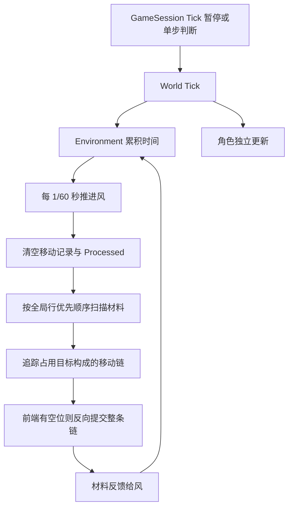

# 世界方块更新性能调查与优化方案

2026 年 10 月 16 日。当前材料更新的主要问题是：**没有发生移动的世界，仍然每个固定步重新证明所有泥土都不能移动。** 优先实现带完整失效条件的静止世界休眠，再扩展到活动区域；移动目标缓存可降低持续活动时的成本。多线程、GPU 和容器替换应排在后面。

本次完成代码调查、CPU 隔离测量和行为验证，生产游戏算法未修改。当前游戏启动默认暂停；本文研究的是恢复模拟后的材料固定步。此前整帧数据来自 [性能基线](PerformanceProfiling.md)，不能当作当前默认暂停状态的帧率。

## 更新逻辑与行为约束



关键入口是 [Environment.cpp](../Pixel/Source/Runtime/Simulation/World/Environment/Environment.cpp) 的 `Tick`、`StepForceField`、`ResolveMovementChain`，以及 [World.cpp](../Pixel/Source/Runtime/Simulation/World/World.cpp) 的 `GetFieldVelocity` 和 `MoveMaterial`。

每个材料步执行以下工作：

1. `Processed.assign(N, 0)` 重置整个世界的处理标记，`DirtMovements.clear()` 清空风反馈记录。
2. 扫描全部 `CellState`，对尚未处理的泥土发起移动链。空气也需要被扫描后才能跳过。
3. 将线性索引转为坐标，沿 `GetFieldVelocity → GetForce → Environment::SampleForce` 读取连续基础力并采样材料风响应，再转换为八邻域方向或静止。
4. 沿方向追踪被占用的目标；直到空位、世界边缘、不可移动材料、静止格或已处理格。
5. 有空位才从链尾向前搬运 `Type`，并标记目标已处理。只有需要材料动量反馈的风策略才收集成功移动；全部材料处理完之后统一反馈给风。

这不是只检查下面一个格子的传统落沙扫描。当前规则允许转弯移动链、任意八方向场、长链整体跟随、闭环阻塞，以及全局行优先的目标争用。基础力属于空间，材料搬迁不携带它。每个材料每步最多移动一个邻格，但影响可以沿很长的占用链传播。

`Processed` 保证每个泥土源位置最多进入一次实际解析；总体材料步工作量可写为 `O(N + D + M)`，其中 N 是世界格数、D 是参与解析的泥土、M 是成功移动数。因此当前材料算法是线性的，不是每个源重新遍历整列的平方级算法。优化重点是减少 N、D 对静止区域的重复支出，以及降低剩余访问的成本。

世界与表现还有一条独立路径：帧首 `PublishState` 交换数组后回填，`BuildWorldGridFrame` 映射材料，再做快照验证、上传与绘制。它们不在 `world.material_step` 内。材料休眠不会自动消除这些成本。

## 实测工作量

计数实验直接在 `Environment.cpp` 的独立副本中记录链、采样和移动次数。以下为 1024×1024 世界的一个步；计数版不用于计时。

| 场景 | 外层扫描格数 | 受力采样 | 发起链数 | 写入链记录 | 成功移动 |
|---|---:|---:|---:|---:|---:|
| 默认下半世界地面 | 1,048,576 | 524,288 | 1,024 | 523,264 | **0** |
| 默认地面加一个空中泥土 | 1,048,576 | 524,289 | 1,025 | 523,265 | **1** |
| 全空气 | 1,048,576 | 0 | 0 | 0 | 0 |
| 空中 256 个分散泥土 | 1,048,576 | 256 | 256 | 256 | 256 |
| 空中 256 行连续泥土 | 1,048,576 | 262,144 | 1,024 | 262,144 | 262,144 |
| 下半世界全部受水平向右力 | 1,048,576 | 524,288 | 512 | 523,776 | 0 |
| 下半世界全部零力 | 1,048,576 | 524,288 | 524,288 | 0 | 0 |
| 默认地面最底部挖掉一格 | 1,048,576 | 524,287 | 1,024 | 523,264 | 511 |

默认地面每列都会被向下追踪到边缘，证明无法移动。下一步全部重做；按 60 步/秒计算，每秒扫描约 6291 万格、采样受力约 3146 万次，而材料完全静止。

默认场景最长记录链为 511，`MovementChain` 容量为 512 条，即本机约 8 KiB。首步只有 10 次容量增长，此后复用。`Processed` 为约 1 MiB。不能将 52 万次 `push_back` 解释成 52 万次堆分配；`reserve` 或更换 allocator 不能解决主要问题。

## 隔离计时结果

使用当前工作区的纯 CPU World 源码，不链接引擎、窗口或渲染。Apple Clang 21，arm64；Debug 为 `-g`，RelWithDebInfo 为 `-O2 -g -DNDEBUG`。每个场景独立创建世界，每轮预热 8 步、测量 40 步，共 3 轮；计时范围为现有 `world.material_step`，每次确认恰好执行一个固定步。正式测量串行进行，期间没有本轮编译负载。

| 场景 | Debug 平均 ms/步 | 优化构建平均 ms/步 |
|---|---:|---:|
| 默认静止地面 | **43.108** | **6.643** |
| 默认地面上只有一个泥土下落 | **43.467** | **6.860** |
| 默认地面且完全移除风 backend | 43.135 | 6.601 |
| 全空气 | 2.428 | 0.243 |
| 空中 256 个分散泥土 | 2.560 | 0.247 |
| 空中 262,144 个泥土整体下落 | 29.416 | 4.242 |
| 半图泥土向右受阻 | 38.818 | 2.364 |
| 半图泥土零力静止 | 26.948 | 2.270 |

空风 backend 与完全禁用风的差异很小，说明单独删除空风虚调用无法解决材料步热点。空世界仍有全图扫描和标记清零，解释稀疏场景的成本下限；但它比默认地面便宜得多，因而只优化清零也无法去掉主要成本。

“默认地面加一个空中泥土”每步实际只移动一个方块，却仍采样全部 524,289 个泥土，耗时约 6.86 ms。整体休眠会被这个持续运动的方块打断，说明活动区域优化对于局部编辑和少量下落仍然必要。该补充场景单独串行采集，差值不应解释为一个方块本身需要额外 0.22 ms。

默认向下受阻与向右受阻的受力采样数相同，优化构建耗时相差约 2.81 倍。向下链以宽度 1024 跨行访问，`CellState`、基础力、处理标记的地址步幅分别约为 12 KiB、8 KiB、1 KiB；向右链大体连续访问。这个差异支持继续研究访问局部性，但同时存在链长度和链数量差别，不能将全部差值断言为缓存未命中；本轮没有硬件 cache-miss 计数。

### 局部简化实验

保留全图扫描、`Processed` 和原移动链算法，只改变移动目标的求法：

| 默认静止地面 | Debug ms/步 | 优化构建 ms/步 | 优化构建相对原算法 |
|---|---:|---:|---:|
| 原算法 | 43.108 | 6.643 | 基线 |
| 直接读取基础力并沿用方向转换 | 35.978 | 6.012 | 减少约 9.5% |
| 预先计算每格目标索引 | 23.071 | 2.266 | 减少约 65.9% |

直接读取版绕过 World/Environment 采样调用链及风采样，只对本实验无风场景有效。缓存版在预热前按当前实际连续力构造全图目标数组，额外占 4 MiB；默认场景构造均值为 Debug 30.38 ms、优化构建 3.94 ms，这部分不计入表中的稳态材料步。它没有实现力场修改和动态风的失效机制。

因此表格证明的是**重复求方向和目标具有可消除的成本**，不代表游戏已经获得 66% 的材料步收益，更不是整帧收益。缓存方案还保留完整移动链与全图扫描，对全空气、只有少量材料的场景几乎无益。不同方案在各场景、各轮结束后的材料与方向元数据哈希一致；这不是动态编辑或动态风下的等价性证明。

## 优化方案与实施顺序

### 第一阶段 静止世界休眠与版本记录

这是当前默认场景最直接、较易证明正确的改进。先用原算法跑完一个完整步；满足以下条件时，后续固定步可跳过材料解析：

- 风策略为 Empty 或风已禁用，没有随时间演化的材料受力。
- 上一完整材料步成功移动数为零。
- 材料内容、连续基础力、风配置的版本均未变化。

在这些条件下，状态与输入完全相同，确定性算法重复执行必然得到相同结果。第一版可以在任意相关编辑后保守唤醒整个世界，继续执行原算法直到再次静止。它不需要先解决局部移动链依赖。

建议将材料版本归于 World，基础力版本归于 ForceField，风配置变化归于 WindSimulation；Environment 只保存上一次确认稳定的版本和是否有移动。接口职责保持在现有模块中，不建立新的全局事件框架。初次构建、地形重置要使旧稳定状态失效。

必须覆盖的变化入口：

| 变化 | 当前入口 | 对休眠或缓存的影响 |
|---|---|---|
| 材料放置、移除和替换 | `PlaceDirt`、`RemoveDirt`、`SetCell`、`Fill`、`MoveMaterial` | 材料版本或变化区域 |
| 离散力修改 | `SetForceDirection`、`FillForceDirection`、`RandomizeForceDirections` | 基础力版本或区域 |
| 连续力修改 | `SetBaseForce`、`AddBaseForce`、`FillBaseForce` | 必须跟踪；不会同步更新 `CellState::Force` |
| 风改变 | 配置策略、配置高度、关闭、添加 impulse | 保守失效；非 Empty 首版全量模拟 |
| 世界重置 | `GenerateTerrain` | 清空全部旧状态和缓存 |
| 快照发布 | `PublishState` | 内容不变，不应唤醒；不能将数组地址作为版本 |

休眠只作用于材料步骤。仍要消费固定步时间、更新角色和必要的环境状态，清除本步移动记录，避免把旧动量重复反馈。不能直接跳过整个 `World::Tick`，也不能依靠 `DirtMovements.empty()` 判断无移动——Empty 策略本来就不记录这个数组。

收益目标是让静止世界预热后的材料访问次数从百万级降为零；具体 ms 和最终 FPS 必须在实现后复测。世界里只要有方块持续运动，整体休眠就不能触发，因此这只是第一阶段。

### 第二阶段 活动区块与移动依赖

针对“大片静止地面加少量移动或编辑”的持续运行场景，引入例如 32×32 的活动区块。1024×1024 世界有 1024 个区块，可记录是否存在泥土、是否需要复核、局部变化范围。32 是候选尺寸，最终通过不同密度场景比较 16、32、64。

区块负责筛选需要工作的空间，现有移动链仍负责执行移动。遍历活跃候选必须保持全局行优先次序；链一旦出发，必须允许越过区块边界继续追踪。不能简单采用“遍历完整区块，再遍历下一个区块”的顺序。

更困难的是唤醒传播：修改目标格后，应沿“哪些材料的目标依赖这里”向上游传递，直到依赖闭合。静态方向下每个目标只有最多八个相邻前驱，可以按目标关系检查，但长链仍可能跨越整个世界。若无法证明闭合范围，应保守唤醒更大连通区域或退回全量步骤。

必须保留同一步的顺序语义，包括源格被腾空后，尚未轮到的其他材料能否进入；只计算下一步活动集合可能漏掉当前步的变化。建议第一版只支持无动态风场景，并使用原全图算法逐步对照。动态风先走全量回退，之后再考虑风区、材料采样邻域与跨区链依赖的保守激活。

活动区块还需要配套减少 `Processed` 的全图清零，例如只清空上一轮触及的区块。世代标记也是候选，但 32 位世代会把标记数组从 1 MiB 扩为 4 MiB，并要处理回绕。先测量再选，不应为了消除廉价清零引入更昂贵的随机访存。

### 第三阶段 缓存静态方向或目标

当大量材料持续活跃、但基础力不常变化时，缓存可以减少每个源的坐标转换、场采样、方向量化和边界判断。优先在静态受力区域按版本构建，局部力编辑只使对应区域失效。

目标索引缓存容易验证，但本实验每百万格增加 4 MiB；压缩为九种方向的字节编码只需约 1 MiB，同时会保留一些坐标和边界计算。生产 World 接受通用尺寸，使用 32 位目标索引前须验证尺寸与哨兵范围，不能仅依据当前 1024×1024 默认值缩窄类型。

缓存必须由真实 `ForceField` 经现有 `FieldResponse` 构造，不能直接复用 `CellState::Force`。后者在连续力修改后只是兼容元数据。动态风区内的有效方向可能每步变化，也可能受邻近固体暴露面影响；重建整个缓存可能比按需计算更慢。第一版保留动态区原路径。

### 后续 数据布局与快照

若上述改动后仍以材料访问为主要成本，再评估将 Type、旧方向元数据与连续基础力分开存储。当前 `CellState` 在本机为 12 字节，材料扫描主要读取 4 字节 Type；分离后更利于批量扫描和增量快照，但会影响 `WorldStateView`、编辑、角色碰撞和发布契约，改动面大于局部缓存。

材料版本也可用于跳过未变化的材质映射和全图数据验证。验证缓存必须包含材料内容、外观表/材质目录、显示模式等依赖；相机、后处理、角色和其他每帧参数仍要更新并验证。GPU 每个 frame slot 要跟踪自己的上传版本，不能只用一个全局 dirty 标记，否则多个在途帧可能读到旧内容。继续保留“帧首发布、Draw 只读快照”的契约。

当前 Empty 风效快照仍会扫描全图，可先增加明确的无风能力判断并提前退出。历史 Debug 基线中，材质映射、风效快照、验证合计约 30 ms/帧；即便材料步骤大幅减少，剩余发布路径仍可能限制帧率。实际 CPU 上传写入很便宜，暂不优先重做 GPU 传输。

## 必须避免的行为变化

**只唤醒修改点周围一圈。** 本轮在一列 1024 个静止泥土的最底部挖一格，下一步最上面的位置立即空出，1023 个泥土都参与了跟随。局部邻域逐帧传播会把一次链移动变成许多帧，改变玩法。

**按区块改变竞争顺序。** 本轮让 `(33,0)` 向左下、`(31,1)` 向右竞争 `(32,1)`。全局行优先由 `(33,0)` 获胜；32×32 区块优先遍历会让 `(31,1)` 抢先。这也是暂不直接并行运行区块的原因。

**把上一帧没动作为唯一休眠条件。** 一个零力泥土保持不动后，`SetBaseForce(1,1,{3600,0})` 会让它下一步向右运动，但 `CellState::Force` 仍是零。本轮已验证这个反例；仅监听材料编辑或旧方向字段会漏唤醒。

**降低固定步频率或按相机裁剪模拟。** 当前每步最多走一格，降低频率会直接改变材料速度；视野外材料也可能影响长链和风。它们属于玩法取舍，不能作为保持行为的透明性能优化。

**先上多线程或 GPU。** 当前链可能跨区、争用目标，而且前面的提交会影响后续结果。并行化需要明确的冲突解决与提交顺序，可能引入新的模拟规则。先减少无效工作，更容易获得默认场景收益并保留确定性。

## 验证与后续验收

优化实现应把现算法保留为测试参考，对照每一步的全部材料、场元数据、材料数量与必要的风反馈，不能只比较最终图片或总方块数。

| 验证场景 | 需要保留的性质 |
|---|---|
| 静止地面和空世界 | 无修改时稳定；休眠后不再扫描材料 |
| 单格编辑、连续批量编辑、重置 | 同一固定步正确唤醒，不遗留缓存 |
| 32768 格长链、折线链、闭环 | 不丢材料、不递归溢出、保持整链跟随 |
| 跨区块争用 | 与原算法逐步一致的获胜源 |
| 连续力与离散力交替修改 | 使用真实受力，保留死区及边界语义 |
| 风策略、高度与 impulse 切换 | 失效完整，材料反馈不重复、不漏记 |
| 快照交换、暂停与单步 | 无悬空视图；暂停后编辑、恢复行为一致 |
| 密集运动 | 活动集合维护不能显著拖慢最坏场景，必要时回退全图 |

性能对照应同时报告材料 ms/步、P95、真正访问格数、场采样次数、活动区块、成功移动、唤醒数和回退次数；整帧另报固定步数、active/gap、发布成本。当前引擎输入上限 50 ms，Environment 步长 1/60 秒；低帧率时每帧最多约三步，优化后步数也会变化，不能用单步倍率直接推算 FPS。

## 证据与复现

完整测量汇总见 [summary.csv](Performance/2026-10-16-material/summary.csv)，工作量见 [counts.csv](Performance/2026-10-16-material/counts.csv)，验证范围见 [verification.txt](Performance/2026-10-16-material/verification.txt)。原始逐步数据和生成的源码副本位于本机 `build-profile-results/2026-10-16-material/`。

源码基线为 Pixel HEAD `bcb4cd24895d390258dbf4e277bb941520621375` 加当前工作区已有改动；本地引擎为 `bf88a6ec235b6931fbdedb81db986dca74d5653a`。本轮不依赖引擎构建；World 源码在调查开始时没有未提交修改。快照哈希见实验目录的 `source-hashes.json`。

实际验证包括：两个构建各 8 个计时场景、3 个算法版本，每组 120 步，共 5760 个计时样本；两个构建的 9 个首步计数场景逐项相同；24 组场景/轮次的结束状态哈希在两个构建、三个版本间一致。原有 `PixelFieldTests`、`PixelBaselineTests`、`PixelWindStrategyTests` 分别链接原算法独立运行，Debug 与优化构建均通过；新增三个语义探针也在两种构建通过。没有运行完整游戏 GPU 测试，本轮未改生产行为。

在工程根执行，输出目录使用新的路径以避免混入旧结果：

```sh
python3 UnitTest/Benchmarks/Material/run_probe.py build --config Debug --output /tmp/pixel-material-investigation
python3 UnitTest/Benchmarks/Material/run_probe.py build --config RelWithDebInfo --output /tmp/pixel-material-investigation

# 构建结束后串行运行；config 分别选择 Debug 和 RelWithDebInfo。
# variant 分别选择 baseline、direct、cached、counters。
python3 UnitTest/Benchmarks/Material/run_probe.py run --config RelWithDebInfo --variant baseline --output /tmp/pixel-material-investigation
python3 UnitTest/Benchmarks/Material/run_probe.py contracts --config RelWithDebInfo --output /tmp/pixel-material-investigation
python3 UnitTest/Benchmarks/Material/run_probe.py summarize --output /tmp/pixel-material-investigation
```

`baseline` 使用原始 Environment 源码；其他变体只生成于输出目录。脚本的源文本替换会校验预期位置，生产源码变化后需要复核实验适用性。细粒度计数运行与正式计时分开，快照哈希计算和 CSV 输出在计时区间之外。本轮数据是 CPU 微基准，不包含显示帧率、GPU 时间，也不构成生产优化已经落地的声明。
