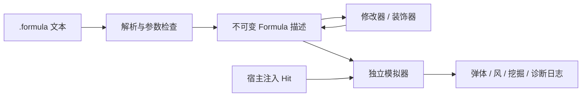

# 构式语言原型（Formula DSL）

正式领域名称为“构式（Formula）”，替代早期“法术”称呼。代码已统一为 `Pixel/Formula`、C++ `Formula` 类型、`pixel::formula` 命名空间、`.formula` 示例文件和 `PixelFormula` 构建目标；`cast` 仍表示激活构式，语义保持不变。整体设计见 [AWT 构式系统](../../.awtcontext/GlobalDoc/FormulaSystem.md)，实际架构与历史提案差异见 [构式语言架构](../../.awtcontext/GlobalDoc/FormulaLanguageArchitecture.md)。

这是 Pixel 内可独立构建的 C++20 子系统，用来验证“构式描述经过修改器或装饰器之后，仍然是构式描述”的玩法基础。它提供文本语言、不可变描述、独立 CPU 模拟器、命令行演示和行为测试。目前不接入游戏中的 World、角色、碰撞或渲染。

## 快速运行

在仓库根目录执行。独立构建只依赖 CMake 3.23+、C++20 编译器与标准库，不需要 `Axiom/`、Slang、窗口或 GPU。

```sh
cmake -S Pixel/Formula -B build-formula -DCMAKE_BUILD_TYPE=Debug
cmake --build build-formula -j4
ctest --test-dir build-formula --output-on-failure

./build-formula/PixelFormulaDemo Pixel/Formula/Examples/order.formula --ticks 0
./build-formula/PixelFormulaDemo Pixel/Formula/Examples/rhythm.formula --ticks 40
./build-formula/PixelFormulaDemo Pixel/Formula/Examples/impact_burst.formula --ticks 30 --hit-at 6
```

以上为单配置生成器的路径；多配置生成器加 `--config Debug`，可执行文件在 `build-formula/Debug/`。根项目也注册 `PixelFormula`、`PixelFormulaDemo` 和 `PixelFormulaTests`；根项目的可执行文件遵循原有 `build-cpu/bin/Debug/` 布局。

`--ticks N` 表示运行到绝对 tick N，默认 60。`--hit-at N` 在 tick N 对**当时所有存活弹体**，按 ID 顺序在其计算位置注入一次命中；后续生成的弹体不会自动命中。这是显式测试操作，不代表已经实现碰撞检测。去掉此选项，弹体只会直线运动并在寿命结束时消失。

## 一个完整程序

```text
// 共享描述，不是共享的运行中对象。
let carrier = bolt() |> speed_mul(1.5) |> damage_add(5);
let impact = seq(wind(8, 120), dig(3), delay(2, bolt(4, 30, 12)));
cast on_hit(carrier, impact) |> fan(3, 10);
```

这个程序在 tick 0 发出三颗弹体，角度为 −10°、0°、+10°，伤害各 15、速度各 90 格/秒。在 tick 6 注入命中后，tick 7 每个命中位置发出风脉冲和挖掘指令，tick 9 各生成一颗伤害 4、速度 30、寿命 12 tick 的弹体，tick 21 消失。外层 `speed_mul`、`damage_add` 不改变命中载荷中的参数。风与挖掘目前只产生可检查的指令日志，不修改地形或风场。

`order.formula` 展示修改顺序的最小对照：基础伤害 10；先加 5 再乘 2 得到 30；先乘 2 再加 5 得到 25。复用 `base` 不改变原描述。

`rhythm.formula` 在 tick 6、18、30 各发出一对 −6°/+6° 的弹体。延迟与重复使用模拟时钟，不使用真实睡眠或渲染帧时间。

## 语言规则

```text
program    := { "let" name "=" expression ";" } "cast" expression ";" EOF
expression := primary { "|>" modifier_call }
primary    := name | call | "(" expression ")"
call       := name "(" [ argument { "," argument } ] ")"
argument   := number | expression
```

- 一个文件定义零个或多个 `let`，最后恰好一个 `cast`。声明按先后顺序可见；不支持前向引用、递归定义、重名、赋值或用户自定义函数。名称使用 ASCII 字母、数字和下划线，首字符不能是数字，区分大小写。
- 支持 `//` 行注释、换行、空白和表达式括号。不支持字符串、循环语句、条件、随机数、算术中缀运算或导入。
- 普通数值支持正负、小数和科学计数，例如 `-5`、`.5`、`1.2e2`，必须可表示为有限 `double`。count 为无符号 32 位十进制整数，tick 为无符号 64 位十进制整数；二者不接受小数、符号或科学计数写法。
- 解析失败给出文件名（CLI）、从 1 开始的行号和列号及原因。解析完成之前不执行任何效果；参数数量、参数类型和语义范围也在解析时检查。

| 表达式 | 含义 |
|---|---|
| `empty()` | 空构式，无指令、无诊断 |
| `bolt()` | 默认伤害 10、速度 60 格/秒、寿命 120 tick |
| `bolt(damage, speed, lifetime)` | 伤害、速度非负，寿命为正整数 |
| `wind(radius, impulse)` | 半径非负；按激活方向产生有符号速度脉冲，负值反向 |
| `dig(radius)` | 半径非负的挖掘指令 |
| `seq(a, b, ...)` | 按书写顺序激活各子描述；允许零个子项 |
| `damage_add(amount, s)` | 弹体伤害相加；每次相加后最低为 0 |
| `damage_mul(factor, s)` | 弹体伤害乘以非负因子 |
| `speed_mul(factor, s)` | 弹体速度乘以非负因子 |
| `delay(ticks, s)` | 相对当前激活时间，延后激活 s |
| `repeat(count, interval, s)` | 在 0、interval、2×interval… 激活 s；count=0 为空 |
| `fan(count, spacing, s)` | 同 tick 居中散射；spacing 是相邻分支的角间距（度），count=0 为空 |
| `on_hit(carrier, payload)` | 给 carrier 中每个弹体注册单次命中载荷 |

管道只支持 `damage_add`、`damage_mul`、`speed_mul`、`delay`、`repeat`、`fan`，左侧自动成为最后一个参数。因此：

```text
bolt() |> damage_add(5) |> damage_mul(2)
// 等价于
damage_mul(2, damage_add(5, bolt()))
```

`on_hit` 使用显式的两个参数，以便清楚区分载体与载荷。每一个参数都可以是完整的组合表达式。CLI 会打印展开绑定、去掉管道语法后的规范表达式；给它加上 `cast ` 前缀和 `;` 后缀即可重新解析。

## 封闭性及作用域

`Formula` 表示有限、构造合法的不可变描述，内部共享 `const Node`。固定合法参数的修改器和装饰器均返回 `Formula`，因此可以不断嵌套。`seq` 和 `on_hit` 接收多个 `Formula`，也只返回一个 `Formula`。活弹体、事件和世界指令是执行产物，不作为下一层描述节点的输入。



- 修改器穿过 `seq`、`delay`、`repeat`、`fan`，只进入 `on_hit` 的 carrier，不进入 payload。嵌套修改按**内层到外层**执行，对应管道从左到右。
- `wind`、`dig` 不具有弹体伤害和速度属性。修改器保留它们的原效果，并输出 `Diagnostic`；把它们当作 `on_hit` 载体也只保留原效果并诊断。空描述不产生诊断。这使混合组合可以继续运行，又不会静默假装修改生效。
- 命中载荷只继承根激活 ID、实际命中位置和载体方向。它不会继承载体的伤害、速度修改器或其他命中绑定；其内部仍可显式包含修改器和下一层 `on_hit`。
- 多个嵌套命中装饰器分别注册，触发时按内层到外层启动。外层修改器只改所有当前载体，不能通过载体穿入这些载荷。
- `seq` 是同一激活时刻的有序组合，不等待前一弹体消失；显式 `delay` 才表示时间。忽略仅用于打印的 AST 括号结构，`seq` 在可观察执行上满足结合律，`empty()` 是其单位元。修改器组合通常不满足交换律。

这里验证的是**描述类型与组合结构的封闭性**，不是无限精度数学运算。有限数值在组合计算中仍可能溢出；模拟器会抛出异常，不输出无穷数或让 tick 回绕。异常发生前可能已经执行了一部分描述；原型不提供事务回滚，遇到运行异常应丢弃本次模拟器实例再重试。这些基础数值检查不构成生产环境的安全或资源控制。

## 模拟器接口和时序

```cpp
#include "Formula/Simulator.h"
using namespace pixel::formula;

auto formula = Parse("cast on_hit(bolt(), wind(8, 120)) |> fan(3, 10);");
Simulator sim;
sim.Cast(formula, {100, 200}, 0); // 0° 向右，正角度转向 +Y（游戏中向下）
sim.AdvanceTo(6);              // 包含 tick 6 的所有到期工作
auto projectiles = sim.Projectiles(); // 独立的当前位置快照
sim.Hit(projectiles.front().Id, {106, 200}); // 宿主提供实际命中位置
sim.AdvanceTo(7);
for (const auto &entry : sim.Trace()) {
    // std::visit 分派 BoltSpawn / WindImpulse / DigArea 等指令。
}
```

- 每 tick 是 1/60 秒。位置单位为世界格，弹体速度和风脉冲为格/秒。初始位置和角度由宿主传入，描述不保存运行中位置。
- `Cast` 只排入当前时刻；`AdvanceTo(Now())` 可以立即执行。时钟不允许倒退。一次推进到 N 或逐 tick 推进，在相同外部事件输入下得到相同结果。
- 弹体位置用初始位置 + 速度 × 经过时间直接求值，没有重力、风阻、碰撞或逐步物理积分。延迟发射使用激活时捕获的位置与方向，不跟随之后移动的宿主角色。
- 弹体在 `[spawnTick, spawnTick + lifetime)` 存活。每个时间点先处理到期消失，再按入队顺序处理计划激活；单次激活内部按描述顺序深度优先，零延迟和零间隔重复立即展开。
- `Hit` 只接受仍存活的弹体 ID，消耗弹体并把每个载荷排入 `Now()+1`；重复、未知和过期 ID 返回 false。自然消失不会触发命中。命中日志先于未来载荷，弹体的旧消失计划到期时会被忽略。
- `Projectiles()` 返回按 ID 排序的快照。`Trace()` 返回模拟器持有的完整日志；继续运行可能改变该 vector，不能长期保存其中元素的引用。
- 相同 `Formula` 可以重复激活，也可以交给多个独立模拟器；描述没有运行状态。原型 API 不承诺同一个 Simulator 的并发访问安全。

## 文件边界与验证

| 文件 | 职责 |
|---|---|
| `Include/Formula/Formula.h`、`Source/Formula.cpp` | 描述值、构造接口与规范打印 |
| `Source/Node.h` | 模块私有的封闭节点集合 |
| `Source/Parser.cpp` | 词法、语法、绑定和构造参数检查 |
| `Include/Formula/Simulator.h`、`Source/Simulator.cpp` | 运行状态、确定性时间队列、事件和指令 |
| `Source/Main.cpp` | 文件和命令行 I/O、演示事件注入 |
| `Tests/FormulaTests.cpp` | 组合行为、作用域、时间与错误诊断的回归测试 |

CTest 的 `Pixel.Formula` 覆盖：共享描述不变性、管道顺序、规范打印再解析、混合效果闭包、序列结合律与单位元、零份数、散射角、延迟重复、时间分段一致性、命中载荷隔离与嵌套、重复命中、寿命边界、独立激活、源位置诊断和数值边界。`Pixel.Formula.Demo` 从磁盘加载示例并检查命中后实际产生风指令。

## 原型边界与后续讨论

这轮没有实现游戏接线、编辑器、抽取机制、资源费用、伤害结算、随机性、序列化版本迁移、取消操作、执行配额或恶意脚本隔离。解释器采用直接递归与展开，日志和计划任务不裁剪；只用于受控的本地小规模实验。它不能保证任意巨大或深层程序的性能，也不是生产沙箱。

下一轮可以用现有样例逐步判断三件事：

1. 这套函数与管道语法是否足以表达玩家想要的构筑，或者应该保留文本作为中间表示、在上层做卡牌/节点编辑器。
2. “当前载体”作为修改作用域是否符合直觉；对不适用属性，现在的“保持效果并诊断”是否要改成编辑期提示或严格错误。
3. 先把 `WindImpulse`、`DigArea` 接到 CPU World，还是先加入真实弹体碰撞。接入时应由 Pixel 玩法层消费指令并回传命中，明确与 Environment 的固定步顺序；World 和引擎不需要反向依赖解析器。

早期完整设计保留在仓库 `Docs/SpellProgrammingSystemDesign.docx`，其中仍使用旧称；提案中的预算、费用、生产调度与引擎集成并非本原型已经实现的功能。当前设计状态由上述 AWT 工程知识维护。
