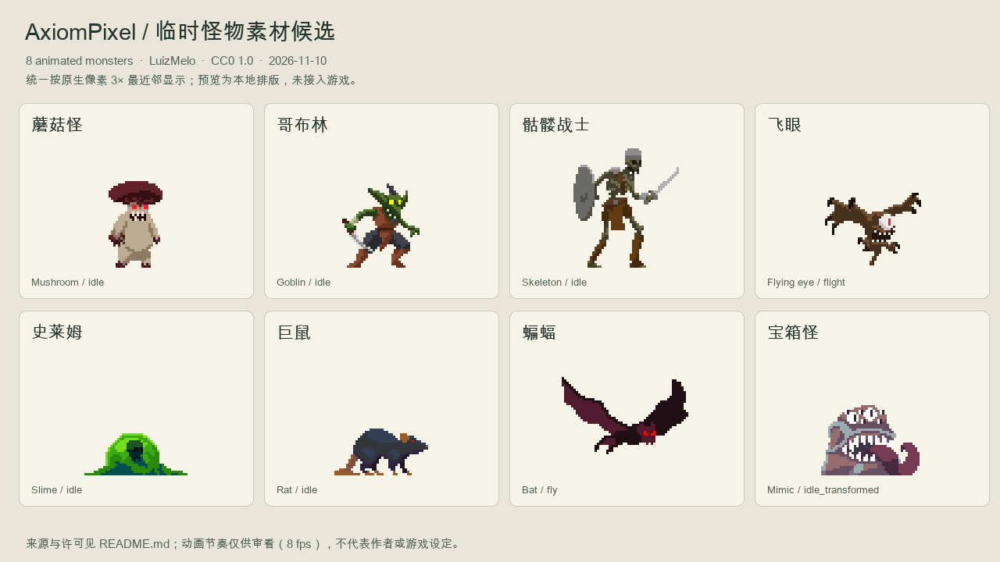

# 临时怪物素材

整理与许可核对：**2026-11-10，Asia/Shanghai**。从 LuizMelo 的两个官方素材页取得 **8 种横版像素怪物**，全部按 US$0 下载。当前用于 AxiomPixel 开发占位，后续可替换；本次没有接入游戏。

[动态预览](Previews/comparison.gif) · [动作与切帧索引](ANIMATIONS.json) · [署名文本](CREDITS.txt) · [完整性验证](VALIDATION.json)

## 推荐用途与规格

选择依据是现有 GandalfHardcore 玩家约 42 像素的可见身高、横版视角、自然山林背景和像素材质。以下用途是本项目的美术建议，不是已实现的怪物行为。两套出自同一作者，轮廓和用色较统一；森林优先试蘑菇、史莱姆与哥布林，地下优先试巨鼠、蝙蝠与骷髅，宝箱怪适合探索奖励点。

| 怪物 | 快速取用 | 帧画布 | 首张预览可见尺寸 | 动作数／帧数 | 建议适用范围 |
| --- | --- | --- | --- | --- | --- |
| 蘑菇怪 | [单张](Stills/mushroom.png) · [动画](Sprites/mushroom/) | 150×150 | 23×37 | 7／47 | 森林、湿洞；近战、孢子攻击 |
| 哥布林 | [单张](Stills/goblin.png) · [动画](Sprites/goblin/) | 150×150 | 33×36 | 7／48 | 林地营地、遗迹；持械、投掷 |
| 骷髅战士 | [单张](Stills/skeleton.png) · [动画](Sprites/skeleton/) | 150×150 | 45×51 | 8／42 | 地下、遗迹；盾防、武器攻击 |
| 飞眼 | [单张](Stills/flying_eye.png) · [动画](Sprites/flying_eye/) | 150×150 | 41×31 | 6／38 | 洞穴、夜间；飞行、远程攻击 |
| 史莱姆 | [单张](Stills/slime.png) · [动画](Sprites/slime/) | 156×156 | 44×18 | 5／53 | 林地、湿地、洞穴；低矮地面敌人 |
| 巨鼠 | [单张](Stills/rat.png) · [动画](Sprites/rat/) | 70×70 | 40×20 | 5／39 | 地道、地下建筑；快速追击 |
| 蝙蝠 | [单张](Stills/bat.png) · [动画](Sprites/bat/) | 87×87 | 54×33 | 6／37 | 洞穴、夜间林地；飞行、受击坠落 |
| 宝箱怪 | [单张](Stills/mimic.png) · [动画](Sprites/mimic/) | 146×146 | 42×30 | 10／66 | 遗迹、宝藏点；伪装、变形、伏击 |

首张可见尺寸按 PNG alpha 非透明边界测量，不含透明留白，也不代表整个动作的最大范围。所有角色图条是单行，切帧从左到右；不能用可见尺寸切图。尤其第二套页面的 44×18、40×20 等是角色外观参考，实际画布以本表和 JSON 为准。蝙蝠首帧实测可见尺寸也与页面概称不同。

## 作者、来源与版权许可

| 资源组 | 作者与官方来源 | 本次取得范围 | 版权与使用条件 |
| --- | --- | --- | --- |
| [Fantasy 1](LuizMeloFantasy1/RESOURCE.md) | [LuizMelo / Monsters Creatures Fantasy](https://luizmelo.itch.io/monsters-creatures-fantasy) | 基础包＋v1.2、v1.3 两个动作补丁；4 种怪物 | 作者声明 **CC0 1.0**；商业和非商业项目可用，可修改、复制和再分发，不强制署名 |
| [Fantasy 2](LuizMeloFantasy2/RESOURCE.md) | [LuizMelo / Monsters Creatures Fantasy 2](https://luizmelo.itch.io/monsters-creatures-fantasy-2) | 完整免费包；4 种怪物 | 同上；作者明确允许商业和非商业使用，CC0，不强制署名 |

许可依据是作者官方页面，不是“可以免费下载”这一事实。两组 ZIP 内均没有独立许可文本或版权年份声明，逐包 `SOURCE.json` 保存核对日期、官网链接、短许可原文、支付金额和原包哈希。作者在页面上声明未使用生成式 AI；这是作者声明，本次没有独立核验创作过程，也没有进行 AI 生图。

CC0 是作者在法律允许范围内将作品贡献至公有领域的声明；本批仍保留作者署名和来源，方便替换和追溯。许可正文及范围见 [CC0 1.0 官方说明](https://creativecommons.org/publicdomain/zero/1.0/) 和 [法律文本](https://creativecommons.org/publicdomain/zero/1.0/legalcode.en)。不应将署名表达成作者为本游戏背书。

当前项目将其作为临时资源；作者许可本身不只限内部试用，也允许商业游戏使用。没有试用到期时间、平台或游戏引擎专属限制的声明。

可复制的建议署名见 [CREDITS.txt](CREDITS.txt)，即使 CC0 不要求署名，本项目也建议保留。

## 文件组织与接入注意

- `LuizMeloFantasy1/Originals/`、`LuizMeloFantasy2/Originals/`：4 个未修改的官方 ZIP。
- 各组 `Extracted/`：完整解压原件。第一套的基础包和两个补丁分别解压，避免覆盖；补丁不能单独代替完整包。
- `Sprites/<monster>/`：58 份便利副本中的 54 张角色图条，文件内容与原件逐字节一致，仅整理路径与名称。映射见 [SPRITES.json](SPRITES.json)。
- `Effects/`：另外 4 张炸弹、剑、孢子和飞眼投射物图条；保留原件，**尚未确认其切帧网格**，不要套用角色的 150×150 网格。
- `Stills/`：8 张透明 PNG 单帧，从对应待机／飞行动画第 0 帧裁去透明边缘得到，颜色和原生像素不变；精确来源和裁剪范围记录在 `ANIMATIONS.json`。适合先看造型或静态占位，不是动画图集。
- `Previews/`：本地静态／动态对比图与制作参数。统一按原生像素 3× 最近邻放大，不是游戏截图；GIF 有调色板量化，显示颜色以原 PNG 为准。

所有怪物都是整身序列帧，未提供人物式换装图层或骨骼。可先沿用玩家的 10.5 texel/世界格作比例起点，再根据实体外观调节；**碰撞体、脚底锚点和攻击命中范围需要单独设置**，不能从整张透明画布推导。骷髅比当前玩家更高，适合较强敌人；史莱姆的鲜绿色比环境更醒目，可按需要使用 CC0 允许的后续调色。

作者未提供已确认的播放 fps，JSON 不把预览速度当作正式动作时序。GIF 请求每帧 125 ms，格式实际量化为 120 ms，约 8.33 fps；循环末尾可能重置在个别怪物动作中途，仅用于审看。

## 验证结果

4 个 ZIP，共 **183,460 字节**；60 张原始 PNG；54 张角色图条，共 **370 个非空帧**；4 张额外特效图条；8 张裁剪单帧。整个目录另含便利副本、预览和元信息。

已校验 ZIP CRC、安全解压路径、全部解压文件与压缩包成员逐字节一致、所有 PNG 可解码、便利副本 SHA-256 一致、角色切帧尺寸整除和每帧非空透明边界；已目视检查静态对比和 GIF 抽帧。详情见 `VALIDATION.json` 与 [IMAGES.json](IMAGES.json)。

没有修改游戏或引擎，没有执行编译、游戏内集成或 GPU 验证。素材已足够覆盖这一轮常见怪物占位，因此没有额外生成图片。
